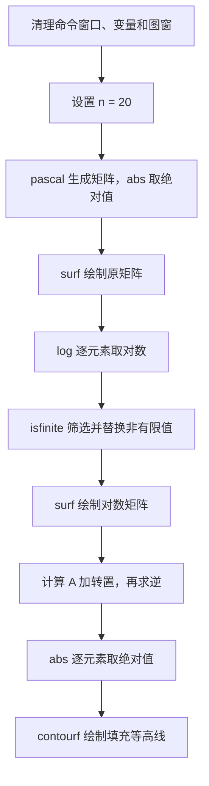
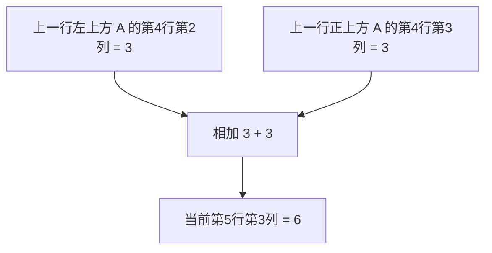

> 本文依据《专业基础实验实践能力（C2）达标测试例题——理科数学》第二题“杨辉三角”整理。原题要求在**一个 `.m` 文件**内生成 $n$ 阶杨辉三角下三角矩阵，绘制两个三维图及一个等高线图，典型参数为 $n=20$。**三个图形正确绘制**是题目的通过标准。下文的数学分析、边界情况和改进建议属于补充讲解，并非原题新增要求。

## 一、题目要求与最短解题路线

设 $A\in\mathbb R^{n\times n}$ 是杨辉三角下三角矩阵：

$$
A_{ij}=\begin{cases}\displaystyle\binom{i-1}{j-1},&1\le j\le i\le n,\\0,&j>i.\end{cases}
$$

需要完成三个图形：

1. $A$ 的三维图；
2. 对 $A$ 的元素取对数后的三维图；
3. $B=(A+A^T)^{-1}$ 的逐元素绝对值等高线图。

关键发现：**MATLAB 已提供 `pascal` 函数，不必自行编写杨辉三角递推循环。**

## 二、闭卷考试主程序

以下保留简洁写法；各部分均在同一个脚本内完成。

```matlab
clc; clear; close all
n = 20;
A = abs(pascal(n,1));

figure
surf(A)

C = log(A);
C(~isfinite(C)) = 0;
figure
surf(C)

B = inv(A+A');
figure
contourf(abs(B))
```

程序依次创建三个独立图窗。为了考试时更方便核对，也可以给图添加标题、坐标轴标签与色条，但这些不是上述极简程序的必要组成部分。

这里沿用 `yanghuitri.m` 的计算顺序。原文件中各句末尾的分号用于抑制命令窗口回显，不会阻止 `surf` 或 `contourf` 绘图。本文主程序只调整空白与分号布局，不改变算法。

### 2.2 先弄清程序在保存什么

| 变量 | 尺寸 | 数学意义 | 后续用途 |
| --- | --- | --- | --- |
| `n` | 标量 | 行数，也是矩阵阶数 | 决定矩阵大小 |
| `A` | `n × n` | 非负二项式系数，下三角以外为零 | 原始曲面、构造对称矩阵 |
| `C` | `n × n` | `A` 的逐元素对数，经非有限值替换 | 对数曲面 |
| `B` | `n × n` | `A+A'` 的逆矩阵（存在时） | 绝对值等高线 |

`C = log(A)` 创建另一个数组，不会把 `A` 改成对数矩阵。因此第三幅图仍使用原始杨辉系数。考试中若误写成 `A = log(A)`，后面的逆矩阵就已经不是题目要求的对象了。

`clc` 只清空命令窗口；`clear` 清理工作区变量；`close all` 关闭已有图窗。这三句不是计算步骤，但可以防止上一次实验的变量和图形干扰核对。运行时把整个脚本保存成一个 `.m` 文件，再在当前文件夹中点击运行；不要将文件命名为 `pascal.m`、`surf.m` 或 `log.m`，以免遮蔽内置函数。

### 2.1 程序执行流程



## 三、核心函数 `pascal(n,1)`

### 3.1 杨辉三角的数学定义

二项式系数满足

$$
\binom{m}{k}=\frac{m!}{k!(m-k)!},\qquad 0\le k\le m.
$$

相邻两行满足 Pascal 恒等式：

$$
\binom{m}{k}=\binom{m-1}{k-1}+\binom{m-1}{k}.
$$

例如 $n=5$ 时，目标矩阵为

$$
A=\begin{pmatrix}
1&0&0&0&0\\
1&1&0&0&0\\
1&2&1&0&0\\
1&3&3&1&0\\
1&4&6&4&1
\end{pmatrix}.
$$

每一行非零元素对应二项式展开系数。例如第四行 $1,3,3,1$ 对应 $(x+y)^3$ 的系数。

**矩阵行号从 1 开始，二项式幂次从 0 开始。** 第 $i$ 行对应 $(x+y)^{i-1}$，第 $j$ 列对应其中的系数 $\binom{i-1}{j-1}$。因此 `n=20` 的末行来自十九次展开，而不是二十次展开。

例如第五行第三列：

$$
A_{5,3}=\binom{4}{2}=\frac{4\cdot3}{2\cdot1}=6.
$$

用上一行计算也是同一个结果：$A_{4,2}+A_{4,3}=3+3=6$。



这个图针对矩阵的左对齐存储方式；在常见的居中三角形画法里，两个父结点则表现为左上和右上。不是递推变了，而是摆放方式变了。

将 $(1+1)^{i-1}$ 展开，可得第 $i$ 行之和为 $2^{i-1}$。这给出一个很方便的自检方法：

```matlab
sum(A,2)             % 2 表示沿列方向相加，每一行得到一个数
2.^(0:n-1)'          % 预期列向量：1,2,4,...,2^(n-1)
```

注意 `.^` 是逐元素乘方；末尾转置把行向量变为列向量，才能和 `sum(A,2)` 的形状对应。

### 3.2 为什么要写 `abs`？

`pascal(n,1)` 给出 MATLAB 定义的下三角 Pascal 型矩阵，其元素可能带交替符号；`abs` 逐元素取绝对值，得到通常所说的**非负杨辉三角系数矩阵**。

```matlab
A = abs(pascal(n,1));
```

这不是对整个矩阵求范数，也不是求行列式。`abs` 对矩阵的每个元素独立作用。

以五阶为例，带符号的结果是：

```text
pascal(5,1) =
     1     0     0     0     0
     1    -1     0     0     0
     1    -2     1     0     0
     1    -3     3    -1     0
     1    -4     6    -4     1
```

第2、4列的非零项为负。取绝对值后，才得到上一节的非负下三角矩阵。第二个参数 `1` 是选择矩阵形式的标志，不是“只生成一阶”或“将初值设为1”。[MathWorks 的 pascal 文档](https://www.mathworks.com/help/matlab/ref/pascal.html)给出了两种调用的区别。

> 注意区分 `pascal(n)` 与 `pascal(n,1)`：前者默认生成的是对称 Pascal 矩阵，而题目需要的是下三角形式。第二个参数不可随意省略。

### 3.3 备用方案：不依赖 `pascal` 的递推

仅用于理解和应对忘记函数名的情况，不是推荐的闭卷主解。

```matlab
A = zeros(n);
for i = 1:n
    A(i,1) = 1;
    A(i,i) = 1;
    for j = 2:i-1
        A(i,j) = A(i-1,j-1) + A(i-1,j);
    end
end
```

递推时，`zeros(n)` 先留下上三角的零；每行两端填1；中间才采用两数相加。当 `i=1` 或 `i=2` 时，`2:i-1` 是空序列，内层循环自然不执行，不需要额外访问不存在的第零行。外层从小行号向大行号推进，保证读取上一行时它已经算好。

## 四、第一幅图：`surf(A)`

```matlab
figure
surf(A)
```

`figure` 创建新的图窗；`surf(A)` 将矩阵元素作为高度，行列索引作为平面坐标，并用颜色编码高度。其本质是把离散矩阵看成规则网格上的曲面采样。

对 $n\times n$ 矩阵，图上的高度值是 $z_{ij}=A_{ij}$。注意 MATLAB 绘图的横向坐标对应列索引、纵向坐标对应行索引。

可以使用以下扩展写法改善阅读：

```matlab
figure
surf(A)
title('Pascal Triangle')
xlabel('Column'); ylabel('Row'); zlabel('Value')
colorbar
```


读图时先看三个轴：横轴是列号 $j$，纵轴是行号 $i$，高度是 $A_{ij}$。例如 `A(5,3)=6` 位于 $(x,y,z)=(3,5,6)$，不要把行列坐标颠倒。

最后一行中间两个系数最大：

$$
A_{20,10}=\binom{19}{9}=92378,
\qquad A_{20,11}=\binom{19}{10}=92378.
$$

所以原图会出现高峰，前几行的1、2、3相较之下几乎贴在底面。这不是计算漏项，而是同一纵轴上的尺度差异。`surf` 在离散网格点间连接面片；图面不是额外算出了“非整数行列处的杨辉系数”。

## 五、第二幅图：对数变换与非有限值

### 5.1 为什么 `log(A)` 会遇到问题？

```matlab
C = log(A);
```

MATLAB 对矩阵使用 `log` 时执行**逐元素自然对数**，即 $C_{ij}=\ln A_{ij}$。但 $A$ 的严格上三角部分全为零，故出现

$$
\ln 0=-\infty
$$

这里的等式是扩展实数意义下的极限记号；在通常的实数函数定义域中，$\ln 0$ 并无定义。MATLAB 对零输入返回 `-Inf`。

### 5.2 `~isfinite(C)` 究竟是什么？

```matlab
C(~isfinite(C)) = 0;
```

- `isfinite(C)`：生成与 $C$ 同大小的逻辑矩阵，有限数对应 `true`，`Inf`、`-Inf`、`NaN` 对应 `false`；
- `~`：逻辑取反，找出所有非有限元素；
- `C(mask)=0`：使用逻辑索引，把这些位置替换为零。

对于本题的正常输入，非有限元素来自原矩阵中的零，因此这个处理相当于定义绘图矩阵

$$
C_{ij}=\begin{cases}
\ln A_{ij},&A_{ij}>0,\\
0,&A_{ij}=0.
\end{cases}
$$

**这是一种绘图约定，并不意味着 $\ln 0=0$。**

可以把一行代码拆成三步阅读：

```matlab
finiteMask = isfinite(C);  % 哪些位置是有限数？
badMask = ~finiteMask;     % 取反：哪些位置需要处理？
C(badMask) = 0;            % 只给这些位置赋值，其他值不动
```

例如一行数据的处理过程如下。逻辑矩阵中的1表示选中，0表示未选中。

| 阶段 | 第1个位置 | 第2个位置 | 第3个位置 | 第4个位置 |
| --- | --- | --- | --- | --- |
| 原始值 | 1 | 2 | 0 | 0 |
| `log` 之后 | 0 | 0.693147… | `-Inf` | `-Inf` |
| `isfinite` | 1 | 1 | 0 | 0 |
| `~isfinite` | 0 | 0 | 1 | 1 |
| 替换之后 | 0 | 0.693147… | 0 | 0 |

这里的 `~` 是逻辑非；不是近似号。`C(mask)` 的括号中放的是一组逻辑选择条件，而不是一个行列下标。`isfinite` 也会把 `NaN` 判为假，详见[官方说明](https://www.mathworks.com/help/matlab/ref/double.isfinite.html)。

例如

$$
A=\begin{pmatrix}1&0&0\\1&1&0\\1&2&1\end{pmatrix}
\quad\Longrightarrow\quad
C=\begin{pmatrix}0&0&0\\0&0&0\\0&\ln2&0\end{pmatrix}.
$$

然后绘制：

```matlab
figure
surf(C)
```

### 5.3 为什么对数图有意义？

随着 $n$ 增大，二项式系数的数值跨度迅速扩大，原始曲面的较小值容易在视觉上被高峰压缩。对数变换使大值之间的比例差异更易观察：

$$
\ln(ab)=\ln a+\ln b.
$$

原始数据中乘法尺度的变化，在对数图中变成加法尺度的变化。

**不要将 `log(A+1)` 与本程序混为一谈**：`log(A+1)` 对所有位置做另一种变换，正元素的高度也会改变；本程序只替换非有限值。


例如原值从10变100是扩大10倍，对数只增加 $\ln10\approx2.302585$；从100变1000也是增加同样的高度。最大值由92378变成约11.433644，较小数值不再被九万多的峰值压扁。

但图中高度零有两种来源：原值为1时自然得到 $\ln1=0$；原值为0时则是人为补零。**仅凭处理后的曲面无法再区分这两类位置。** 若要展示定义域而不是补齐底面，可另做 `C(A==0)=NaN` 的对照图；不要把这种不同方案混入原始考试代码。

## 六、第三幅图：转置、求逆与等高线

```matlab
B = inv(A+A');
figure
contourf(abs(B))
```

### 6.1 `A'` 是什么？

对于实矩阵，`A'` 表示转置 $A^T$（MATLAB 中更一般地表示共轭转置；本题矩阵全为实数，两者相同）。

$$
M=A+A^T.
$$

由于 $M^T=M$，矩阵 $M$ 是实对称矩阵，但**实对称不保证可逆**。

### 6.2 `inv` 与 `abs`

`inv(M)` 在 $M$ 非奇异时求逆矩阵 $B=M^{-1}$，满足

$$
MB=BM=I.
$$

`abs(B)` 是逐元素取绝对值：

$$
|B|_{\mathrm{elem}}=(|b_{ij}|)_{n\times n}.
$$

它**不是**行列式 $\det B$，因为行列式是一个标量，不能表达题目要求的二维矩阵等高线。

### 6.3 `contourf` 与 `contour` 的区别

- `contour(Z)`：绘制矩阵 $Z$ 对应的等值线；
- `contourf(Z)`：绘制带颜色填充的等值区域。

例如添加色条：

```matlab
figure
contourf(abs(B))
colorbar
title('Absolute Inverse Matrix')
```

这里绘制的是 $|b_{ij}|$ 在行列索引网格上的等值区域，不是矩阵行列式的等高线。


等高线把“高度接近”的位置连接起来；填色表示高度区间。它仍然使用两个索引轴，只是不再把数值画成竖直高度。颜色必须结合右侧色条读取，不能仅凭亮暗判断正负——此处画的已经是绝对值。

### 6.4 用二阶矩阵手算整个链条

先取 $n=2$，可以把求逆过程完整写出来：

$$
A=\begin{pmatrix}1&0\\1&1\end{pmatrix},\qquad
A^T=\begin{pmatrix}1&1\\0&1\end{pmatrix},\qquad
M=A+A^T=\begin{pmatrix}2&1\\1&2\end{pmatrix}.
$$

$\det M=2\times2-1\times1=3\ne0$，所以

$$
B=\frac13\begin{pmatrix}2&-1\\-1&2\end{pmatrix},
\qquad |B|_{\mathrm{elem}}=\frac13\begin{pmatrix}2&1\\1&2\end{pmatrix}.
$$

这同时说明 `inv(M)` 不等于 `1./M`。后者只是逐项倒数，会得到 $\begin{pmatrix}1/2&1\\1&1/2\end{pmatrix}$，不是逆矩阵。也不能把 `abs(inv(M))` 擅自换为 `inv(abs(M))`：前者去掉逆矩阵中的负号，后者在本例中仍等于带负号的 $B$。

本题明确要求显示逆矩阵，因此保留 `inv` 是贴合任务的；若另一个任务只要求解 $Mx=b$，通常应直接写 `x=M\b`，不必先算整个逆矩阵。

## 七、数学严谨性与题目潜在缺陷（拓展）

### 7.1 对数的零元素未在题目中定义

原题要求“对矩阵的每个元素取对数”，但下三角矩阵必然包含零。你的 `isfinite` 方案给出一种合理的**可视化处理**，却不是对零取对数的数学定义。若题目要求严格的函数值，可以用 `NaN` 标记不可定义区域，绘图效果会不同。

### 7.2 $A+A^T$ 不一定可逆

以 $n=3$ 为例：

$$
A+A^T=\begin{pmatrix}
2&1&1\\
1&2&2\\
1&2&2
\end{pmatrix}.
$$

第二、三行相同，故行列式为零，逆矩阵不存在。题目若允许任意正整数 $n$，就应说明可逆性条件或如何处理奇异情况。

### 7.3 数值可逆性也需要留意

即使矩阵在精确数学意义下可逆，浮点运算也可能因病态而不稳定。检查方法：

```matlab
M = A + A';
rcond(M)
```

`rcond` 返回倒条件数的估计值；结果接近零提示数值不稳定风险。**此项是拓展检查，不必强行加入考试最短代码。**

“图画出来了”和“逆矩阵的所有数字都高度精确”是两件事。双精度计算保存的有效位数有限，病态矩阵会放大输入或舍入误差。不要因为 `inv` 返回了一个数组，就把它当成精确的有理数答案。

可检查乘回去是否接近单位矩阵：

```matlab
M = A + A';
R = M*B - eye(n);
norm(R,inf)
```

`eye(n)` 是 $n$ 阶单位矩阵；这里 `*` 是矩阵乘法，不是 `.*`。矩阵无穷范数是各行绝对值之和的最大值，因此这个残差测量的是 $MB$ 偏离 $I$ 的程度。它不能独自证明逆矩阵的每个元素都准确，仍应结合条件数看待。

### 7.4 本次实际运行记录

2026年10月14日，在 MATLAB R2026b（26.2.0.3386108）中实际运行原始 `yanghuitri.m`，得到三个图窗。本文配图取自这些图窗，只增加轴标签、标题、色条和统一导出尺寸，没有更换计算数据或偷偷改用伪逆。

```text
max(A) = 92378
max(C) = 11.4336441340425
zero entries = 190
rcond(A+A') = 8.50240238115381e-11
inverse residual infinity norm = 0.000112110945337918
max(abs(B)) = 3614.24334269278
All assertions passed; exported 3 figures.
```

逐项解释：

- 严格上三角有 $20\times19/2=190$ 个位置，正好对应190个零以及取对数时的190个 `-Inf`。
- 最大对数值是 $\ln92378\approx11.433644$，与曲面高度一致。
- 倒条件数约 $8.50\times10^{-11}$，提示明显的病态风险，不应宣称本题逆矩阵数值毫无误差。
- 实测 $\|MB-I\|_\infty\approx1.12\times10^{-4}$，不等于严格的零。不同版本或计算环境下，末位数值可能不同。

额外断言核对了矩阵尺寸、下三角结构、对角线全1、各行和为2的相应幂次、`B` 和处理后的 `C` 全部有限，以及恰有三个图窗。它们是本次核验，不是对所有 $n$ 的可逆性证明，也不替代教师对作图的判分。

### 7.5 绘图结果的判分歧义

原题未明确必须用 `surf` 还是 `mesh`，也未明确 `|B|` 的记号约定。按题目要求和典型 MATLAB 用法，你的 `surf`、`contourf(abs(B))` 是合理实现；若考场提供样例图，应优先与样例核对。

## 八、闭卷记忆：只记关键调用

| 代码 | 作用 | 容易忘的地方 |
| --- | --- | --- |
| `clc; clear; close all` | 清理环境 | 三个操作含义不同 |
| `pascal(n,1)` | 下三角 Pascal 矩阵 | 不要漏掉第二个参数 `1` |
| `abs(...)` | 逐元素取绝对值 | 不是行列式 |
| `figure` | 新建图窗 | 三个图分开 |
| `surf(A)` | 三维曲面 | 直接接矩阵 |
| `log(A)` | 逐元素自然对数 | 零会产生 `-Inf` |
| `~isfinite(C)` | 非有限元素掩码 | `~` 是取反 |
| `A'` | 实矩阵转置 | 不要写成 `A` |
| `inv(...)` | 求逆 | 奇异矩阵不能求逆 |
| `contourf(...)` | 填充等高线 | 最后的 `f` 表示 filled |

### 考前一分钟默写

```matlab
clc;clear;close all
n=20;
A=abs(pascal(n,1));
figure;surf(A)
C=log(A);
C(~isfinite(C))=0;
figure;surf(C)
B=inv(A+A');
figure;contourf(abs(B))
```

### 自测

1. 为什么 `pascal(n)` 不能直接替换 `pascal(n,1)`？
2. `abs(pascal(n,1))` 中的 `abs` 为什么必要？
3. `~isfinite(C)` 中的波浪号代表什么？
4. 为什么不能把 `abs(B)` 理解为 $\det B$？
5. `contourf` 和 `surf` 分别显示几维网格上的什么信息？

**核对要点：**默认 `pascal(n)` 的矩阵形态不同；`abs` 去除交替符号；`~` 表示逻辑非；行列式是标量而非矩阵；`surf` 以高度绘制三维曲面，`contourf` 在平面上绘制填充等值区域。

### 常见报错与现场排查

| 现象 | 优先检查 | 原因 |
| --- | --- | --- |
| 只剩最后一张图 | 每次绘图前是否写了 `figure` | 否则可能在当前坐标轴上覆盖前图 |
| 第一幅图不是下三角结构 | 是否漏了 `pascal(n,1)` 的第二个参数 | 默认形式是对称矩阵 |
| 对数出现复数或警告 | 是否漏掉最开始的 `abs` | 带负号的系数不能直接取实数对数 |
| 对数图有空洞或非有限值 | 是否执行了 `C(~isfinite(C))=0` | 严格上三角的零产生 `-Inf` |
| 第三幅图不对 | 是否误改了 `A`，是否把 `inv` 写成 `1./` | 输入对象或运算含义发生改变 |
| 换成三阶后求逆失败 | 检查 `A+A'` 是否奇异 | 三阶反例确实不存在逆，不能靠绘图命令修复 |

若考试输入可以自行选择，按题目典型值20练习；若教师给定其他 $n$，应如实处理奇异情形，不要擅自换成 `pinv` 后仍称它为逆矩阵。伪逆是另一个数学对象。

## 九、结语

这道题表面上涉及组合数学、矩阵求逆和三种绘图任务，但 MATLAB 的内置函数使主程序非常短。闭卷时的真正重点是记住 `pascal(n,1)`、`~isfinite`、`surf` 和 `contourf` 的用法，同时理解每一步在数学上做了什么。

本文保留所提供参考稿的解题结构，以原始 MATLAB 脚本为计算依据；已针对 $n=20$ 实际运行并检查三张导出图。学习时先掌握考试主程序，再看拓展部分，不必为了记住极简解法同时背下所有数值分析细节。
