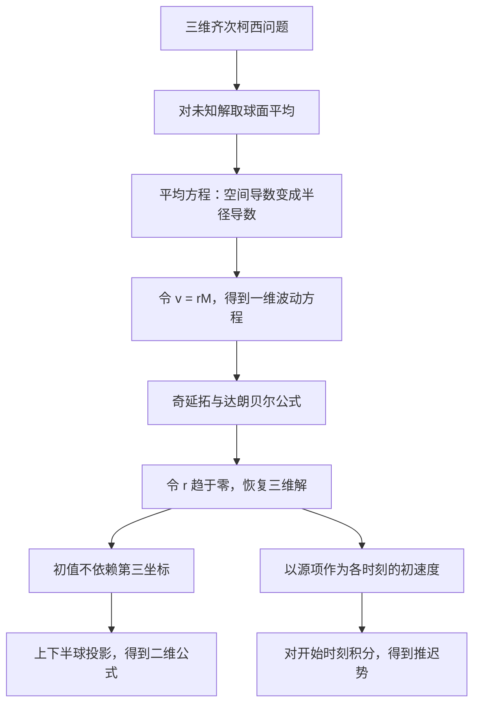

> **阅读范围**：对应吴事良《第三章·波动方程》讲义 §3.2“高维波动方程的柯西问题”，从 PDF 第 37 页到第 55 页；第 56 页开始为 §3.3。本文保留完整计算与解释，并补充可视化、核验例子和易错点。页码按 PDF 阅读器的物理页序计。

> [!IMPORTANT]
> **本节的三条主线**：三维问题通过“球面平均 → 乘以半径 → 一维波动方程”求解；二维问题借用三维公式，通过球面投影降维；非齐次问题把每一时刻源项产生的响应叠加，得到推迟势。

## 阅读导航

1. 三维问题与一维公式的启发
2. 球面平均的定义、几何意义与关键引理
3. 平均方程、一维化、奇延拓和恢复原解
4. 三维解公式与存在唯一性
5. 二维降维法、投影面积元与泊松公式
6. 非齐次方程、齐次化原理与推迟势
7. 公式核验、易错点和复习清单

全文约定 $a>0$ 为常波速。讨论经典解，并假设初值和源项具有相应的光滑性，使文中的求导、积分交换合法。三维齐次问题的明确充分条件为 $\varphi\in C^3(\mathbb R^3)$、$\psi\in C^2(\mathbb R^3)$；非齐次推导可先在光滑源项下理解。

**标识约定**：**【定义】**说明对象；**【核心】**标记推导枢纽；**【必会】**给出应能独立完成的计算；**【易错】**指出常见错误；**【补充】**是帮助理解的延伸。

## 1. 三维柯西问题：我们要求什么？

考虑

$$
\begin{cases}
u_{tt}-a^2\Delta u=0,&x=(x_1,x_2,x_3)\in\mathbb R^3,\ t>0,\\
u(x,0)=\varphi(x),\\
u_t(x,0)=\psi(x).
\end{cases}
$$

其中

$$
\Delta u=u_{x_1x_1}+u_{x_2x_2}+u_{x_3x_3}.
$$

$\varphi$ 是初始位移，$\psi$ 是初始速度。空间为整个 $\mathbb R^3$，因此这是全空间初值问题，没有另给空间边界条件。

一维方程已经可以用达朗贝尔公式求解。三维却有三个空间方向，不能把一维公式中的标量 $x$ 机械替换成向量。我们需要先找到一个真正满足一维方程的辅助函数。

## 2. 为什么想到平均值？从一维公式改写开始

一维达朗贝尔公式为

$$
u(x,t)=\frac{\varphi(x+at)+\varphi(x-at)}2
+\frac1{2a}\int_{x-at}^{x+at}\psi(s)\,ds.
$$

暂时定义一维的**区间平均值**

$$
A_h(x,r)=\frac1{2r}\int_{x-r}^{x+r}h(s)\,ds.
$$

于是

$$
tA_\varphi(x,at)=\frac1{2a}\int_{x-at}^{x+at}\varphi(s)\,ds.
$$

对时间求导，上端点的导数为 $a$，下端点的导数为 $-a$：

$$
\begin{aligned}
\frac{\partial}{\partial t}[tA_\varphi(x,at)]
&=\frac1{2a}\bigl[a\varphi(x+at)-(-a)\varphi(x-at)\bigr]\\
&=\frac{\varphi(x+at)+\varphi(x-at)}2.
\end{aligned}
$$

同时

$$
tA_\psi(x,at)=\frac1{2a}\int_{x-at}^{x+at}\psi(s)\,ds.
$$

所以一维解可以写成

$$
\boxed{u(x,t)=\partial_t[tA_\varphi(x,at)]+tA_\psi(x,at).}
$$

讲义由此提出三维的候选形式：把这里的区间平均换成**球面平均**，是否仍能成立？后面的球面平均法就是对这个猜想的证明。

> [!WARNING]
> **【易错】同样叫“平均”，平均对象并不相同。** 此处一维用区间平均；三维用球面平均。三维的 $M_h$ 不是球体平均，也不能由类比直接认定它满足解公式。

## 3. 球面平均：引入半径这个新变量

### 3.1 定义与符号

固定球心 $x\in\mathbb R^3$，记

$$
S_x^r=\{y:|y-x|=r\},\qquad B_x^r=\{y:|y-x|<r\}.
$$

$S_x^r$ 是球面，$B_x^r$ 是球体。球面面积为 $4\pi r^2$。

**【定义】** 对连续函数 $h$，球面平均为

$$
\boxed{M_h(x,r)=\frac1{4\pi r^2}\int_{S_x^r}h(y)\,dS_y,\qquad r>0.}
$$

它就是球面上的函数积分除以球面面积。若 $h\equiv c$，则 $M_h\equiv c$。

| 符号 | 含义 | 求导时的身份 |
| --- | --- | --- |
| $x$ | 球心、最终的观察位置 | $\Delta_x$ 对它求导 |
| $y$ | 球面上的积分点 | 积分哑变量 |
| $r$ | 额外引入的半径 | 与 $t$ 独立的变量 |
| $t$ | 时间 | $\partial_t$ 对它求导 |
| $\xi$ | 单位方向向量 | $\lvert \xi\rvert =1$，在单位球面上变化 |

> [!IMPORTANT]
> **【核心】推导阶段的 $r$ 与 $t$ 是独立变量。** 先对任意半径取平均，最后的解公式才出现 $r=at$。如果提前把两者绑在一起，会混淆偏导与复合函数求导。

*图 1：$y=x+r\xi$ 将单位方向映射到以 $x$ 为球心的球面。右图以 $h(y)=|y|^2$ 为例，展示平均值随半径趋零回到球心值。*

### 3.2 为什么改写成单位球面积分？

令

$$
y=x+r\xi,\qquad |\xi|=1.
$$

长度放大 $r$ 倍，曲面面积放大 $r^2$ 倍，因此

$$
dS_y=r^2dS_\xi.
$$

代入定义：

$$
\boxed{M_h(x,r)=\frac1{4\pi}\int_{|\xi|=1}h(x+r\xi)\,dS_\xi.}
$$

原先的积分区域 $S_x^r$ 同时依赖 $x,r$；现在积分区域固定为单位球面。于是对 $x$ 或 $r$ 求导时，可以直接处理被积函数，避免遗漏移动区域的贡献。

### 3.3 球面缩到一点为什么能恢复函数？

当 $r\to0^+$ 时，所有单位方向都满足 $x+r\xi\to x$。连续性给出

$$
\begin{aligned}
\lim_{r\to0^+}M_h(x,r)
&=\frac1{4\pi}\int_{|\xi|=1}h(x)\,dS_\xi\\
&=h(x).
\end{aligned}
$$

更直接地，

$$
|M_h(x,r)-h(x)|\le\sup_{|y-x|=r}|h(y)-h(x)|\longrightarrow0.
$$

所以可连续定义 $M_h(x,0)=h(x)$。

对未知解同样定义

$$
M_u(x,r,t)=\frac1{4\pi}\int_{|\xi|=1}u(x+r\xi,t)\,dS_\xi.
$$

因此

$$
\boxed{u(x,t)=\lim_{r\to0^+}M_u(x,r,t).}
$$

平均化虽然把每个固定半径上的方向信息汇总了，但我们保留了所有小半径的平均；取极限就能恢复球心的值。

## 4. 球面平均的关键引理：完整证明

**【核心】** 若 $h\in C^2(\mathbb R^3)$，则对 $r>0$，

$$
\boxed{\Delta_xM_h=M_{h,rr}+\frac2rM_{h,r}.}
$$

并且

$$
M_h(x,0)=h(x),\qquad M_{h,r}(x,0)=0.
$$

左边对三个球心坐标求二阶导数，右边只对一个半径变量求导。这是降为一维问题的关键桥梁。

### 4.1 对球心求拉普拉斯

从单位球面表达式出发，

$$
\begin{aligned}
\Delta_xM_h(x,r)
&=\frac1{4\pi}\int_{|\xi|=1}(\Delta h)(x+r\xi)\,dS_\xi\\
&=\frac1{4\pi r^2}\int_{S_x^r}\Delta h(y)\,dS_y.
\end{aligned}
$$

这里固定 $r,\xi$ 时，$y_j=x_j+r\xi_j$，所以对 $x_j$ 的求导直接作用为对 $h$ 第 $j$ 个自变量的求导。

### 4.2 对半径求导，为什么出现法向导数？

链式法则给出

$$
\frac{\partial}{\partial r}h(x+r\xi)=\nabla h(x+r\xi)\cdot\xi.
$$

所以

$$
M_{h,r}(x,r)=\frac1{4\pi}\int_{|\xi|=1}\nabla h(x+r\xi)\cdot\xi\,dS_\xi.
$$

换回 $y$，球面的外单位法向量正好是

$$
n(y)=\frac{y-x}{r}=\xi.
$$

于是

$$
M_{h,r}(x,r)=\frac1{4\pi r^2}\int_{S_x^r}\nabla h(y)\cdot n(y)\,dS_y.
$$

其中 $\nabla h\cdot n=\partial_nh$，是沿外法向的变化率。

### 4.3 用高斯散度定理把曲面积分变成体积分

因为

$$
\operatorname{div}(\nabla h)=\Delta h,
$$

高斯散度定理给出

$$
\int_{S_x^r}\nabla h\cdot n\,dS_y=\int_{B_x^r}\Delta h(y)\,dy.
$$

因此

$$
\boxed{r^2M_{h,r}(x,r)=\frac1{4\pi}\int_{B_x^r}\Delta h(y)\,dy.}
$$

这一步建议先把 $r^2$ 乘到左边，再求导；这样比直接对 $r^{-2}$ 用乘积法则更清楚。

### 4.4 球体积分对半径求导为什么是球面积分？

对连续函数 $q$，

$$
\frac d{dr}\int_{B_x^r}q(y)\,dy=\int_{S_x^r}q(y)\,dS_y.
$$

几何上，球体半径增加 $dr$，增加的是一层厚度约为 $dr$ 的球壳。严格地，写成球坐标：

$$
\int_{B_x^r}q(y)\,dy
=\int_0^r\rho^2\int_{|\xi|=1}q(x+\rho\xi)\,dS_\xi\,d\rho.
$$

对上限求导：

$$
\frac d{dr}\int_{B_x^r}q(y)\,dy
=r^2\int_{|\xi|=1}q(x+r\xi)\,dS_\xi
=\int_{S_x^r}q(y)\,dS_y.
$$

### 4.5 完成引理证明

对 $r^2M_{h,r}$ 求导，得到

$$
2rM_{h,r}+r^2M_{h,rr}=\frac1{4\pi}\int_{S_x^r}\Delta h(y)\,dS_y.
$$

除以 $r^2$ 并使用 4.1 的等式：

$$
\boxed{M_{h,rr}+\frac2rM_{h,r}=\Delta_xM_h.}
$$

在 $r=0$ 处，由单位球面的表达式，

$$
M_{h,r}(x,0)=\frac1{4\pi}\nabla h(x)\cdot\int_{|\xi|=1}\xi\,dS_\xi=0.
$$

因为每个方向 $\xi$ 都有相反方向 $-\xi$ 与之抵消。

> [!TIP]
> **【补充】用泰勒展开看这个结论。** 球面对称性还给出 $\frac1{4\pi}\int\xi_i\xi_j\,dS=\delta_{ij}/3$，因此 $M_h(x,r)=h(x)+\frac{r^2}{6}\Delta h(x)+o(r^2)$。一阶项消失，所以 $M_{h,r}(x,0)=0$；也说明引理中的 $2/r$ 并不意味着平均函数在球心发散。

## 5. 未知解的球面平均满足什么方程？

暂记 $M(x,r,t)=M_u(x,r,t)$。对 $t$ 求两次导数，利用原方程：

$$
\begin{aligned}
M_{tt}
&=\frac1{4\pi}\int_{|\xi|=1}u_{tt}(x+r\xi,t)\,dS_\xi\\
&=\frac{a^2}{4\pi}\int_{|\xi|=1}\Delta u(x+r\xi,t)\,dS_\xi\\
&=a^2\Delta_xM.
\end{aligned}
$$

再用球面平均引理：

$$
\boxed{M_{tt}=a^2\left(M_{rr}+\frac2rM_r\right),\qquad r>0.}
$$

初值直接取平均：

$$
M(x,r,0)=M_\varphi(x,r),\qquad M_t(x,r,0)=M_\psi(x,r).
$$

这就是 Euler–Poisson–Darboux 型方程。接下来固定球心 $x$，把它视为参数，只把 $r,t$ 当作未知函数的变量。

> [!WARNING]
> **【易错】没有假设原解 $u$ 球对称。** 是对任意球心取球面平均之后，方向信息才被积分掉。原函数仍可以具有任意的空间方向变化。

## 6. 为什么令 $v=rM$？

平均方程比标准一维波动方程多出 $2M_r/r$。令

$$
\boxed{v(x,r,t)=rM(x,r,t).}
$$

直接求导：

$$
v_r=M+rM_r,\qquad v_{rr}=2M_r+rM_{rr},\qquad v_{tt}=rM_{tt}.
$$

于是

$$
\begin{aligned}
v_{tt}
&=a^2r\left(M_{rr}+\frac2rM_r\right)\\
&=a^2(rM_{rr}+2M_r)=a^2v_{rr}.
\end{aligned}
$$

得到了真正的一维波动方程：

$$
\boxed{v_{tt}-a^2v_{rr}=0.}
$$

**【必会】乘 $r$ 不是凭空猜出一个神奇技巧，而是因为 $(rM)_{rr}$ 恰好等于 $rM_{rr}+2M_r$。**

相应的定解问题为

$$
\begin{cases}
v_{tt}-a^2v_{rr}=0,&r>0,\ t>0,\\
v(x,r,0)=rM_\varphi(x,r),\\
v_t(x,r,0)=rM_\psi(x,r),\\
v(x,0,t)=0.
\end{cases}
$$

最后的边界条件来自 $M(x,r,t)\to u(x,t)$ 有限，因此 $rM(x,r,t)\to0$。它是辅助半直线问题自然产生的条件，不是原三维问题新增了一面固定边界。

## 7. 半直线问题：奇延拓与达朗贝尔公式

固定 $x$，简记

$$
F(r)=rM_\varphi(x,r),\qquad G(r)=rM_\psi(x,r),\qquad r\ge0.
$$

讲义中的 $\widetilde M_\varphi,\widetilde M_\psi$ 就对应这里的 $F,G$。

因为 $v(0,t)=0$，把初值作奇延拓：

$$
F(-r)=-F(r),\qquad G(-r)=-G(r).
$$

此后同一符号表示延拓后的全实轴函数。套用达朗贝尔公式：

$$
v(r,t)=\frac{F(r+at)+F(r-at)}2
+\frac1{2a}\int_{r-at}^{r+at}G(s)\,ds.
$$

为什么这个全实轴解满足 $v(0,t)=0$？代入后，两个 $F$ 值互为相反数，而奇函数 $G$ 在对称区间上的积分为零。

最终需要 $r\to0^+$。固定 $t>0$ 后，只需考察 $0<r<at$。此时

$$
F(r-at)=-F(at-r).
$$

积分也能化简：

$$
\begin{aligned}
\int_{r-at}^{r+at}G(s)\,ds
&=\int_{-(at-r)}^{at-r}G(s)\,ds
+\int_{at-r}^{at+r}G(s)\,ds\\
&=\int_{at-r}^{at+r}G(s)\,ds.
\end{aligned}
$$

所以

$$
\boxed{v(r,t)=\frac{F(at+r)-F(at-r)}2
+\frac1{2a}\int_{at-r}^{at+r}G(s)\,ds.}
$$

*图 2：取示例奇函数 $G(s)=s$。$[-(at-r),at-r]$ 上的正负贡献抵消，剩余 $[at-r,at+r]$；图中采用 $at=3,r=0.7$。*

## 8. 让半径趋零：两个极限各自意味着什么？

由 $v=rM$，

$$
u(x,t)=\lim_{r\to0^+}\frac{v(x,r,t)}r.
$$

于是

$$
u(x,t)=\lim_{r\to0^+}\frac{F(at+r)-F(at-r)}{2r}
+\lim_{r\to0^+}\frac1{2ar}\int_{at-r}^{at+r}G(s)\,ds.
$$

### 8.1 第一项：对称差商

$$
\lim_{r\to0^+}\frac{F(at+r)-F(at-r)}{2r}=F'(at).
$$

因 $F(s)=sM_\varphi(x,s)$，

$$
F'(at)=M_\varphi(x,at)+at\,\partial_rM_\varphi(x,at).
$$

另一方面，链式法则给出

$$
\partial_t[tM_\varphi(x,at)]
=M_\varphi(x,at)+at\,\partial_rM_\varphi(x,at).
$$

所以第一项是 $\partial_t[tM_\varphi(x,at)]$。

也可以写为 $tM_\varphi(x,at)=F(at)/a$，从而 $\partial_t[F(at)/a]=F'(at)$。这个写法能直接看出链式法则产生的 $a$ 与前面的 $1/a$ 抵消。

### 8.2 第二项：短区间平均值

$$
\begin{aligned}
\lim_{r\to0^+}\frac1{2ar}\int_{at-r}^{at+r}G(s)\,ds
&=\frac1aG(at)\\
&=\frac1a\,atM_\psi(x,at)\\
&=tM_\psi(x,at).
\end{aligned}
$$

这里区间长度是 $2r$，因此积分除以 $2r$ 是局部平均；当区间缩到 $at$，它趋于 $G(at)$。

### 8.3 得到三维泊松公式

$$
\boxed{u(x,t)=\partial_t[tM_\varphi(x,at)]+tM_\psi(x,at).}
$$

> [!WARNING]
> **【讲义勘误】PDF 第 47 页最后一行。** 左边是 $\widetilde M_\varphi$ 的对称差商，右边两个下标却印成了 $\psi$。应改为 $\partial_s\widetilde M_\varphi(x,s)|_{s=at}=\partial_t[tM_\varphi(x,at)]$。初位移产生的项不能在极限中变成初速度项。

## 9. 三维解公式的三种等价形式

### 9.1 球面平均形式：便于记忆结构

$$
\boxed{u=\partial_t(tM_\varphi)+tM_\psi,}
$$

这里两个平均均在以 $x$ 为球心、$at$ 为半径的球面上计算。

### 9.2 移动球面积分形式：Kirchhoff 公式

由于

$$
tM_h(x,at)=\frac1{4\pi a^2t}\int_{|y-x|=at}h(y)\,dS_y,
$$

得到

$$
\boxed{
\begin{aligned}
u(x,t)={}&\partial_t\left[\frac1{4\pi a^2t}
\int_{|y-x|=at}\varphi(y)\,dS_y\right]\\
&+\frac1{4\pi a^2t}\int_{|y-x|=at}\psi(y)\,dS_y.
\end{aligned}}
$$

讲义称其为泊松公式；三维的这一球面表示也常称 Kirchhoff 公式。应以具体公式及归一化为准。

> [!WARNING]
> **【易错】对时间求导时，$1/t$ 和球面半径 $at$ 都在变化。** 只对外面的 $1/t$ 求导会漏掉主要贡献。先换成固定单位球面的积分最稳妥。

### 9.3 固定单位球面形式：便于实际求导

$$
\boxed{
\begin{aligned}
u(x,t)=\frac1{4\pi}\int_{|\xi|=1}\bigl[&\varphi(x+at\xi)\\
&+at\,\nabla\varphi(x+at\xi)\cdot\xi\\
&+t\psi(x+at\xi)\bigr],dS_\xi.
\end{aligned}}
$$

三部分分别是初始位移的平均、球面随时间扩大带来的径向变化，以及初始速度产生的贡献。

## 10. 为什么还要证明存在性？唯一性在哪里？

前面的推导以“设 $u$ 是解”为起点，得到“$u$ 必须等于公式”。这说明**任何足够光滑的解都只能是该表达式**，因此给出唯一性。

但它还没有自动证明公式确实满足原问题。存在性要反过来验证。

对光滑函数 $h$ 定义

$$
W_h(x,t)=tM_h(x,at).
$$

对 $t$ 求导：

$$
(W_h)_t=M_h+atM_{h,r},
$$

$$
(W_h)_{tt}=2aM_{h,r}+a^2tM_{h,rr}.
$$

以上 $M_h$ 及其半径导数均在 $(x,at)$ 处取值。另一方面，对 $t>0$，

$$
\begin{aligned}
a^2\Delta_xW_h
&=a^2t\left(M_{h,rr}+\frac2{at}M_{h,r}\right)\\
&=a^2tM_{h,rr}+2aM_{h,r}=(W_h)_{tt}.
\end{aligned}
$$

所以 $W_h$ 自己满足波动方程。且

$$
W_h(x,0)=0,\qquad (W_h)_t(x,0)=h(x),\qquad (W_h)_{tt}(x,0)=0.
$$

最后一个等式用到了 $M_{h,r}(x,0)=0$。令

$$
u=\partial_tW_\varphi+W_\psi.
$$

因波动算子系数不依赖 $t$，光滑解的时间导数仍满足同一齐次方程；再利用线性性，$u$ 满足方程，且

$$
u(x,0)=\varphi(x),\qquad u_t(x,0)=\psi(x).
$$

**讲义定理 10**：若 $\varphi\in C^3(\mathbb R^3)$、$\psi\in C^2(\mathbb R^3)$，则三维齐次柯西问题有唯一经典解，由上述公式给出。这是一组充分条件，不宣称它是最弱条件。

## 11. 二维方程：借助三维公式的降维法

现在求解

$$
\begin{cases}
u_{tt}-a^2(u_{x_1x_1}+u_{x_2x_2})=0,&x=(x_1,x_2)\in\mathbb R^2,\\
u(x,0)=\varphi(x),\\
u_t(x,0)=\psi(x).
\end{cases}
$$

增加一个空间变量 $x_3$，但把初值沿这个方向保持不变：

$$
\widetilde\varphi(x_1,x_2,x_3)=\varphi(x_1,x_2),\qquad
\widetilde\psi(x_1,x_2,x_3)=\psi(x_1,x_2).
$$

用三维公式解初值为 $\widetilde\varphi,\widetilde\psi$ 的三维问题。如果所得 $\widetilde u$ 不依赖 $x_3$，则

$$
\widetilde u_{x_3x_3}=0,
$$

三维方程就自动变成二维方程。

**【核心】降维法的逻辑是：延拓二维初值 → 求三维解 → 证明解与额外坐标无关 → 得到二维解。** 不是先假设所构造的三维解一定与 $x_3$ 无关。

## 12. 球面投影到圆盘：根号分母从哪里来？

记三维球心为 $X=(x_1,x_2,x_3)$，二维投影为 $x=(x_1,x_2)$，并令 $R=at$。先看初速度项：

$$
\frac1{4\pi a^2t}\int_{|Y-X|=R}\psi(y_1,y_2)\,dS_Y.
$$

由于被积函数与 $y_3$ 无关，把上下半球分别投影到圆盘

$$
D_R(x)=\{y=(y_1,y_2):|y-x|<R\}.
$$

*图 3：左侧画出球面的一个竖直截面；每个圆盘内部点对应上下两个球面点。右侧展示单个半球的投影面积倍率 $1/\sqrt{1-(\rho/R)^2}$；靠近边缘时球面更陡，因此相同平面面积对应更大的曲面面积。*

### 12.1 把上下半球写成函数图像

球面满足

$$
(y_1-x_1)^2+(y_2-x_2)^2+(y_3-x_3)^2=R^2.
$$

记 $\rho^2=(y_1-x_1)^2+(y_2-x_2)^2$，则上下半球为

$$
y_3=x_3\pm\sqrt{R^2-\rho^2}.
$$

以上半球 $y_3=g(y_1,y_2)$ 为例，

$$
g_{y_1}=-\frac{y_1-x_1}{\sqrt{R^2-\rho^2}},\qquad
g_{y_2}=-\frac{y_2-x_2}{\sqrt{R^2-\rho^2}}.
$$

由曲面面积元公式，

$$
dS_Y=\sqrt{1+g_{y_1}^2+g_{y_2}^2}\,dy_1dy_2.
$$

其中

$$
1+g_{y_1}^2+g_{y_2}^2
=1+\frac{\rho^2}{R^2-\rho^2}
=\frac{R^2}{R^2-\rho^2}.
$$

所以

$$
\boxed{dS_Y=\frac{R}{\sqrt{R^2-\rho^2}}\,dy_1dy_2.}
$$

下半球的偏导符号相反，但平方后面积倍率完全相同。

### 12.2 为什么乘以 2？

同一投影点上的上下两个球面点，$\psi(y_1,y_2)$ 相同，面积倍率也相同，因此两个半球的积分相等：

$$
\boxed{\int_{|Y-X|=R}\psi(y_1,y_2)\,dS_Y
=2R\int_{D_R(x)}\frac{\psi(y)}{\sqrt{R^2-|y-x|^2}}\,dy.}
$$

这里 $dy=dy_1dy_2$。赤道处图像表示的导数发散，但可先在较小圆盘上积分再取极限；边缘的奇性可积，见第 14 节。

令 $R=at$，系数化简为

$$
\frac{2at}{4\pi a^2t}=\frac1{2\pi a}.
$$

所以三维初速度项变为

$$
\boxed{\frac1{2\pi a}\int_{|y-x|<at}
\frac{\psi(y)}{\sqrt{a^2t^2-|y-x|^2}}\,dy.}
$$

初位移项同理。得到的表达式中没有 $x_3$，从而完成降维逻辑所需的证明。

## 13. 二维泊松公式：圆盘形式与极坐标形式

### 13.1 圆盘积分形式

$$
\boxed{
\begin{aligned}
u(x,t)={}&\frac1{2\pi a}\partial_t\left[
\int_{|y-x|<at}\frac{\varphi(y)}{\sqrt{a^2t^2-|y-x|^2}}\,dy\right]\\
&+\frac1{2\pi a}\int_{|y-x|<at}
\frac{\psi(y)}{\sqrt{a^2t^2-|y-x|^2}}\,dy.
\end{aligned}}
$$

**【重点】这里积分的是整个圆盘，不只是圆周。** 它来自三维球面的投影：上下两个半球各自覆盖整个圆盘。

### 13.2 讲义中的极坐标形式

以 $x$ 为中心换坐标：

$$
y_1=x_1+r\cos\theta,\qquad y_2=x_2+r\sin\theta.
$$

则

$$
|y-x|=r,\qquad dy_1dy_2=r\,dr\,d\theta,
\qquad 0\le r<at,\quad0\le\theta<2\pi.
$$

记 $e_\theta=(\cos\theta,\sin\theta)$，有

$$
\boxed{
\begin{aligned}
u(x,t)={}&\frac1{2\pi a}\partial_t\left[
\int_0^{2\pi}\int_0^{at}
\frac{\varphi(x+re_\theta)r}{\sqrt{a^2t^2-r^2}}\,dr\,d\theta\right]\\
&+\frac1{2\pi a}\int_0^{2\pi}\int_0^{at}
\frac{\psi(x+re_\theta)r}{\sqrt{a^2t^2-r^2}}\,dr\,d\theta.
\end{aligned}}
$$

| 因子 | 具体来源 |
| --- | --- |
| $\sqrt{a^2t^2-r^2}$ 的倒数 | 曲面投影面积倍率 |
| 分子中的 $r$ | 平面极坐标雅可比 |
| 上下半球相加的 $2$ | 两个半球贡献相同 |
| 半径 $at$ | 三维齐次公式中的传播半径 |

> [!WARNING]
> **【易错】不能把投影面积倍率和极坐标雅可比混为一谈。** 前者把曲面积分变成平面二重积分，后者才把平面直角坐标变成极坐标。

## 14. 分母在边缘为零，积分与求导怎么处理？

### 14.1 奇性可积

虽然 $\sqrt{a^2t^2-r^2}\to0$，但

$$
\int_0^{at}\frac{r}{\sqrt{a^2t^2-r^2}}\,dr
=\left[-\sqrt{a^2t^2-r^2}\right]_0^{at}=at.
$$

所以初值连续时，在这个紧区域上有界，积分仍然收敛。被积函数无界不等于积分发散。

### 14.2 对时间求导前，先固定区域

不能把上限处发散的被积函数直接塞进普通变限积分求导公式。令

$$
y=x+atz,\qquad |z|<1.
$$

在二维中，

$$
dy=a^2t^2dz,\qquad
\sqrt{a^2t^2-|y-x|^2}=at\sqrt{1-|z|^2}.
$$

因此

$$
\frac1{2\pi a}\int_{|y-x|<at}
\frac{h(y)}{\sqrt{a^2t^2-|y-x|^2}}\,dy
=\frac t{2\pi}\int_{|z|<1}\frac{h(x+atz)}{\sqrt{1-|z|^2}}\,dz.
$$

二维解也可写成

$$
\boxed{
\begin{aligned}
u(x,t)={}&\partial_t\left[\frac t{2\pi}\int_{|z|<1}
\frac{\varphi(x+atz)}{\sqrt{1-|z|^2}}\,dz\right]\\
&+\frac t{2\pi}\int_{|z|<1}\frac{\psi(x+atz)}{\sqrt{1-|z|^2}}\,dz.
\end{aligned}}
$$

展开导数后，

$$
u(x,t)=\frac1{2\pi}\int_{|z|<1}
\frac{\varphi(x+atz)+at\nabla\varphi(x+atz)\cdot z+t\psi(x+atz)}
{\sqrt{1-|z|^2}}\,dz.
$$

这里区域和奇性权重都与 $t$ 无关，在数据足够光滑时可用可积控制函数论证积分号下求导。

## 15. 二维能不能直接照搬三维的球平均法？

二维可以取**圆周平均**，但相应平均函数满足

$$
M_{tt}=a^2\left(M_{rr}+\frac1rM_r\right).
$$

三维的系数是 $2/r$，二维变成了 $1/r$。若仍令 $v=rM$，则

$$
v_{rr}=rM_{rr}+2M_r,\qquad
v_{tt}=a^2(rM_{rr}+M_r),
$$

因而

$$
\boxed{v_{tt}-a^2v_{rr}=-a^2M_r,}
$$

不能化成自由的一维波动方程。

**准确结论：二维能取平均，但三维“乘 $r$ 就消项”的技巧不再成立。** 不能把这件事说成“二维根本不能用平均法”。

**【补充】维数差异的统一表达。** 在 $n$ 维，球面平均满足

$$
M_{tt}=a^2\left(M_{rr}+\frac{n-1}{r}M_r\right).
$$

令 $v=r^{(n-1)/2}M$，可得

$$
v_{tt}=a^2\left(v_{rr}-\frac{(n-1)(n-3)}{4r^2}v\right).
$$

$n=3$ 时势项恰好消失；$n=2$ 时仍有 $+v/(4r^2)$。这解释了三维在本方法中的特殊性。

## 16. 非齐次方程：为什么先取零初值？

考虑三维问题

$$
\begin{cases}
u_{tt}-a^2\Delta u=f(x,t),\\
u(x,0)=0,\\
u_t(x,0)=0.
\end{cases}
$$

$f$ 表示持续作用的源项。一般初值问题可以按线性性拆成

$$
\boxed{u=u_{\mathrm{init}}+u_{\mathrm{source}}.}
$$

其中

$$
\begin{cases}
(u_{\mathrm{init}})_{tt}-a^2\Delta u_{\mathrm{init}}=0,\\
u_{\mathrm{init}}(x,0)=\varphi(x),\quad
(u_{\mathrm{init}})_t(x,0)=\psi(x),
\end{cases}
$$

而 $u_{\mathrm{source}}$ 满足有源方程和零初值。第一部分已经求出，所以只需处理第二部分。

## 17. 齐次化原理：把每一时刻产生的响应叠加

### 17.1 三个变量的身份

引入开始时刻 $\tau$。对每个固定的 $\tau$，解辅助问题

$$
\begin{cases}
\omega_{tt}-a^2\Delta\omega=0,&t>\tau,\\
\omega(x,\tau;\tau)=0,\\
\omega_t(x,\tau;\tau)=f(x,\tau).
\end{cases}
$$

| 符号 | 含义 |
| --- | --- |
| $x$ | 观察位置 |
| $t$ | 观察时刻，辅助方程对它求导 |
| $\tau$ | 这一份响应开始的时刻，求辅助问题时视为参数 |
| $t-\tau$ | 这一份响应已经传播的时间 |

定义

$$
\boxed{u(x,t)=\int_0^t\omega(x,t;\tau)\,d\tau.}
$$

这就是 Duhamel 原理，也称齐次化原理。

### 17.2 为什么让源项充当初速度？

在很短的时间段 $d\tau$ 内，源项对应一份约为 $f(x,\tau)d\tau$ 的速度增量。这份增量此后按齐次方程传播。$\omega$ 是以 $f(x,\tau)$ 为初速度的单位时间权重响应，实际叠加的是 $\omega d\tau$。

这只是直观解释。严格理由是：积分对时间求两次导数后，初速度恰好作为边界项出现。

### 17.3 完整验证：求两次导数

第一次应用变上限积分求导公式：

$$
u_t(x,t)=\omega(x,t;t)+\int_0^t\omega_t(x,t;\tau)\,d\tau.
$$

因为每一份响应的初位移为零，$\omega(x,t;t)=0$，所以

$$
u_t(x,t)=\int_0^t\omega_t(x,t;\tau)\,d\tau.
$$

再求一次导数：

$$
u_{tt}(x,t)=\omega_t(x,t;t)+\int_0^t\omega_{tt}(x,t;\tau)\,d\tau.
$$

这次的边界项为

$$
\omega_t(x,t;t)=f(x,t).
$$

又因每个辅助函数满足 $\omega_{tt}=a^2\Delta\omega$，

$$
\begin{aligned}
u_{tt}
&=f(x,t)+a^2\int_0^t\Delta\omega(x,t;\tau)\,d\tau\\
&=f(x,t)+a^2\Delta u.
\end{aligned}
$$

并且积分区间在 $t=0$ 缩为零，故 $u(x,0)=u_t(x,0)=0$。原问题全部成立。

> [!IMPORTANT]
> **【必会】第一次时间求导，边界项是初位移，等于零；第二次时间求导，边界项是初速度，等于源项。** 这是 Duhamel 原理最值得独立重做的一段证明。

> [!WARNING]
> **【易错】$\omega_t(x,t;t)$ 是先对第二个变量求偏导，再令 $\tau=t$。** 它不等于沿对角线的全导数 $d[\omega(x,t;t)]/dt$。后者还包含对参数 $\tau$ 的导数；不能由 $\omega(x,t;t)=0$ 推出 $\omega_t(x,t;t)=0$。

## 18. 用三维齐次公式计算辅助响应

辅助问题从 $\tau$ 开始，设新时间 $s=t-\tau$。它的初位移为零、初速度为 $f(\cdot,\tau)$，因此三维公式直接给出

$$
\boxed{\omega(x,t;\tau)=\frac1{4\pi a^2(t-\tau)}
\int_{|y-x|=a(t-\tau)}f(y,\tau)\,dS_y.}
$$

这里初速度项前没有 $\partial_t$；初位移为零，所以原公式中的时间导数项消失。

两个时间位置不能混淆：球半径为 $a(t-\tau)$，因为已经传播了 $t-\tau$；源项为 $f(y,\tau)$，因为这份响应在 $\tau$ 时产生。

叠加得到

$$
\boxed{u(x,t)=\int_0^t\frac1{4\pi a^2(t-\tau)}
\int_{|y-x|=a(t-\tau)}f(y,\tau)\,dS_y\,d\tau.}
$$

当 $\tau\to t$ 时，分母趋零，但球面面积是 $4\pi a^2(t-\tau)^2$；若 $f$ 连续，$\omega\sim(t-\tau)f(x,\tau)$，所以它连续趋于零，并不存在这一处的发散。

## 19. 从时间积分变成球体积分：逐项跟踪系数

令

$$
r=a(t-\tau),\qquad \tau=t-\frac ra,\qquad d\tau=-\frac1a\,dr.
$$

上下限变为

$$
\tau=0\Rightarrow r=at,\qquad \tau=t\Rightarrow r=0.
$$

原系数

$$
\frac1{4\pi a^2(t-\tau)}=\frac1{4\pi ar}.
$$

再乘 $d\tau=-dr/a$，并反转积分上下限，得到

$$
\boxed{u(x,t)=\frac1{4\pi a^2}\int_0^{at}
\int_{|y-x|=r}\frac{f(y,t-r/a)}r\,dS_y\,dr.}
$$

这相当于先在半径 $r$ 的球面上积分，再沿半径把所有球壳加起来。球坐标下

$$
dS_y=r^2d\Omega,\qquad dy=r^2dr\,d\Omega=dS_y\,dr.
$$

所以所有球壳填满 $B_x^{at}$，得到

$$
\boxed{u(x,t)=\frac1{4\pi a^2}\int_{|y-x|<at}
\frac{f\!\left(y,t-\frac{|y-x|}{a}\right)}{|y-x|}\,dy.}
$$

此处 $dy=dy_1dy_2dy_3$ 是三维体积元。这就是推迟势。

> [!WARNING]
> **【易错 1】不能在 $dS_y\,dr$ 之外再乘一次 $r^2$。** 面积元本身已经含有 $r^2$。
>
> **【易错 2】讲义最后简写的 $r$ 是 $|y-x|$。** 进入体积分之后，它随着积分点 $y$ 变化，不是固定半径。
>
> **【易错 3】$d\tau=-dr/a$ 会额外产生一个 $1/a$。** 不能只换掉积分球面和时间参数，却漏掉微分的系数。

## 20. 推迟势的几何意义

*图 4：左侧是时空锥的二维截面，纵轴为源发生时刻 $\tau$，横轴为相对观察点的一个空间截面坐标。固定 $\tau$ 对应半径 $a(t-\tau)$ 的球面。右侧画出几个同心球面的截面；较早的源对应较大的传播半径。该图不是把三维球面误当成一维的两个点，而是用截面表达几何关系。*

关键时间为

$$
\boxed{\tau=t-\frac{|y-x|}{a}.}
$$

源点 $y$ 到观察点 $x$ 的距离为 $|y-x|$，传播速度为 $a$，因此传播耗时为 $|y-x|/a$。要在时刻 $t$ 到达，必须在 $t-|y-x|/a$ 时产生。

例如距离为 $6$、波速为 $2$，传播需要 $3$ 个时间单位。观察时刻 $t=10$ 收到的是源点在 $\tau=7$ 时产生的贡献。

### 20.1 为什么只积到半径 $at$？

源项从 $t=0$ 开始作用，所以推迟时刻必须非负：

$$
t-\frac{|y-x|}{a}\ge0\quad\Longleftrightarrow\quad |y-x|\le at.
$$

更远处的源，在当前时刻尚未来得及影响 $x$。

### 20.2 体积分里的各点并不在同一源时刻取值

虽然最后写成球体积分，但每个位置对应自己的推迟时刻。近处取较晚的 $f$，远处取较早的 $f$。

> [!IMPORTANT]
> **【核心】不能把推迟势写成 $\int f(y,t)/|y-x|\,dy$。** 那会丢掉传播延迟。也不能认为这里是对过去时空锥内部所有时空点逐个独立积分：在三维的这个表示中，每个源位置只取满足传播关系的那个推迟时刻。

### 20.3 $1/|y-x|$ 在球心是否可积？

三维体积元提供 $r^2$，抵消后只剩 $r$：

$$
\int_{|y-x|<\varepsilon}\frac1{|y-x|}\,dy
=4\pi\int_0^\varepsilon r\,dr=2\pi\varepsilon^2.
$$

所以在光滑源项条件下，这一奇性可积。单个点处的表达式未定义，不妨碍反常积分成立。

## 21. 一般三维非齐次问题的完整解

对于

$$
\begin{cases}
u_{tt}-a^2\Delta u=f(x,t),\\
u(x,0)=\varphi(x),\\
u_t(x,0)=\psi(x),
\end{cases}
$$

把初值响应和零初值源项响应相加：

$$
\boxed{
\begin{aligned}
u(x,t)={}&\partial_t[tM_\varphi(x,at)]+tM_\psi(x,at)\\
&+\frac1{4\pi a^2}\int_{|y-x|<at}
\frac{f\!\left(y,t-\frac{|y-x|}{a}\right)}{|y-x|}\,dy.
\end{aligned}}
$$

| 组成部分 | 对应数据 | 是否持续注入 |
| --- | --- | --- |
| $\partial_t[tM_\varphi(x,at)]$ | 初始位移 | 只在初始时刻给定 |
| $tM_\psi(x,at)$ | 初始速度 | 只在初始时刻给定 |
| 推迟势 | 源项 $f(x,t)$ | 随时间持续作用 |

三维齐次初值项在半径 $at$ 的球面上计算；源项之所以最终写成球体积分，是因为把不同源时刻对应的不同半径球面叠加了。这两件事不矛盾。对于初位移项，展开后还涉及球面上的径向导数，不能把“依赖球面”粗略理解成只需知道 $\varphi$ 的球面函数值。

## 22. 四个快速核验：用简单数据检查复杂公式

### 22.1 常数初值：三维与二维都应得到线性时间函数

取 $\varphi\equiv A,\psi\equiv B$。空间常数的拉普拉斯为零，原方程退化为 $u_{tt}=0$，所以应有

$$
u(x,t)=A+Bt.
$$

三维中 $M_\varphi=A,M_\psi=B$，公式直接给出同一结果。

二维中，

$$
\int_{|y-x|<at}\frac1{\sqrt{a^2t^2-|y-x|^2}}\,dy
=2\pi\int_0^{at}\frac{r}{\sqrt{a^2t^2-r^2}}\,dr=2\pi at.
$$

初速度项为 $Bt$，初位移项为 $\partial_t(At)=A$。这同时核验了二维公式的 $2\pi a$ 系数。

### 22.2 二次初位移：检验球面平均与时间导数

三维取 $\varphi(x)=|x|^2,\psi=0$。由球面对称性，

$$
M_\varphi(x,r)=\frac1{4\pi}\int_{|\xi|=1}|x+r\xi|^2\,dS_\xi
=|x|^2+r^2.
$$

因此

$$
u(x,t)=\partial_t[t(|x|^2+a^2t^2)]=|x|^2+3a^2t^2.
$$

验证：$u_{tt}=6a^2$，而 $\Delta|x|^2=6$，故 $u_{tt}=a^2\Delta u$，初始速度也为零。

### 22.3 空间常数源项：检验推迟势的系数

取零初值、$f\equiv C$。应有 $u=Ct^2/2$。推迟势给出

$$
\begin{aligned}
u(x,t)
&=\frac C{4\pi a^2}\int_{|y-x|<at}\frac1{|y-x|}\,dy\\
&=\frac C{a^2}\int_0^{at}r\,dr=\frac{Ct^2}2.
\end{aligned}
$$

这能有效检查最终系数是否漏掉了一个 $a$。

### 22.4 仅依赖时间的源项：检验推迟时刻

若 $f(x,t)=q(t)$，空间常数解应满足 $u''=q$ 和零初值，所以

$$
u(t)=\int_0^t(t-\tau)q(\tau)\,d\tau.
$$

推迟势恰好化为

$$
\begin{aligned}
u(t)
&=\frac1{a^2}\int_0^{at}r\,q(t-r/a)\,dr\\
&=\int_0^t(t-\tau)q(\tau)\,d\tau.
\end{aligned}
$$

若错误地把 $q(t-r/a)$ 改成 $q(t)$，一般就无法得到正确结果。

## 23. 配套可视化：三个可调实验

[打开离线交互可视化](/visualizations/notes/equations-of-mathematical-physics/wave-equation-cauchy-problem.html)。下载整套文件后，在浏览器中打开该 HTML；它不需要联网或外部 JavaScript 库。

| 实验 | 可调参数 | 应观察到的现象 |
| --- | --- | --- |
| 球面平均 | 半径 $r$ | 对 $h(y)=\lvert y\rvert ^2$，$M_h(x,r)=\lvert x\rvert ^2+r^2$；$r\to0$ 时回到球心值 |
| 球面投影 | 相对半径 $\rho/R$ | 上下半球投影到同一点；越靠近边缘，面积倍率越大 |
| 推迟时刻 | 波速 $a$、观察时刻 $t$、源距离 $d$ | $\tau=t-d/a$；若 $d>at$，从零时刻开始的源尚不能影响观察点 |

可视化用于核对几何关系，公式推导仍以正文为准。若发布环境只支持 Markdown，前文的静态图片与 Mermaid 流程图已经覆盖主要解释；交互文件可作为附加资源链接。

## 24. 重点、易错点与自测

### 24.1 必须能写出的五个关键等式

$$
M_h(x,r)=\frac1{4\pi}\int_{|\xi|=1}h(x+r\xi)\,dS_\xi,
$$

$$
\Delta_xM_h=M_{h,rr}+\frac2rM_{h,r},
$$

$$
v=rM_u\quad\Longrightarrow\quad v_{tt}=a^2v_{rr},
$$

$$
u(x,t)=\partial_t[tM_\varphi(x,at)]+tM_\psi(x,at),
$$

$$
u_{\mathrm{source}}(x,t)=\frac1{4\pi a^2}\int_{|y-x|<at}
\frac{f(y,t-|y-x|/a)}{|y-x|}\,dy.
$$

### 24.2 易错点总表

| 容易写错的地方 | 正确理解 |
| --- | --- |
| 把三维球面平均当成球体平均 | 分母为球面面积 $4\pi r^2$，积分区域为 $S_x^r$ |
| 推导一开始就令 $r=at$ | 辅助问题中的 $r,t$ 独立，最后才代入传播半径 |
| 认为要求原函数球对称 | 不需要；平均可以围绕任意球心进行 |
| 对 $tM(x,at)$ 求导漏掉链式法则 | 导数为 $M+atM_r$ |
| 把讲义第 47 页的 $\psi$ 原样抄入差商极限 | 那两处应为 $\varphi$ |
| 求出候选公式就认为存在性已证 | 必须代回方程与初值；从解推出公式主要给唯一性 |
| 二维投影只算一个半球 | 上下半球贡献相同，需乘 $2$ |
| 二维圆盘积分遗漏极坐标的 $r$ | $dy_1dy_2=r\,dr\,d\theta$ |
| 用发散的上端点值直接做变限积分求导 | 先缩放为单位圆盘，再求导 |
| 把二维平均法说成“不存在” | 圆周平均存在，但不能按三维的 $v=rM$ 消项 |
| 把 $\omega_t(x,t;t)$ 当成沿对角线的全导数 | 它是先对第二变量求偏导，再代入 $\tau=t$ |
| 换元 $r=a(t-\tau)$ 漏掉 $1/a$ | $d\tau=-dr/a$，且上下限反向 |
| 球壳叠加再多乘 $r^2$ | $dS\,dr$ 已经是体积元 |
| 推迟势使用当前时刻 $f(y,t)$ | 必须用 $f(y,t-\lvert y-x\rvert /a)$ |

### 24.3 自测问题

1. 为什么 $M_{h,r}(x,0)=0$？请分别用球面对称性和泰勒展开解释。
2. 从 $r^2M_{h,r}=\frac1{4\pi}\int_{B_x^r}\Delta h$ 出发，独立推出球面平均引理。
3. 为什么 $v=rM$ 的边界条件是 $v(0,t)=0$，而不是 $v_r(0,t)=0$？
4. 奇延拓后，积分区间为什么从 $[r-at,r+at]$ 变成 $[at-r,at+r]$？
5. 对称差商给出 $F'(at)$ 后，为什么变成 $\partial_t[tM_\varphi(x,at)]$，没有多余的 $a$？
6. 二维公式的根号分母、分子 $r$ 和系数 $2$ 分别来自哪一步？
7. Duhamel 原理中，第一次与第二次时间求导的边界项各是什么？
8. 推迟势为什么对球体积分，却又不是在同一时刻取整个球体的源项？

### 24.4 自测核对提示

1. 单位方向的球面平均为零；泰勒展开的一次项抵消。
2. 对半径求导，球体积分变为球面积分，再除以 $r^2$。
3. 因为 $M$ 有限而 $r\to0$；实际上 $v_r(0,t)=u(x,t)$，一般不为零。
4. 奇函数在中间的对称区间上积分为零。
5. $tM_\varphi(x,at)=F(at)/a$，链式法则的 $a$ 被抵消。
6. 分别来自曲面投影、平面极坐标雅可比、上下半球相加。
7. 分别是 $\omega(x,t;t)=0$ 和 $\omega_t(x,t;t)=f(x,t)$。
8. 不同半径对应不同源时刻；对每个 $y$ 使用 $\tau=t-|y-x|/a$。

## 25. 来源与编排说明

- 原始讲义：吴事良《数学物理方程》第三章《波动方程》，§3.2，PDF 第 37—55 页。
- 第 37—48 页：三维齐次柯西问题、球面平均、引理 7—9、定理 10。
- 第 49—53 页：二维问题的降维法和泊松公式。
- 第 54—55 页：非齐次方程的齐次化原理（定理 11）与推迟势。
- PDF 第 47 页下标勘误已在第 8 节注明；第 56 页开始为 §3.3，本笔记不展开波的传播与衰减。
- 本文是依据讲义与学习对话重新组织的讲解，并非讲义逐页转录；泰勒展开、维数统一公式、核验例子和可视化是帮助理解的补充。
- 配图为按数学关系绘制的原创示意，配套脚本和矢量版本随资源包提供。图形中的截面表示及示例参数均在图注中说明。
