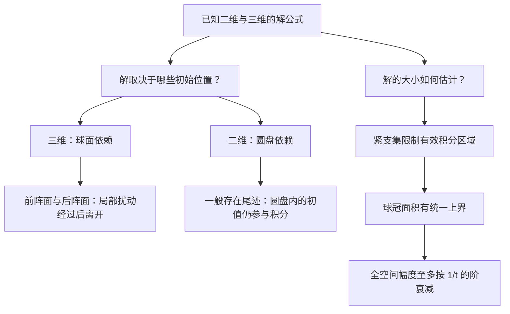

> **范围与前置知识**：依据吴事良《数学物理方程》第三章讲义 §3.3。按所附 PDF 的物理页序，第 56 页介绍传播，第 57—60 页讲衰减，第 61 页进入 §3.4 能量方法。本文把**传播与衰减两部分都展开**，并在末尾解释与能量方法的联系；不把下一节的全部内容混入本节。
>
> 前置笔记：[高维波动方程的柯西问题](https://adhochorizon813.github.io/inkroam/notes/equations-of-mathematical-physics/wave-equation-cauchy-problem/)。本文会重列用到的公式，不要求来回翻阅才能理解。

> [!IMPORTANT]
> **这节问的是两个不同的问题。**
>
> **传播**：初始扰动能影响哪里？什么时候到达、什么时候离开？
>
> **衰减**：随着时间增大，波的幅度怎样变小？这个结论是对固定位置成立，还是对所有位置统一成立？
>
> 三维的“固定位置最终完全归零”和“全空间最大幅度为 $O(t^{-1})$”并不矛盾，因为波还在向越来越远的地方传播。

## 阅读路线与标识

全文使用 **【定义】**、**【核心】**、**【易错】**、**【证明补全】**、**【拓展】** 标明知识的作用。

- **第一部分：波的传播。** 从解公式读出依赖区域，区分依赖、决定、影响三个视角；推导有限传播速度、三维球壳与前后阵面、二维后效。
- **第二部分：波的衰减。** 解释紧支集与一致收敛，逐行展开 PPT 的公式变换，补上球冠面积估计，得到严格的 $O(t^{-1})$ 结论。
- **第三部分：两者的联系。** 解释局部归零与全局衰减、幅度衰减与能量守恒，并用例子说明 $1/t$ 上界的意义。

所有主结论均针对全空间、常波速 $a>0$、无源的线性波动方程

$$
\begin{cases}
u_{tt}-a^2\Delta u=0,&x\in\mathbb R^n,\ t>0,\\
u(x,0)=\varphi(x),\\
u_t(x,0)=\psi(x),
\end{cases}
\qquad n=2\text{ 或 }3.
$$

初值足够光滑，使经典解公式与求导合法。涉及紧支集与衰减的地方会明确再加相应假设。存在边界、反射、持续源项或变系数时，不能直接照搬本节所有结论。

## 第一部分：波的传播

## 1. 先把解公式当成一张“信息来源地图”

### 1.1 三维：在一个球面上读取初始信息

三维泊松公式可写为

$$
u(x,t)=\partial_t[tM_\varphi(x,at)]+tM_\psi(x,at),
$$

其中

$$
M_h(x,R)=\frac1{4\pi R^2}\int_{|y-x|=R}h(y)\,dS_y.
$$

把时间导数展开，得到

$$
\boxed{
u(x,t)=\frac1{4\pi a^2t^2}
\int_{|y-x|=at}
\bigl[\varphi(y)+\nabla\varphi(y)\cdot(y-x)+t\psi(y)\bigr],dS_y.
}
$$

固定观察事件 $(x,t)$ 后，这个公式只在

$$
\boxed{S_x^{at}=\{y\in\mathbb R^3:|y-x|=at\}}
$$

上取初始数据。因此几何上的依赖集合是一个**球面**，不是整个球体。

> [!WARNING]
> **【易错】“只依赖球面”不等于“只知道 $\varphi$ 在球面上的函数值就够了”。** 展开式还含初位移的法向导数，因为 $y-x$ 是法向方向。若要比较两个解，一个稳妥条件是两组初值在该球面的某个开邻域内相同；这样 $\varphi,\nabla\varphi,\psi$ 在球面上都相同，解值才必然相同。仅有初位移的球面迹，一般不足以确定法向导数。

### 1.2 二维：在整个圆盘上读取初始信息

二维泊松公式是

$$
\begin{aligned}
u(x,t)={}&\frac1{2\pi a}\partial_t\left[
\int_{|y-x|<at}\frac{\varphi(y)}{\sqrt{a^2t^2-|y-x|^2}}\,dy\right]\\
&+\frac1{2\pi a}\int_{|y-x|<at}
\frac{\psi(y)}{\sqrt{a^2t^2-|y-x|^2}}\,dy.
\end{aligned}
$$

因此它依赖的是以 $x$ 为中心、半径 $at$ 的**整个圆盘**。讨论闭的依赖集合时通常记作 $\overline B_x^{at}$；积分本身可在开圆盘上作带边缘可积奇性的积分。

两种情况的根本区别就在积分区域：

| 维数 | 对固定事件 $(x,t)$ 的初值依赖集合 | 内部初值是否继续参与？ |
| --- | --- | --- |
| 三维 | 球面 $S_x^{at}$，并涉及初位移的法向变化 | 球面之外、严格位于内部的局部扰动不参与这一时刻的球面积分 |
| 二维 | 圆盘 $\overline B_x^{at}$ | 圆盘内部一般仍然参与 |

*图 1：左图是三维球面与一个平面的截面，所以画成圆周；实际依赖集合仍是二维球面。右图是二维问题真正的圆盘。两者的圆心都是观察位置 $x$，半径都是 $at$。*

## 2. 依赖区域、决定区域、影响区域：三个问题，三个视角

PPT 提到这些概念，却没有展开。它们不应仅靠名称区分，而应先说明“已知什么、要问什么”。不同教材的精确措辞可能略有区别；以下采用本节公式能直接验证的表述。

### 2.1 依赖区域：从一个未来点往回看

**【定义】** 固定一个未来事件 $(x,t)$，问：确定这里的解，需要初始时刻哪些位置的信息？

三维的精细回答是球面 $S_x^{at}$；二维是圆盘 $\overline B_x^{at}$。

在一般有限传播速度的表述里，也可以统一使用初始球体 $\overline B_x^{at}$ 作为一个足够大的依赖区域。三维的球面结论比它更强：不是整个球体内部都必须参与。

### 2.2 决定区域：从一块已知初值往前看

**【定义】** 假设只知道初始集合 $K$ 附近的两组初值，问：哪些未来点的解值已被这部分数据唯一确定，无论 $K$ 外怎样改变都不受影响？

一个通用而直观的充分条件是：未来点的整个初始依赖球都落在已知区域内部。

例如初始数据在以 $x_c$ 为中心、半径 $\rho$ 的开球中已知。如果

$$
\boxed{|x-x_c|+at<\rho,}
$$

那么对任何满足 $|y-x|\le at$ 的点，三角不等式给出

$$
|y-x_c|\le|y-x|+|x-x_c|\le at+|x-x_c|<\rho.
$$

因此未来解在这一区域中已确定。其时空形状是一个向上收拢的锥体：时间越晚，为避免读取未知初值，允许的观察位置就越靠近球心。

这里采用严格不等号，是为了避开“只知道边界值却不知道所需导数”的细节。对于任意形状的 $K$，可以进一步利用真实依赖集合分析；上述球形情形已足以掌握教材的主要图像。

### 2.3 影响区域：从一处初始扰动往前看

**【定义】** 若初值只在某个集合 $K$ 内发生改变，问：这种改变以后可能影响哪些事件？

应比较两个解 $u_1,u_2$，令 $w=u_1-u_2$。它仍满足齐次波动方程，初值是两组初值之差。若差值的支集位于 $K$，就研究 $w$ 的传播。

- 三维：只有当 $S_x^{at}$ 与 $K$ 相遇时，才可能受到该扰动影响。
- 二维：只要 $\overline B_x^{at}$ 与 $K$ 相遇，就进入了可能受影响的范围。

> [!IMPORTANT]
> **【核心】“可能受影响”不是“这里必定非零”。** 初值可能在积分中抵消，也可能具有特殊对称性。传播几何给出的是允许出现信号的区域，或者解的支集的上界；不能只凭几何相交就断言振幅严格大于零。

如果讨论“一个初始点”的影响，通常指基本解的几何支集，或者把扰动限制在该点的任意小邻域来理解。非零光滑函数不可能只支撑在孤立的一个点上。

| 概念 | 固定的对象 | 问的问题 |
| --- | --- | --- |
| 依赖区域 | 一个未来事件 $(x,t)$ | 需要从初始时刻哪里读取信息？ |
| 决定区域 | 一块已知初值区域 | 哪些未来事件已能唯一确定？ |
| 影响区域 | 一块被改变的初值区域 | 哪些未来事件可能发生改变？ |

## 3. 有限传播速度：为什么信号不能瞬间影响全空间？

设初始扰动支集在 $K$ 内。如果

$$
\operatorname{dist}(x,K)>at,
$$

那么半径 $at$ 的整个依赖球都碰不到 $K$，其球面当然也碰不到。因此二维、三维都有

$$
\boxed{\operatorname{dist}(x,K)>at\quad\Longrightarrow\quad u(x,t)=0.}
$$

这里默认初值在 $K$ 外均为零；对两个解之差也同样成立。

这就是**有限传播速度**：传播到距离 $d$ 至少需要时间 $d/a$。

例如 $a=2$，某观察点距初始扰动集合最近距离为 $6$，那么 $t<3$ 时该点绝不可能感受到这个扰动。

> [!TIP]
> 有限传播速度只说明“尚未到达时为零”，并没有说明“到达以后何时恢复为零”。三维无后效的结论，正是在有限传播速度之外再增加的性质。

## 4. 紧支集：局部扰动的数学表达

PPT 在衰减部分正式定义紧支集。为了讨论局部波包的传播，先把它放在这里说明。

**【定义】** 函数 $h$ 的支集是非零点集合的闭包：

$$
\boxed{\operatorname{supp}h=\overline{\{x:h(x)\ne0\}}.}
$$

支集为紧集，就称 $h$ 具有紧支集。在 $\mathbb R^n$ 中，紧集等价于有界闭集，因此紧支集意味着存在某个有限半径 $\rho$，使

$$
h(x)=0\qquad\text{当 }|x|>\rho.
$$

**“很小”不等于“为零”。** 例如 $e^{-|x|^2}$ 虽然在远处快速减小，但处处非零，支集是整个 $\mathbb R^n$，没有紧支集。

一个光滑紧支集例子是

$$
b(x)=\begin{cases}
\exp\!\left(-\dfrac1{1-|x|^2/\rho^2}\right),&|x|<\rho,\\
0,&|x|\ge\rho.
\end{cases}
$$

它在球内非零，在球外恒零，且跨越边界仍光滑。

如果 $\varphi,\psi$ 都有紧支集，可以选一个共同的大球包住它们：

$$
K:=\operatorname{supp}\varphi\cup\operatorname{supp}\psi
\subset\overline B_0^\rho.
$$

以后就以这个半径 $\rho$ 描述初始扰动的空间大小。实际支集可以更小或不规则，这个球只是包围它的方便上界。

## 5. 三维波为什么形成向外传播的球壳？

设初始扰动位于 $\overline B_0^\rho$。固定观察位置 $x$，记

$$
d=|x|,\qquad R=at.
$$

三维解可能非零，必须有

$$
S_x^R\cap\overline B_0^\rho\ne\varnothing.
$$

球面 $S_x^R$ 上的点离原点最近的距离是

$$
\min_{y\in S_x^R}|y|=|d-R|.
$$

为什么是绝对值？沿着两个球心的连线观察：当原点在观察球外时，最近距离是 $d-R$；当原点在观察球内时，离球面最近的距离是 $R-d$。

所以球面与初始支集的包围球相遇，当且仅当

$$
|d-R|\le\rho.
$$

代入 $R=at$，得到

$$
\boxed{|\,|x|-at\,|\le\rho.}
$$

解的支集因此满足

$$
\boxed{\operatorname{supp}u(\cdot,t)
\subset\{x:\max(0,at-\rho)\le|x|\le at+\rho\}.}
$$

严格位于这个区域之外时，球面与初始支集没有交点，初始位移、其导数和初始速度在积分球面上均为零，解必为零。

### 5.1 波的外边缘：前阵面

$$
\boxed{|x|=at+\rho.}
$$

在它外面，即 $|x|>at+\rho$，信号还没有到达。这是包围初始扰动的球所给出的最外传播边界。

### 5.2 波的内边缘：后阵面

当 $at>\rho$ 时，还有

$$
\boxed{|x|=at-\rho.}
$$

在它里面，即 $|x|<at-\rho$，波已经过去：此时以 $x$ 为球心的积分球面太大，整个初始支集严格位于其内部，球面本身反而与支集不相交。

所以信号不在这个内部区域继续留下尾迹。这一内边缘称为后阵面；从初始包围球出发，它在 $t=\rho/a$ 后才形成非空的内部空区。

> [!WARNING]
> **【易错】“球面围住了支集”与“球面碰到了支集”不是一回事。** 三维积分在球面上进行。初始支集被球面整个包在里面，却不接触球面时，该积分为零。

若 $at<\rho$，没有正半径的内边缘，传播范围上界还是一个球；不能把负数 $at-\rho$ 当作一个实际球面的半径。

*图 2：采用 $a=1,\rho=1$。三维图是球壳的平面截面；橙色虚线表示初始包围球的截面。阴影仅表示可能非零的范围，并非声称阴影内处处有相同或非零振幅。二维只有由有限传播速度保证的外边缘，不能普遍排除内部尾迹。*

## 6. 在一个固定位置，什么时候开始、什么时候结束？

由

$$
|d-at|\le\rho
$$

可得可能受到影响的时间窗口

$$
\boxed{\max\left(0,\frac{d-\rho}{a}\right)
\le t\le\frac{d+\rho}{a}.}
$$

对初始支集外的观察点 $d>\rho$，

$$
t_{\mathrm{first}}=\frac{d-\rho}{a},\qquad
t_{\mathrm{last}}=\frac{d+\rho}{a}.
$$

这是包围球所给出的最早可能到达和最晚可能结束的时刻。若实际支集更小或者发生抵消，实际信号窗口可以更短。

例如 $a=2,\rho=1,d=5$，则

$$
t_{\mathrm{first}}=2,\qquad t_{\mathrm{last}}=3.
$$

- $t<2$：还没到，解为零。
- $2<t<3$：球面穿过初始扰动区域，可能有信号。
- $t>3$：已经过去，解再次恒为零。

传播窗口长度为 $2\rho/a$，不随远处观察点的距离增大而增加。这里说的是由包围球得到的时间窗口上界，不是每个波形必定持续这个长度。

## 7. 惠更斯原理与“无后效”究竟指什么？

在本节的三维自由波动方程中，**强惠更斯性质**可以表述为：解在事件 $(x,t)$ 处只取决于过去特征锥在初始面上截出的球面，而不取决于这个球面的严格内部。

对紧支集初值，这带来直接可观察的后果：对每个固定 $x$，

$$
\boxed{t>\frac{|x|+\rho}{a}\quad\Longrightarrow\quad u(x,t)=0.}
$$

局部初始扰动经过观察点后会完全离开，称为**无后效**。它不是“波停止存在”，而是“波离开了当前观察位置”。

> [!NOTE]
> 光学里“每一点可视为次级波源”的惠更斯描述，与这里严格讨论的“传播只在特征锥面、没有锥内尾迹”的强惠更斯性质，应注意区分。本节 PPT 用“惠更斯原理（无后效）”指向的是后一种性质。

## 8. 二维为什么一般会有后效？

二维的积分区域是整个圆盘 $B_x^{at}$。随着 $t$ 增大，它不断扩大。

当圆盘尚未碰到初始支集时，当然没有影响。但当圆盘已经把初始支集完全包含进去时，支集仍在积分区域里，所以仍然可能有贡献。

这恰好与三维球面的情况相反：

| 情形 | 积分区域已包住整个初始支集之后 |
| --- | --- |
| 三维球面积分 | 若球面与支集分离，贡献为零 |
| 二维圆盘积分 | 支集仍在圆盘内部，一般继续贡献 |

对支集在 $\overline B_0^\rho$ 内的二维初值，只能普遍得到

$$
\operatorname{supp}u(\cdot,t)\subset\overline B_0^{\rho+at}.
$$

不能普遍补上三维那样的内部空区。这就是 PPT 所说二维一般“有前阵面、无后阵面”，也即存在后效。

### 8.1 用正的初速度严格证明尾迹可以一直存在

取

$$
\varphi=0,\qquad \psi\ge0,\qquad
\psi\in C_c^\infty(\mathbb R^2),\qquad\psi\not\equiv0,
$$

并令其支集在 $\overline B_0^\rho$ 内。固定 $x$，当

$$
t>\frac{|x|+\rho}{a}
$$

时，整个支集都严格落在积分圆盘内，因此

$$
u(x,t)=\frac1{2\pi a}
\int_{\operatorname{supp}\psi}
\frac{\psi(y)}{\sqrt{a^2t^2-|y-x|^2}}\,dy>0.
$$

这里分母严格为正，且 $\psi$ 在某个开集上严格为正，所以积分严格大于零。这说明即使“来自最远初始点的直达传播时间”已经过去，二维仍可以留下非零尾迹。

**这不是只靠图形作猜测，而是由正积分直接证明的反例：二维不能具有与三维完全相同的普遍无后效性质。**

### 8.2 有后效不等于不衰减

仍取上面的初值，固定 $x$。当 $t\to\infty$ 时，支集有界，故在整个积分支集上

$$
\frac1{\sqrt{a^2t^2-|y-x|^2}}
=\frac1{at}\left(1+O(t^{-2})\right).
$$

于是

$$
\boxed{u(x,t)=\frac1{2\pi a^2t}\int_{\mathbb R^2}\psi(y)\,dy+O(t^{-3}).}
$$

所以这个例子在固定位置一直不严格为零，却逐渐减小到零。

> [!WARNING]
> 上式是这个二维例子的**固定位置渐近式**，不是对所有 $x$ 一致的估计。其余项中的常数可依赖固定的 $x$。不能把它直接说成二维全空间的 $L^\infty$ 衰减定理。

## 9. 三维与二维传播的答题整理

**三维：** 由泊松公式，$u(x,t)$ 依赖初始球面 $S_x^{at}$ 上的相关数据。若初始扰动支集在 $\overline B_0^\rho$ 内，则

$$
u(x,t)=0\qquad\text{当 }|\,|x|-at\,|>\rho.
$$

因此当 $at>\rho$ 时，扰动只可能位于 $at-\rho\le|x|\le at+\rho$ 的球壳内，具有前阵面和后阵面，局部扰动通过后无后效。

**二维：** 由泊松公式，$u(x,t)$ 依赖初始圆盘 $\overline B_x^{at}$ 上的数据。由有限传播速度，$|x|>at+\rho$ 时为零，但圆盘内部的初值可以继续贡献，不能一般推出内部空区，因而一般具有后效。

上述前后阵面是由球形支集上界得到的几何传播边界，不要求解在它们之间处处非零；光滑初值也不要求在这些边界上形成跳跃奇性。

## 第二部分：波的衰减

## 10. PPT 的衰减定理到底说了什么？

**定理（PPT 定理 13 的严格上界表述）。** 设三维齐次柯西问题的初值满足

$$
\varphi\in C_c^3(\mathbb R^3),\qquad
\psi\in C_c^2(\mathbb R^3).
$$

则存在仅依赖初值与波速的常数 $C$，使

$$
\boxed{\sup_{x\in\mathbb R^3}|u(x,t)|\le\frac Ct,\qquad t\ge1.}
$$

也就是

$$
\boxed{\|u(\cdot,t)\|_{L^\infty(\mathbb R^3)}=O(t^{-1}).}
$$

因此解在全空间上一致趋于零。

### 10.1 “一致”比“每个固定位置”强在哪里？

逐点趋于零是

$$
\forall x,\quad u(x,t)\to0.
$$

一致趋于零则是

$$
\sup_x|u(x,t)|\to0.
$$

等价地，对于每个 $\varepsilon>0$，要有一个**不依赖 $x$** 的 $T$，使

$$
t>T\quad\Longrightarrow\quad |u(x,t)|<\varepsilon\quad\text{对所有 }x\text{ 同时成立}.
$$

证明中所有最终常数都必须不依赖 $x$，否则最多得到逐点结论。

### 10.2 “阶数为 $t^{-1}$”应该怎样理解？

PPT 的计算证明的是上界

$$
|u(x,t)|\le\frac{C_1}{t}+\frac{C_2}{t^2}.
$$

所以严格结论是 $O(t^{-1})$。它不能直接推出每个解都满足

$$
|u(x,t)|\sim\frac1t,
$$

也不能推出每个固定 $x$ 上都存在非零的 $1/t$ 渐近系数。零初值的解恒为零；紧支集三维解在固定位置还会最终严格归零。

> [!IMPORTANT]
> **【核心】上界、渐近等价、最优统一阶数是三件不同的事。** PPT 证明给出上界；要说明该统一阶数一般不能改进，还需要另外构造例子，见第 18 节。

## 11. 先把时间导数展开：补全 PPT 第 58 页

三维公式为

$$
u(x,t)=\partial_t[tM_\varphi(x,at)]+tM_\psi(x,at).
$$

直接对随时间移动的球面求导容易漏项，所以先改写为固定单位球面：

$$
tM_\varphi(x,at)=\frac1{4\pi}\int_{|\xi|=1}t\varphi(x+at\xi)\,dS_\xi.
$$

对被积函数应用乘积法则和链式法则：

$$
\begin{aligned}
\partial_t[t\varphi(x+at\xi)]
&=\varphi(x+at\xi)+t\partial_t\varphi(x+at\xi)\\
&=\varphi(x+at\xi)+at\nabla\varphi(x+at\xi)\cdot\xi.
\end{aligned}
$$

这里 $x,\xi$ 都是三维向量。写成分量就是

$$
\partial_t\varphi(x+at\xi)
=a\sum_{j=1}^3\varphi_{x_j}(x+at\xi)\xi_j.
$$

再换回

$$
y=x+at\xi,
$$

就有

$$
at\xi=y-x,\qquad dS_y=(at)^2dS_\xi.
$$

因此

$$
\partial_t[tM_\varphi(x,at)]
=\frac1{4\pi a^2t^2}
\int_{S_x^{at}}[\varphi(y)+\nabla\varphi(y)\cdot(y-x)]\,dS_y.
$$

初速度项可统一分母为

$$
tM_\psi(x,at)=\frac1{4\pi a^2t^2}
\int_{S_x^{at}}t\psi(y)\,dS_y.
$$

两项相加，得到

$$
\boxed{u(x,t)=\frac1{4\pi a^2t^2}
\int_{S_x^{at}}[\varphi(y)+\nabla\varphi(y)\cdot(y-x)+t\psi(y)]\,dS_y.}
$$

这个形式适合估计，因为前面的系数显式带有 $t^{-2}$。

## 12. 紧支集为什么是衰减证明的关键？

选 $\rho>0$ 使

$$
\operatorname{supp}\varphi\cup\operatorname{supp}\psi\subset\overline B_0^\rho.
$$

由于 $\varphi$ 在球外的开集上恒为零，其各阶导数在球外也为零。因此有效积分区域可以缩成

$$
\Gamma(x,t):=S_x^{at}\cap\overline B_0^\rho.
$$

写成

$$
u(x,t)=\frac1{4\pi a^2t^2}
\int_{\Gamma(x,t)}[\varphi(y)+\nabla\varphi(y)\cdot(y-x)+t\psi(y)]\,dS_y.
$$

> [!WARNING]
> **【易错】若仍用整个大球面面积 $4\pi a^2t^2$ 去估计，前面的 $t^{-2}$ 会被抵消，得不到所需衰减。** 必须利用紧支集把积分限制到大球面穿过固定小球的那一片曲面。

即使大球面半径 $at$ 越来越大，它穿过固定初始支集的有效面积仍有一个与 $x,t$ 无关的上界。这是下一步的几何核心。

## 13. 被积函数为什么至多增长成 $C_2t+C_3$？

记

$$
A=\|\varphi\|_\infty,\qquad
B=\|\nabla\varphi\|_\infty,\qquad
D=\|\psi\|_\infty.
$$

这些量有限：函数及导数连续，且只需在一个紧球上取上界，球外为零。

在积分球面上，恒有

$$
|y-x|=at.
$$

因此由三角不等式和柯西不等式，

$$
\begin{aligned}
|\varphi(y)+\nabla\varphi(y)\cdot(y-x)+t\psi(y)|
&\le|\varphi(y)|+|\nabla\varphi(y)|\,|y-x|+t|\psi(y)|\\
&\le A+Bat+Dt\\
&=A+(aB+D)t.
\end{aligned}
$$

若取

$$
C_3=A,\qquad C_2=aB+D,
$$

就得到 PPT 中的 $C_2t+C_3$。

**【核心】这里没有对 $|x|$ 单独估计。** 因为积分球面已经给出了准确距离 $|y-x|=at$，所以常数可以完全不依赖观察位置 $x$。

若按 PPT 先逐个控制 $|\varphi_{x_i}|\le C_1$，则 $|\nabla\varphi|\le\sqrt3C_1$，取 $C_2=(a\sqrt3+1)C_1$、$C_3=C_1$ 即可。常数具体数值不是主旨，不依赖 $x,t$ 才是关键。

## 14. PPT 跳过的几何引理：球冠面积为什么有统一上界？

需要证明：对任意球心 $x$、任意半径 $R>0$，

$$
\boxed{\operatorname{Area}(S_x^R\cap\overline B_0^\rho)\le4\pi\rho^2.}
$$

注意 $S_x^R\cap\overline B_0^\rho$ 一般不是小球面 $\partial B_0^\rho$ 的子集。PPT 把积分估计到 $\partial B_0^\rho$ 上，**不能简单解释成积分区域包含关系**；真实需要的是面积比较。

### 14.1 情况一：$R\le\rho$

有效面积不超过整个球面的面积，所以

$$
\operatorname{Area}(S_x^R\cap\overline B_0^\rho)
\le4\pi R^2\le4\pi\rho^2.
$$

这一情况最直接，也涵盖了小积分球面完全落在初始包围球内的情况。

### 14.2 情况二：$R>\rho$

若不相交，面积为零；相切时接触集合面积也为零。下面只考虑真正相交的情况。

令 $d=|x|>0$，沿两个球心连线取方向：从大球心 $x$ 指向小球心 $0$ 的单位向量为 $e$。大球面上的点可写成

$$
y=x+R\eta,\qquad |\eta|=1.
$$

令 $\theta$ 为 $\eta$ 与 $e$ 的夹角。由于 $x=-de$，

$$
|y|^2=d^2+R^2-2dR\cos\theta.
$$

点落在小球内的条件是

$$
\cos\theta\ge\frac{d^2+R^2-\rho^2}{2dR}.
$$

因为 $R>\rho$，右端严格为正，所以这个有效曲面是一个**小于半球的球冠**。设球冠边缘角为 $\theta_0$，高度为

$$
h=R(1-\cos\theta_0),\qquad 0<h<R.
$$

设球冠底面圆的半径为 $b$，则

$$
b^2=R^2-(R-h)^2=2Rh-h^2.
$$

因 $h\le R$，有 $h^2\le Rh$，所以

$$
b^2=2Rh-h^2\ge Rh.
$$

另一方面，底面圆正是两个球面的交圆；它位于半径 $\rho$ 的小球上，所以

$$
b\le\rho.
$$

球冠面积为

$$
A_{\mathrm{cap}}=2\pi Rh.
$$

因而

$$
A_{\mathrm{cap}}\le2\pi b^2\le2\pi\rho^2\le4\pi\rho^2.
$$

两种情况合起来，几何引理得证。

### 14.3 球冠面积公式本身从哪里来？

若不想背 $2\pi Rh$，用球面坐标直接算：

$$
\begin{aligned}
A_{\mathrm{cap}}
&=\int_0^{2\pi}\int_0^{\theta_0}R^2\sin\theta\,d\theta\,d\alpha\\
&=2\pi R^2(1-\cos\theta_0)=2\pi Rh.
\end{aligned}
$$

这又用到了曲面面积元 $R^2\sin\theta\,d\theta\,d\alpha$。

*图 3：蓝色大圆是积分球面的截面，橙色小圆是固定支集包围球的截面，绿色弧段代表有效球冠的截面。左图显示全局位置，右图放大交叠区域并标出球冠高度 $h$ 与底圆半径 $b$。弧线长度不是球冠面积，面积仍需使用三维公式 $2\pi Rh$。*

> [!TIP]
> **【证明补全】本节最值得补上的一步。** 固定小球内的曲面面积并不因“它在小球里面”就自动受小球表面积控制；任意褶皱曲面可有很大的面积。这里之所以能控制，是因为有效曲面来自另一个球面，它具有球冠这种特殊几何结构。

## 15. 合并估计：完整证明一致 $O(t^{-1})$ 衰减

由第 12—14 节，

$$
\begin{aligned}
|u(x,t)|
&\le\frac1{4\pi a^2t^2}
\int_{\Gamma(x,t)}[A+(aB+D)t]\,dS_y\\
&=\frac{A+(aB+D)t}{4\pi a^2t^2}
\operatorname{Area}(\Gamma(x,t))\\
&\le\frac{A+(aB+D)t}{4\pi a^2t^2}\,4\pi\rho^2\\
&=\frac{\rho^2}{a^2}\left(\frac{aB+D}{t}+\frac A{t^2}\right).
\end{aligned}
$$

因此对所有 $x\in\mathbb R^3$、所有 $t>0$，

$$
\boxed{|u(x,t)|\le\frac{\rho^2}{a^2}
\left(\frac{a\|\nabla\varphi\|_\infty+\|\psi\|_\infty}{t}
+\frac{\|\varphi\|_\infty}{t^2}\right).}
$$

这个粗估计在 $t\downarrow0$ 时变大，不代表实际解发散；它是为大时间衰减设计的估计，初始时刻应回到原解公式。

对 $t\ge1$，$t^{-2}\le t^{-1}$，于是

$$
\sup_x|u(x,t)|\le\frac Ct,
$$

其中可取

$$
C=\frac{\rho^2}{a^2}
\bigl(a\|\nabla\varphi\|_\infty+\|\psi\|_\infty+\|\varphi\|_\infty\bigr).
$$

给定 $\varepsilon>0$，取 $T>\max(1,C/\varepsilon)$，就有

$$
t>T\Longrightarrow\sup_x|u(x,t)|<\varepsilon.
$$

定理得证。

### 15.1 一句话记住估计的结构

$$
\underbrace{t^{-2}}_{\text{公式前的系数}}
\times
\underbrace{O(t)}_{\text{被积函数上界}}
\times
\underbrace{O(1)}_{\text{有效球冠面积}}
=O(t^{-1}).
$$

三个因子缺一不可。其中 $O(1)$ 的有效面积，正是紧支集发挥作用的地方。

## 16. 为什么波都“过去了”，还要证明一致衰减？

三维无后效告诉我们：对每个固定 $x$，只要

$$
t>\frac{|x|+\rho}{a},
$$

解就为零。看上去这比 $1/t$ 衰减更强，但这个结束时刻依赖 $x$。当 $|x|$ 越大时，波要更晚才离开。

全空间有无限远的位置，因此不存在仅由这个逐点结论得到的“所有位置同时归零”的统一时刻。时刻 $t$ 的波仍可能位于 $|x|\approx at$ 的远处球壳。

- **固定位置观察**：波经过后离开，最终严格为零。
- **跟随波向外移动**：仍可以看到波，但幅度逐渐减小。
- **对所有位置取最大值**：峰值可能随时间移动，所以需要独立的一致估计。

进一步，对任何固定有界区域 $|x|\le L$，若

$$
t>\frac{L+\rho}{a},
$$

该区域内的解就同时全部为零。但把 $L$ 取成无穷大，不能保留这个有限时间结论。

## 第三部分：理解衰减的意义

## 17. 多项式衰减不等于能量被消耗

PPT 第 60 页强调：这里是多项式（代数）衰减，不是指数衰减。

$$
\text{代数衰减示例： }t^{-1},\qquad
\text{指数衰减示例： }e^{-ct}\ (c>0).
$$

更重要的是，原方程没有阻尼项。对足够光滑且紧支集传播的解，总能量

$$
E(t)=\frac12\int_{\mathbb R^3}
\left(u_t^2+a^2|\nabla u|^2\right)dx
$$

保持不变。简要验证如下：

$$
\begin{aligned}
E'(t)
&=\int_{\mathbb R^3}
\bigl(u_tu_{tt}+a^2\nabla u\cdot\nabla u_t\bigr)dx\\
&=\int_{\mathbb R^3}u_t(u_{tt}-a^2\Delta u)dx=0.
\end{aligned}
$$

第二步用分部积分。每个有限时间解都有有界支集，因此可在一个足够大的球上积分，边界附近解和导数为零，不产生无穷远边界项。

**振幅变小而总能量不变，是因为能量向外输运、分布在越来越大的区域中。** 不能把“衰减”直接解释成摩擦或阻尼造成的耗散。

三维球壳的半径约为 $at$，厚度由初始支集尺度控制，其体积量级约为 $t^2$。对典型向外传播的波包，导数幅度约为 $1/t$ 时，能量密度量级约为 $1/t^2$，与不断扩大的球壳体积相乘可以保持总能量量级不变。这是物理上的一致性解释，不替代第 15 节的严格证明。

PPT 第 61 页正由此转入下一节：能量积分法将用于证明定解问题解的唯一性与稳定性。本文只说明联系，不提前展开其全部定理。

## 18. $1/t$ 只是粗上界吗？为什么这个阶数一般不能改进？

**【拓展：可在掌握主证明后阅读】** 为了区分“每个解都等于 $1/t$”与“统一阶数不能普遍改进”，构造一个三维径向例子。

取

$$
\varphi=0,\qquad\psi(y)=g(|y|),
$$

其中 $g\ge0$、不恒为零，且所定义的径向函数光滑、支撑在 $|y|\le\rho$。可使用第 4 节的光滑隆起函数（bump function）作为具体初速度。

令观察点到原点的距离为 $r=|x|>0$，传播半径为 $R=at$。球面上距离原点的变量记为 $s=|y|$。以球心连线为极轴，

$$
s^2=r^2+R^2+2rR\cos\theta.
$$

由此可把球面积分化为

$$
\int_{|y-x|=R}g(|y|)\,dS_y
=\frac{2\pi R}{r}\int_{|r-R|}^{r+R}s\,g(s)\,ds.
$$

代入初速度项，得到

$$
\boxed{u(r,t)=\frac1{2ar}\int_{|r-at|}^{r+at}s\,g(s)\,ds.}
$$

现在不固定观察点，而是沿着移动路径 $x(t)=at\,e_1$ 观察，即 $r=at$。当 $2at\ge\rho$ 时，

$$
\begin{aligned}
u(at\,e_1,t)
&=\frac1{2a^2t}\int_0^{2at}s\,g(s)\,ds\\
&=\frac1{2a^2t}\int_0^\rho s\,g(s)\,ds=\frac{c_0}{t},
\end{aligned}
$$

其中

$$
c_0=\frac1{2a^2}\int_0^\rho s\,g(s)\,ds>0.
$$

因此

$$
\sup_x|u(x,t)|\ge\frac{c_0}{t}.
$$

结合前面的 $C/t$ 上界，这个例子的全空间最大幅度确实是 $t^{-1}$ 的量级。所以对所有这类初值，不能普遍把统一上界改成 $o(t^{-1})$，更不能普遍保证指数衰减。

但这个例子在每个固定位置仍会最终归零。下界是在随时间移动的观察点 $x(t)$ 上取得的，逻辑上完全一致。

*图 4：用三维径向、非负、光滑紧支集初速度作示例，$a=\rho=1$。左图展示波形沿径向向外移动；右图比较固定位置 $|x|=2$ 与移动位置 $|x(t)|=t$ 的振幅。移动位置在 $t\ge1/2$ 时有严格的 $c_0/t$ 公式，固定位置在 $t>3$ 后为零。绘图用一维积分作数值求值，精确结论来自本节解析公式。*

## 19. 为什么紧支集假设不能随意去掉？

如果初位移为常数 $\varphi\equiv1$、初速度为零，那么解为

$$
u(x,t)\equiv1.
$$

它当然不衰减。这不反驳定理，因为常数函数没有紧支集。

若初位移为零、初速度为常数 $\psi\equiv1$，解为

$$
u(x,t)=t,
$$

甚至随时间增长，同样不满足紧支集条件。

某些非紧支集但有足够空间衰减的初值，也可以获得衰减估计；那需要另外的加权可积性或衰减条件，不能直接使用本节的固定球冠面积证明。

## 20. 一页结论表：把传播与衰减连起来

| 主题 | 准确结论 | 必须记住的限制 |
| --- | --- | --- |
| 有限传播速度 | 距初始扰动集合超过 $at$ 的位置尚未受影响 | 二维、三维都成立 |
| 三维依赖 | 初始球面 $S_x^{at}$ | 初位移还涉及法向导数 |
| 二维依赖 | 初始圆盘 $\overline B_x^{at}$ | 圆盘内部一般持续贡献 |
| 三维球壳 | $\max(0,at-\rho)\le\lvert x\rvert\le at+\rho$ 是可能非零范围 | 支集包含关系，不保证壳内处处非零 |
| 三维无后效 | 固定点在 $t>(\lvert x\rvert+\rho)/a$ 后为零 | 齐次、全空间、常系数、紧支集局部扰动 |
| 二维后效 | 一般不能给出三维式的普遍结束时刻 | 有尾迹不表示不衰减 |
| 三维一致衰减 | $\sup_x\lvert u(x,t)\rvert\le C/t$，$t\ge1$ | 足够光滑且紧支集的初值 |
| 有效曲面面积 | $\operatorname{Area}(S_x^R\cap\overline B_0^\rho)\le4\pi\rho^2$ | 依靠球冠结构，不是普通集合包含 |
| 总能量 | $E(t)=E(0)$ | 无阻尼、无源；幅度衰减并非能量耗散 |
| $t^{-1}$ 的意义 | 是统一上界；有例子达到该量级 | 不能说每个解、每个固定点都渐近等于 $1/t$ |

## 21. 最容易混淆的七句话

1. **“传播到某处，就会永远影响那里。”** 三维局部自由波可经过后完全离开；二维一般有后效。
2. **“球面包含支集，所以球面积分一定非零。”** 包围不等于相交；若支集严格在内部且不触及球面，积分为零。
3. **“二维有后效，所以二维不衰减。”** 尾迹可以一直非零，同时趋于零。
4. **“每个固定点最终为零，所以某一时刻全空间一起为零。”** 结束时刻依赖位置；更远的波壳仍在传播。
5. **“曲面位于固定小球内，所以其面积显然小于小球表面积。”** 对任意曲面是错的；本证明必须利用球面交球体形成球冠的结构。
6. **“PPT 最后一行写 $\sim1/t$，因此解就与 $1/t$ 渐近等价。”** 前面建立的是上界，结论应先表述成 $O(t^{-1})$。
7. **“振幅减小意味着总能量减少。”** 自由波的总能量可守恒，幅度减小来自向外传播和空间分散。

## 22. 自测与核对

### 自测问题

1. 固定观察事件 $(x,t)$ 时，三维与二维的初值依赖集合分别是什么？
2. 为什么知道 $\varphi$ 的球面函数值还不足以单独确定三维初位移项？
3. 若初值支集位于 $\overline B_0^\rho$，怎样从几何上推出三维的球壳范围？
4. 对初始支集外的观察点，最早可能到达与最晚可能结束的时间分别是多少？
5. 用非负初速度的积分说明，二维为什么一般有后效。
6. 衰减证明中，为什么用整个大球面的面积会失去 $1/t$ 上界？
7. 如何证明有效球冠面积与球心和传播半径无关地有界？
8. 一致衰减中的常数为什么不能依赖 $x$？
9. 固定位置最终归零，为何不妨碍移动位置仍有 $c_0/t$ 的振幅？
10. 本节与下一节的能量方法有什么联系？

### 核对要点

1. 三维为球面 $S_x^{at}$；二维为圆盘 $\overline B_x^{at}$。
2. 展开式含 $\nabla\varphi\cdot(y-x)$，即初位移的法向变化。
3. 球面到原点的最短距离为 $\bigl||x|-at\bigr|$；它不大于 $\rho$ 才可能与初始支集相交。
4. $(|x|-\rho)/a$ 与 $(|x|+\rho)/a$；它们是包围球给出的时间窗口界。
5. 对 $\varphi=0$、非负非零的光滑紧支集 $\psi$，整个支集进入圆盘后，正核积分仍严格大于零。
6. 大球面面积为 $O(t^2)$，会抵消公式前的 $t^{-2}$；必须只算穿过固定支集的有效曲面。
7. 半径小于 $\rho$ 时直接用整球面积；大于 $\rho$ 时是小于半球的球冠，用 $2\pi Rh\le2\pi b^2\le2\pi\rho^2$。
8. 否则不能用同一个时间阈值同时控制全空间。
9. 波的非零区域向外移动，固定观察点与移动观察路径的量词不同。
10. 总能量守恒说明振幅衰减不等于耗散；能量积分法进一步用于唯一性与稳定性。

## 来源与补充范围

- 原始材料：吴事良《数学物理方程》第三章《波动方程》讲义，§3.3“波的传播与衰减”。
- PDF 第 56 页：传播、依赖区域、前后阵面、惠更斯原理和后效的概要。
- 第 57 页：紧支集定义、三维衰减定理；支集定义包含非零点集的闭包。
- 第 58 页：将泊松公式展开成适于估计的球面积分。
- 第 59 页：限制有效积分区域并估计衰减，球冠面积比较在本文中补全。
- 第 60 页：代数衰减及其传播解释。
- 第 61 页：§3.4 能量积分法的引入；本文只补充能量守恒与本节的联系。
- 传播部分的详细定义、几何推导、二维正尾迹例子、球冠面积证明、量词辨析和最优阶例子，是围绕 PPT 结论作的补充讲解；未声称逐字转述老师指定的、未提供的课本。
