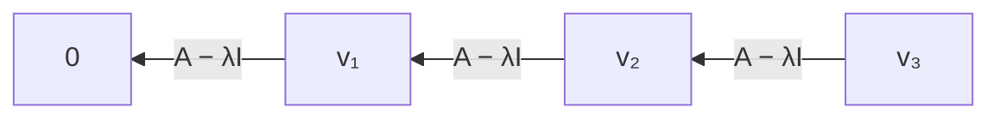

本章面向数学专业类竞赛复习。目标是能说明一个结论为什么成立、在哪个数域上成立，以及遇到具体问题时怎样选择工具。它不是只列公式的速查表；建议按小节分次阅读，每看完一组例题就合上答案重算。

**统一约定。** 除特别说明外，$\mathbb F$ 是特征为零的域，例如 $\mathbb Q,\mathbb R,\mathbb C$；$M_{m\times n}(\mathbb F)$ 表示 $m$ 行 $n$ 列矩阵。向量写成列向量，矩阵从左作用。$I_n$ 是单位矩阵，$\operatorname{rank}A$ 是秩，$\operatorname{tr}A$ 是迹，$A^T$ 是转置。谈 Jordan 形时要求特征多项式在所用域上完全分裂，特别可取 $\mathbb C$。在 $\mathbb R$ 上不能无条件使用实 Jordan 形。

## 1.1 竞赛要点与难点

最常见的困难是把“数值计算”和“结构判断”混在一起。例如：行变换可以求秩，却不能直接保持特征值；知道特征多项式，仍不足以确定相似类；分块行列式里随意交换矩阵次序，可能把正确公式变成错误公式。

| 问题信号 | 首选工具 | 必须检查 |
| --- | --- | --- |
| 求逆、求秩、判断线性方程组 | 初等变换、秩、核 | 矩阵尺寸、参数是否使主元为零 |
| 对角块可逆，存在大块零元素 | 分块消元、Schur 补 | 哪个块可逆，乘法次序 |
| 行列式具有重复结构或低秩扰动 | 多线性、展开、秩一公式 | 除法前是否排除了零值 |
| 求矩阵幂、证明多项式恒等式 | 最小多项式、Hamilton–Cayley 定理 | 恒等式是否对所有矩阵成立 |
| 判断相似、确定 Jordan 块 | 不变因子、核维数序列 | 所用数域、代数与几何重数 |

下面三种关系贯穿两章，先记住它们的对象不同：

$$
\begin{array}{lll}
\text{等价：}&B=PAQ,&\text{左右可独立变换，分类量是秩；}\\
\text{相似：}&B=P^{-1}AP,&\text{同一个线性变换换基；}\\
\text{合同：}&B=P^TAP,&\text{同一个二次型换坐标。}
\end{array}
$$

其中 $P,Q$ 均可逆，尺寸应与乘积相容。“都用了可逆矩阵”并不意味着三种关系相同。

## 1.2 矩阵的概念、运算与运算律

### 从列向量看矩阵

矩阵 $A=(a_{ij})\in M_{m\times n}(\mathbb F)$ 可以表示线性映射 $\mathbb F^n\to\mathbb F^m$。若列向量为 $a_1,\ldots,a_n$，则

$$
Ax=x_1a_1+\cdots+x_na_n.
$$

这条式子很重要：矩阵的列不是随意排列的数字，而是各个标准基向量的像，因为 $Ae_j=a_j$。第 $i$ 行则描述输出的第 $i$ 个坐标如何由输入组成。

同型矩阵逐项相加，数乘逐项进行。只有 $A\in M_{m\times n}$、$B\in M_{n\times p}$ 时，乘积 $AB$ 才有定义，且

$$
(AB)_{ij}=\sum_{k=1}^n a_{ik}b_{kj},\qquad AB\in M_{m\times p}.
$$

$AB$ 表示**先做 $B$，再做 $A$**，次序与从左到右阅读表达式的直觉相反。

### 哪些运算律仍成立？

在尺寸相容时，乘法结合律、左右分配律成立：

$$
(AB)C=A(BC),\quad A(B+C)=AB+AC,\quad (A+B)C=AC+BC.
$$

但一般没有交换律。取

$$
A=\begin{pmatrix}0&1\\0&0\end{pmatrix},\qquad
B=\begin{pmatrix}0&0\\1&0\end{pmatrix},
$$

则 $AB=\operatorname{diag}(1,0)$，$BA=\operatorname{diag}(0,1)$。同一个非零矩阵 $A$ 还满足 $A^2=0$，说明“乘积为零就有一个因子为零”也失效。

所以从 $AB=AC$ 消去 $A$ 需要额外条件：例如 $A$ 可逆，或作为线性映射是单射。对矩形矩阵，也不能随意谈 $A^{-1}$。

转置把行与列交换，满足

$$
(A+B)^T=A^T+B^T,\qquad (AB)^T=B^TA^T.
$$

乘积转置必须反序。若 $A,B$ 可逆，则 $(AB)^{-1}=B^{-1}A^{-1}$，理由是直接相乘得到单位矩阵。

### 可视化：行列式为什么与面积有关？

下面的图可以调整二维矩阵。两列分别是 $e_1,e_2$ 的像，单位正方形变成由两列张成的平行四边形。橙色边框是原正方形，蓝色区域是它的像。

::algebra-explorer{mode="matrix"}
::

对 $A=\begin{pmatrix}a&b\\c&d\end{pmatrix}$，有向面积为 $ad-bc$。绝对值是面积倍率，符号记录定向是否翻转，零值表示平面压到一条直线或一个点。可以依次试单位阵、剪切、交换两轴和两列相同四个预设。图像帮助形成直觉；任意维数的结论仍要由行列式定义证明。

## 1.3 矩阵乘积、行列式与秩

若 $A,B$ 是同阶方阵，则

$$
\det(AB)=\det A\det B.
$$

注意这是同阶方阵的公式。若 $A$ 为 $m\times n$、$B$ 为 $n\times m$ 且 $m\ne n$，就不能写 $\det A\det B$。矩形情形的对应工具是 **Cauchy–Binet 公式**：当 $m\le n$ 时，

$$
\det(AB)=\sum_{\substack{S\subseteq\{1,\ldots,n\}\\|S|=m}}
\det A[:,S]\det B[S,:].
$$

它把中间的 $n$ 个坐标按 $m$ 个一组选择；当 $m=n$ 时退化为方阵乘积公式。

### 秩的上界与 Sylvester 不等式

设 $A$ 是 $m\times n$，$B$ 是 $n\times p$。把 $B$ 看作 $\mathbb F^p\to\mathbb F^n$，$A$ 看作 $\mathbb F^n\to\mathbb F^m$，则

$$
\boxed{\operatorname{rank}(AB)\le
\min\{\operatorname{rank}A,\operatorname{rank}B\}.}
$$

因为 $\operatorname{Im}(AB)\subseteq\operatorname{Im}A$，而映射 $A$ 不能增加 $\operatorname{Im}B$ 的维数。

更精确地，对限制映射 $A|_{\operatorname{Im}B}$ 应用秩–零化度定理：

$$
\operatorname{rank}(AB)
=\operatorname{rank}B-\dim(\operatorname{Im}B\cap\ker A).
$$

交空间维数至多为 $\dim\ker A=n-\operatorname{rank}A$，故

$$
\boxed{\operatorname{rank}A+\operatorname{rank}B-n
\le\operatorname{rank}(AB).}
$$

这个证明也解释了损失发生在哪里：$B$ 的像落入 $A$ 的核的那部分被消灭。

**例。** 若 $A,B$ 为 $n$ 阶矩阵且 $AB=0$，则 $\operatorname{Im}B\subseteq\ker A$，从而 $\operatorname{rank}A+\operatorname{rank}B\le n$。不是分别估计两个矩阵，而是先识别像与核的包含关系。

可逆乘子不改变秩：$\operatorname{rank}(PAQ)=\operatorname{rank}A$。由 $P^{-1}(PAQ)Q^{-1}=A$ 和两边的秩上界即可得到等号。

## 1.4 逆矩阵、伴随矩阵与初等变换

### 可逆的条件是同一件事的不同表述

对 $n$ 阶方阵 $A$，下列条件等价：

$$
\begin{aligned}
A\text{ 可逆}
&\Longleftrightarrow \det A\ne0
\Longleftrightarrow\operatorname{rank}A=n\\
&\Longleftrightarrow\ker A=\{0\}
\Longleftrightarrow Ax=b\text{ 对每个 }b\text{ 有唯一解}.
\end{aligned}
$$

逆矩阵若存在必唯一：若 $BA=I$ 且 $AC=I$，则 $B=B(AC)=(BA)C=C$。同阶方阵的单侧逆也是双侧逆，可由秩满或行列式非零证明；矩形矩阵的左逆和右逆不能混同。

### 伴随矩阵

删去第 $i$ 行第 $j$ 列得到的行列式为 $M_{ij}$，代数余子式为 $C_{ij}=(-1)^{i+j}M_{ij}$。经典伴随矩阵定义为

$$
\operatorname{adj}A=(C_{ji}),
\qquad A\operatorname{adj}A=\operatorname{adj}A\,A=(\det A)I.
$$

注意余子式矩阵还要转置。此处 $\operatorname{adj}A$ 不是复内积中的共轭转置 $A^*$。若 $A$ 可逆，

$$
A^{-1}=\frac{\operatorname{adj}A}{\det A}.
$$

对 $n\ge2$，伴随矩阵的秩满足：原矩阵秩为 $n$ 时秩为 $n$；秩为 $n-1$ 时秩为 $1$；秩至多 $n-2$ 时伴随矩阵为零。中间情形：至少一个 $(n-1)$ 阶子式非零，且伴随矩阵的每列属于一维核，故其秩恰为 $1$。

### 初等矩阵与等价标准形

对单位阵做一次初等行变换，得到初等矩阵 $E$。左乘 $E$ 对 $A$ 做行变换；右乘相应初等矩阵做列变换。

| 变换 | 限制 | 逆变换 |
| --- | --- | --- |
| 交换两行或两列 | 两个位置不同 | 再交换一次 |
| 一行或一列乘 $k$ | $k\ne0$ | 乘 $1/k$ |
| 一行加另一行的 $k$ 倍 | 被加行与来源行不同 | 加其 $-k$ 倍 |

因此初等变换均可逆。任何 $m\times n$、秩为 $r$ 的矩阵，都可经过行、列变换化为

$$
PAQ=\begin{pmatrix}I_r&0\\0&0\end{pmatrix}.
$$

这是**等价标准形**。证明思路：把一个非零元素移到左上角，化为 $1$，消去其同行同列的其他元素，再对剩下的子矩阵重复。最终主元个数就是 $r$。同行同列都能独立动，所以只剩秩这一分类量。

### 用增广矩阵求逆

仅对 $[A\mid I]$ 做行变换。若左侧能化成 $I$，右侧就成为 $A^{-1}$，因为所有行变换的乘积 $E$ 满足 $EA=I$。

例如

$$
\left[\begin{array}{cc|cc}1&2&1&0\\3&5&0&1\end{array}\right]
\xrightarrow{R_2-3R_1}
\left[\begin{array}{cc|cc}1&2&1&0\\0&-1&-3&1\end{array}\right]
\xrightarrow{-R_2,\ R_1-2R_2}
\left[\begin{array}{cc|cc}1&0&-5&2\\0&1&3&-1\end{array}\right].
$$

故 $A^{-1}=\begin{pmatrix}-5&2\\3&-1\end{pmatrix}$。可以乘回去验证；求逆的消元过程中不能只对左半边做列变换。

## 1.5 分块矩阵与分块初等变换

分块就是把一组相邻元素当成一个矩阵块。相加需有相同分块尺寸；相乘需保证每个内维相容。例如

$$
\begin{pmatrix}A&B\\C&D\end{pmatrix}
\begin{pmatrix}E&F\\G&H\end{pmatrix}
=\begin{pmatrix}AE+BG&AF+BH\\CE+DG&CF+DH\end{pmatrix}.
$$

块之间一般不能交换次序。块三角方阵的行列式等于对角方块行列式的乘积；块对角矩阵的秩等于各块秩之和。

### 分块初等矩阵

对一个块行加另一个块行左乘适当矩阵的结果，可用

$$
L=\begin{pmatrix}I&0\\X&I\end{pmatrix},
\qquad L^{-1}=\begin{pmatrix}I&0\\-X&I\end{pmatrix}
$$

实现。块列变换则在右侧乘对应矩阵。$X$ 可以是矩形块，只要整体乘法有定义。

### Schur 补从消元得到

设 $A$ 是可逆的 $r$ 阶方块，$D$ 是 $s$ 阶方块，记

$$
M=\begin{pmatrix}A&B\\C&D\end{pmatrix},\qquad S=D-CA^{-1}B.
$$

先消左下块，再消右上块：

$$
\begin{pmatrix}I&0\\-CA^{-1}&I\end{pmatrix}
M
\begin{pmatrix}I&-A^{-1}B\\0&I\end{pmatrix}
=\begin{pmatrix}A&0\\0&S\end{pmatrix}.
$$

两个乘子均可逆，行列式均为 $1$，所以同时得到

$$
\boxed{\det M=\det A\det S,\qquad
\operatorname{rank}M=r+\operatorname{rank}S.}
$$

若 $S$ 也可逆，反向还原消元得到

$$
M^{-1}=\begin{pmatrix}
A^{-1}+A^{-1}BS^{-1}CA^{-1}&-A^{-1}BS^{-1}\\
-S^{-1}CA^{-1}&S^{-1}
\end{pmatrix}.
$$

不必死记这个长式子，记住 $M$ 如何被左右消成块对角即可重建它。

**例。** 对 $M=\begin{pmatrix}I&B\\C&I\end{pmatrix}$，有 $\det M=\det(I-CB)$。若 $B$ 为 $r\times s$、$C$ 为 $s\times r$，也可以从右下块消元，得到

$$
\det(I_s-CB)=\det(I_r-BC).
$$

两边的单位阵可能阶数不同。这是合法的行列式恒等式，并不意味着 $BC=CB$。

## 1.6 行列式的定义：排列与逆序数

二阶行列式定义为 $a_{11}a_{22}-a_{12}a_{21}$。三阶的对角线法则是六项展开：

$$
\begin{aligned}
\det A={}&a_{11}a_{22}a_{33}+a_{12}a_{23}a_{31}+a_{13}a_{21}a_{32}\\
&-a_{13}a_{22}a_{31}-a_{12}a_{21}a_{33}-a_{11}a_{23}a_{32}.
\end{aligned}
$$

**对角线法则只适用于二阶、三阶，不能推广到四阶。** 四阶有 $24$ 项，画几条对角线无法覆盖全部项。

排列 $\sigma=(\sigma(1),\ldots,\sigma(n))$ 的逆序数 $\operatorname{inv}(\sigma)$ 是满足 $i<j$ 且 $\sigma(i)>\sigma(j)$ 的数对数量。例如 $(3,1,2)$ 的逆序对为 $(3,1),(3,2)$，逆序数为 $2$，符号为正。

$n$ 阶行列式定义为

$$
\boxed{\det A=\sum_{\sigma\in S_n}
(-1)^{\operatorname{inv}(\sigma)}\prod_{i=1}^n a_{i,\sigma(i)}.}
$$

每一项在每行、每列都恰取一个元素。交换排列中的两个位置使符号反号，构成行列式交替性的来源。

**稀疏矩阵例。** 对

$$
A=\begin{pmatrix}0&a&0\\0&0&b\\c&0&0\end{pmatrix},
$$

只有排列 $(2,3,1)$ 产生非零项，其逆序数为 $2$，所以 $\det A=abc$。遇到“每行只有一个非零元素”的题，定义比机械消元更直接。

## 1.7 行列式的性质

由定义可推出：行列式对每行分别线性，交换两行反号，有相同行则为零。这三条足以推导大多数计算规则；列的规则由 $\det A^T=\det A$ 得到。

| 操作或结构 | 行列式变化 |
| --- | --- |
| 交换两行 | 乘 $-1$ |
| 一行乘 $k$ | 乘 $k$ |
| 一行加另一行的 $k$ 倍 | 不变 |
| 上、下三角矩阵 | 等于对角元素之积 |
| 整个 $n$ 阶矩阵乘 $k$ | 乘 $k^n$ |

为什么“加另一行的倍数”不变？按被修改行的线性性拆成两项，新增项有两行成比例，故为零。这个推导比单独背一个操作规则更稳妥。

由乘积性质，$A$ 可逆时 $\det A^{-1}=1/\det A$。但一般没有
$\det(A+B)=\det A+\det B$，因为“对每行线性”不是“对整个矩阵线性”。例如二阶 $A=B=I$ 时，左边为 $4$，右边为 $2$。

## 1.8 行列式计算、展开与 Laplace 定理

### 按行、列展开

固定第 $i$ 行或第 $j$ 列，有

$$
\det A=\sum_{j=1}^n a_{ij}C_{ij}
=\sum_{i=1}^n a_{ij}C_{ij}.
$$

挑零最多的一行或一列展开。用另一行的元素配同一行的余子式则得到零：$\sum_j a_{kj}C_{ij}=0$（$k\ne i$），因为对应的是把第 $i$ 行替换成第 $k$ 行后的行列式。这也是伴随恒等式的证明。

### Laplace 展开：一次选多行

设固定行指标集 $I=\{i_1<\cdots<i_k\}$。对每个 $k$ 元列指标集 $J$，记 $I^c,J^c$ 为补集，各子式按指标升序取行列，则

$$
\boxed{\det A=\sum_{|J|=k}
(-1)^{\sum_{i\in I}i+\sum_{j\in J}j}
\det A[I,J]\det A[I^c,J^c].}
$$

取 $k=1$ 就是单行展开。一般情形可把定义中的排列按“这些固定行选了哪几列”分组，组内分别产生两个子式；把所选行列搬到前面需要的交换次数给出符号。

**例。** 对

$$
\begin{pmatrix}
1&2&0&0\\3&4&0&0\\u&v&5&6\\s&t&7&8
\end{pmatrix},
$$

固定前两行，只有 $J=\{1,2\}$ 不为零，故行列式为 $(4-6)(40-42)=4$。左下块可以任意改变而不影响结果。

### 结构例一：Vandermonde 行列式

$$
V_n=\det(x_j^{i-1})_{i,j=1}^n
=\prod_{1\le i<j\le n}(x_j-x_i).
$$

证明分三步：$x_i=x_j$ 时两列相同，所以每个 $(x_j-x_i)$ 都是因子；两边总次数均为 $n(n-1)/2$；比较单项式 $x_2x_3^2\cdots x_n^{n-1}$ 的系数确定常数为 $1$。先证明多项式恒等式，就不需要假定这些 $x_i$ 两两不同。

### 结构例二：秩一扰动

$$
\det(I+uv^T)=1+v^Tu.
$$

按列的多线性展开：选零个扰动列得到 $1$；选一个得到 $v_ju_j$；选至少两个时它们都与 $u$ 成比例，故项为零。这一证明不依赖 $u,v$ 是否为零。

由此，若 $A$ 可逆，

$$
\det(A+uv^T)=\det A\,(1+v^TA^{-1}u).
$$

**例。** 记 $\mathbf1=(1,\ldots,1)^T$，则 $\det(tI+\mathbf1\mathbf1^T)=t^{n-1}(t+n)$。先对 $t\ne0$ 使用公式，再由两边都是多项式将恒等式延拓到 $t=0$；不能在 $t=0$ 时直接写 $1/t$。

## 1.9 Cramer 法则

设 $A$ 为 $n$ 阶且 $\det A\ne0$，将第 $j$ 列替换成 $b$ 的矩阵记作 $A_j(b)$，则 $Ax=b$ 的唯一解为

$$
\boxed{x_j=\frac{\det A_j(b)}{\det A}.}
$$

证明：由 $b=\sum_k x_ka_k$，替换列后的行列式按该列展开。$k\ne j$ 的项有重复列而为零，只剩 $x_j\det A$。

例如 $x+2y=5,\ 3x+5y=13$，原行列式为 $-1$，替换第一、第二列后的行列式分别为 $-1,-2$，故 $x=1,y=2$。

Cramer 法则适合理论推导和小规模精确计算，大规模求解通常选消元。当 $\det A=0$ 时，不能用“分子也等于零”就断言有解，更不能解释 $0/0$；应转向第二章的增广矩阵秩判别。

## 1.10 行秩、列秩与子式

列秩是列向量张成空间的维数；行秩是行向量张成空间的维数。它们相等，统称矩阵的秩。

一个证明利用等价标准形：左乘可逆矩阵是列空间的可逆映射，右乘可逆矩阵是列向量的可逆重组，均不改变列秩；对行秩同理。标准形 $\operatorname{diag}(I_r,0)$ 的行秩与列秩均为 $r$，所以原矩阵两者相等。

若 $A$ 非零，秩等于它的非零子式的最高阶数；零矩阵的秩约定为 $0$。具体说：

$$
\operatorname{rank}A=r
\Longleftrightarrow
\begin{cases}
\text{存在非零的 }r\text{ 阶子式},\\
\text{所有可取的 }(r+1)\text{ 阶子式均为零}.
\end{cases}
$$

非零 $r$ 阶子式保证对应 $r$ 列无关；反过来，$r$ 个无关列形成满列秩矩阵，可选 $r$ 行得到非零子式。较高阶子式为零也可由线性相关或反复展开推出。

**参数例。**

$$
A(t)=\begin{pmatrix}1&1&1\\1&t&1\\1&1&t\end{pmatrix}
\xrightarrow{R_2-R_1,\ R_3-R_1}
\begin{pmatrix}1&1&1\\0&t-1&0\\0&0&t-1\end{pmatrix}.
$$

于是 $t\ne1$ 时秩为 $3$，$t=1$ 时秩为 $1$，没有秩为 $2$ 的情形。含参数的消元应先分支，不能在未讨论 $t=1$ 时除以 $t-1$。

## 1.11 线性变换及其矩阵

在线性空间 $V$ 上，线性变换 $T:V\to V$ 满足 $T(\alpha u+\beta v)=\alpha Tu+\beta Tv$。线性变换可以相加、数乘、复合，复合通常不交换。

取基 $\mathcal E=(e_1,\ldots,e_n)$，把 $Te_j$ 的坐标作为第 $j$ 列，就得到矩阵 $[T]_{\mathcal E}=A$：

$$
[Tv]_{\mathcal E}=A[v]_{\mathcal E}.
$$

因此线性变换的加法、数乘、复合分别对应矩阵的加法、数乘、乘法。

若新基 $\mathcal F=\mathcal E P$，即 $P$ 的列是新基在旧基中的坐标，那么

$$
[v]_{\mathcal E}=P[v]_{\mathcal F},\qquad
[T]_{\mathcal F}=P^{-1}AP.
$$

先换输入坐标，再执行旧矩阵，再把输出换回新坐标，所以有一左一右两个互逆乘子。一般 $V\to W$ 的映射可以独立换定义域与值域的基，矩阵关系是等价；只有同一空间的同一基变换才得到相似。

## 1.12 特征值、相似、可对角化与 Hamilton–Cayley 定理

### 特征值与两种重数

若 $v\ne0$ 且 $Av=\lambda v$，称 $\lambda$ 为特征值，$v$ 为特征向量。特征值恰为特征多项式

$$
\chi_A(\lambda)=\det(\lambda I-A)
$$

在所用域内的根。对应特征空间为 $E_\lambda=\ker(A-\lambda I)$，其中包括零向量，但零向量不称为特征向量。

代数重数是 $\lambda$ 作为 $\chi_A$ 的根的重数；几何重数是 $\dim E_\lambda$。有 $1\le\dim E_\lambda\le$ 代数重数。不同特征值对应的特征向量线性无关：若有最短的非平凡线性关系，作用 $A-\lambda_k I$ 就得到更短关系，矛盾。

### 可对角化的判定

$A$ 可对角化，等价于存在 $n$ 个线性无关的特征向量；以它们为列构成 $P$，便有 $P^{-1}AP$ 为对角阵。在 $\chi_A$ 完全分裂的前提下，还等价于各特征值的几何重数等于代数重数。

有 $n$ 个互异特征值是充分条件，不是必要条件：$I_n$ 只有一个特征值，仍可对角化。反之

$$
\begin{pmatrix}1&1\\0&1\end{pmatrix}
$$

只有一维特征空间，不能对角化。最小多项式判别是：$A$ 在 $\mathbb F$ 上可对角化，当且仅当 $m_A$ 在 $\mathbb F$ 上分裂为互异一次因子的乘积；“没有重因子”在 $\mathbb Q$ 上仍不足以保证能对角化到 $\mathbb Q$ 的对角阵。

若 $A=PDP^{-1}$，则 $A^k=PD^kP^{-1}$，$f(A)=Pf(D)P^{-1}$。竞赛中常用来计算幂和矩阵递推。

### 相似不变量与不充分条件

相似保持特征多项式、最小多项式、行列式、迹、秩以及每个 $\operatorname{rank}f(A)$。例如 $f(P^{-1}AP)=P^{-1}f(A)P$。

这些都是必要条件，单看特征多项式、迹或行列式一般不充分。例如 $I_2$ 与上面的非平凡 Jordan 块特征多项式相同，最小多项式却分别为 $\lambda-1$、$(\lambda-1)^2$，故不相似。

### Hamilton–Cayley：矩阵满足自己的特征多项式

若 $\chi_A(\lambda)=\lambda^n+c_{n-1}\lambda^{n-1}+\cdots+c_0$，则

$$
\boxed{A^n+c_{n-1}A^{n-1}+\cdots+c_0I=0.}
$$

不要把证明简化成“在 $\det(\lambda I-A)$ 中令 $\lambda=A$”：标量行列式中的变量不能这样随意替成矩阵。

严谨证明可从伴随恒等式出发。写
$\operatorname{adj}(\lambda I-A)=\sum_{k=0}^{n-1}\lambda^kB_k$，比较
$(\lambda I-A)\operatorname{adj}(\lambda I-A)=\chi_A(\lambda)I$ 的系数：

$$
B_{n-1}=I,\qquad B_{k-1}-AB_k=c_kI\ (1\le k\le n-1),\qquad -AB_0=c_0I.
$$

将这些等式分别左乘适当的 $A$ 的幂并相加，中间的 $A^{k+1}B_k$ 项逐项抵消，恰好得到 $\chi_A(A)=0$。

**应用。** $A=\begin{pmatrix}2&1\\0&3\end{pmatrix}$ 满足 $A^2-5A+6I=0$。对 $k\ge0$，将 $\lambda^k$ 除以 $(\lambda-2)(\lambda-3)$，余式 $r(\lambda)=u\lambda+v$ 满足 $r(2)=2^k,r(3)=3^k$，故

$$
A^k=(3^k-2^k)A+(3\cdot2^k-2\cdot3^k)I.
$$

这个方法不需要先算特征向量。若特征值有重根，余式条件还要包含导数条件，见第三章。

## 1.13 λ-矩阵、行列式因子、不变因子与初等因子

这一节依赖多项式整除和最大公因式。若尚不熟悉，可先读第三章的 3.2，再回到这里。

### 多项式矩阵的合法初等变换

$\lambda$-矩阵是元素属于 $\mathbb F[\lambda]$ 的矩阵。允许交换行列、一行列加另一行列的多项式倍，以及乘一个**非零常数**。不能把一行乘 $\lambda$ 视为可逆初等变换，因为 $1/\lambda$ 不在多项式环里。

多项式矩阵 $U$ 在 $\mathbb F[\lambda]$ 上可逆，当且仅当 $\det U$ 是非零常数，称为幺模矩阵。多项式矩阵的等价关系为 $N=UMV$，其中 $U,V$ 幺模。

利用多项式带余除法不断降低主元次数，可以把秩为 $r$ 的多项式矩阵化为 Smith 标准形：

$$
UMV=\operatorname{diag}(d_1,\ldots,d_r,0,\ldots),\qquad
d_1\mid d_2\mid\cdots\mid d_r,
$$

其中 $d_i$ 取首一多项式。整除链不能省略：随便把矩阵化成某个对角阵，未必已经是 Smith 标准形。

### 从子式恢复标准形

定义 $\Delta_0=1$；对 $1\le k\le r$，$\Delta_k$ 是所有 $k$ 阶子式的首一最大公因式，称为行列式因子。初等变换把新子式表示为旧子式的多项式线性组合，逆变换也如此，所以这些子式生成的理想不变，$\Delta_k$ 不变。

在 Smith 形上，直接得到

$$
\Delta_k=d_1\cdots d_k,\qquad
\boxed{d_k=\Delta_k/\Delta_{k-1}.}
$$

$d_k$ 是不变因子。将每个非常数 $d_k$ 分解成首一不可约多项式的正整数幂，收集这些幂及其重复次数，得到初等因子。不能把相同底数的所有幂一律合并，否则会丢失块的数量。

### 矩阵相似的完整判别

对 $n$ 阶常矩阵 $A$，研究 $\lambda I-A$。它的行列式是首一 $n$ 次多项式，因此在有理函数域上秩为 $n$，有 $n$ 个非零不变因子，允许其中一些等于 $1$。

$$
\boxed{A\sim B\ \Longleftrightarrow\
\lambda I-A\text{ 与 }\lambda I-B\text{ 在 }\mathbb F[\lambda]\text{ 上等价}.}
$$

等价地，两者的行列式因子、不变因子或初等因子分别相同。此时

$$
\chi_A=\prod_{i=1}^n d_i,\qquad m_A=d_n.
$$

理解理由：令多项式中的 $\lambda$ 作用为 $A$，则 $\mathbb F^n$ 成为 $\mathbb F[\lambda]$-模。Smith 分解把它拆成循环模 $\mathbb F[\lambda]/(d_i)$；模的同构正是一个与 $A,B$ 作用相容的可逆线性映射，也就是相似。第三章的互素分解会解释这些块如何进一步拆开。

**对照例。**

$$
A=\operatorname{diag}(2,2,3),\qquad
B=J_2(2)\oplus(3).
$$

二者特征多项式均为 $(\lambda-2)^2(\lambda-3)$。但 $A$ 的不变因子是
$1,\lambda-2,(\lambda-2)(\lambda-3)$，$B$ 的是
$1,1,(\lambda-2)^2(\lambda-3)$。例如 $A$ 的二阶子式最大公因式为 $\lambda-2$，而 $B$ 的二阶子式中有 $(\lambda-2)^2$ 和 $-(\lambda-3)$，它们互素。因此二者不相似。

## 1.14 Jordan 标准形与有理标准形

### Jordan 块记录“离特征向量差几步”

$$
J_s(\lambda)=\begin{pmatrix}
\lambda&1&&0\\
&\lambda&\ddots&\\
&&\ddots&1\\
0&&&\lambda
\end{pmatrix}=\lambda I+N,\qquad N^s=0.
$$

若向量链满足 $(A-\lambda I)v_1=0$、$(A-\lambda I)v_j=v_{j-1}$，则在基 $(v_1,\ldots,v_s)$ 上得到这个超对角线为 $1$ 的块。第一根向量是特征向量，其余是广义特征向量。

若 $\chi_A$ 完全分裂，则 $A$ 相似于 Jordan 块的直和；除块的排列次序外唯一。对某个特征值：块大小之和是代数重数，块个数是几何重数，最大块大小是该因子在最小多项式中的指数。所有块均为 $1$ 阶，恰好就是可对角化。

### 从核维数反推块大小

记 $\nu_k=\dim\ker(A-\lambda I)^k$，$\nu_0=0$。一个大小为 $s$ 的对应块贡献 $\min(k,s)$，其他特征值的块贡献零。因此

$$
\nu_k-\nu_{k-1}=\text{大小至少为 }k\text{ 的块数},
$$

$$
\boxed{2\nu_k-\nu_{k-1}-\nu_{k+1}
=\text{大小恰为 }k\text{ 的块数}.}
$$

**例。** 一个五维幂零矩阵满足 $\nu_1=2,\nu_2=4,\nu_3=5$，以后不再增加。差分为 $2,2,1,0$，所以有两个块，其中两个至少二阶、一个至少三阶：Jordan 形为 $J_3(0)\oplus J_2(0)$。不要把 $\nu_k$ 本身误当作块数。

### 有理标准形不要求特征值属于数域

对首一多项式 $f(\lambda)=\lambda^s+a_{s-1}\lambda^{s-1}+\cdots+a_0$，伴随矩阵（这里指 companion matrix，区别于 $\operatorname{adj}A$）定义为

$$
C(f)=\begin{pmatrix}
0&0&\cdots&0&-a_0\\
1&0&\cdots&0&-a_1\\
0&1&\cdots&0&-a_2\\
\vdots&\vdots&\ddots&\vdots&\vdots\\
0&0&\cdots&1&-a_{s-1}
\end{pmatrix}.
$$

一阶时就是 $(-a_0)$。取循环空间的基 $v,Av,\ldots,A^{s-1}v$，由 $f(A)v=0$，最后一列恰为负系数，前面的列将基向右推进一步。

把 $\lambda I-A$ 的非常数不变因子 $d_i$ 各自换成 $C(d_i)$ 并取直和，就得到有理标准形。它在任意 $\mathbb F$ 上存在，名字中的“有理”不要求矩阵元素都是有理数。

例如 $A=\begin{pmatrix}0&-1\\1&0\end{pmatrix}$ 在 $\mathbb R$ 上特征多项式为 $\lambda^2+1$，没有实特征向量，不能实对角化；它本身就是 $C(\lambda^2+1)$。扩到 $\mathbb C$ 后可对角化为 $\operatorname{diag}(i,-i)$。数域改变，标准形的表达也会改变。

不变因子决定有理标准形；把它们在分裂域上分解成 $(\lambda-\alpha)^s$，每一个这样的初等因子对应一个 $J_s(\alpha)$。

## 1.15 综合例题：从恒等式读出结构

### 例一：幂等矩阵

设 $A^2=A$。任意 $v$ 可写成 $Av+(v-Av)$，前项属于 $\operatorname{Im}A$，后项属于 $\ker A$；交空间为零。因此

$$
\mathbb F^n=\operatorname{Im}A\oplus\ker A,\qquad
A\sim\operatorname{diag}(I_r,0).
$$

所以 $\operatorname{tr}A=\operatorname{rank}A=r$。也可以由最小多项式整除 $\lambda(\lambda-1)$ 得到可对角化，但空间分解更直接地说明这个矩阵是一种投影。

### 例二：幂零矩阵的幂与秩

若 $A^3=0$，Jordan 块至多三阶。设三阶、二阶、一阶块的个数分别为 $a,b,c$，则

$$
n=3a+2b+c,\quad \operatorname{rank}A=2a+b,\quad
\operatorname{rank}A^2=a.
$$

给出 $n$ 与这两个秩，就可以解出全部块数，并用非负性检查数据是否可能。例如 $n=6$、秩为 $3$、平方秩为 $1$ 时，$a=1,b=1,c=1$。

## 1.16 自测与解答

先独立判断，再阅读后面的解答。

1. 若 $A,B$ 为 $n$ 阶矩阵且 $AB=I$，为什么 $BA=I$？若矩形矩阵满足 $AB=I_m$，还能同样推断吗？
2. 求 $\det\begin{pmatrix}2&1&1\\1&2&1\\1&1&2\end{pmatrix}$，并给出不用完整展开的理由。
3. 两个四阶幂零矩阵的 Jordan 形分别为 $J_3(0)\oplus J_1(0)$、$J_2(0)\oplus J_2(0)$。它们的迹、行列式、特征多项式和秩能区分相似类吗？
4. 某特征值代数重数为 $6$，对应 $\nu_1=3,\nu_2=5,\nu_3=6$，求它的 Jordan 块。
5. 对 $n\ge2$，证明秩为 $n-1$ 的 $A$ 的伴随矩阵非零且秩为 $1$。

### 解答

1. 方阵由 $\det A\det B=1$ 得到两者可逆。矩形反例：$A=(1\ 0)$、$B=(1\ 0)^T$，$AB=(1)$，$BA=\operatorname{diag}(1,0)$。
2. 矩阵为 $I+\mathbf1\mathbf1^T$，行列式为 $1+3=4$；也可找特征值 $4,1,1$。
3. 前三种量相同，秩也都为 $2$，仍不能区分。平方的秩分别为 $1,0$，最小多项式分别为 $\lambda^3,\lambda^2$，可以区分。
4. 差分 $3,2,1,0$，块为 $J_3(\lambda),J_2(\lambda),J_1(\lambda)$。
5. 至少一个 $(n-1)$ 阶子式非零，所以伴随矩阵非零；由 $A\operatorname{adj}A=0$，其列均在一维 $\ker A$ 中，故秩恰为 $1$。

下一章将系统建立这里已经用到的像、核、直和与维数公式，并说明为什么二次型需要合同而不是相似。
