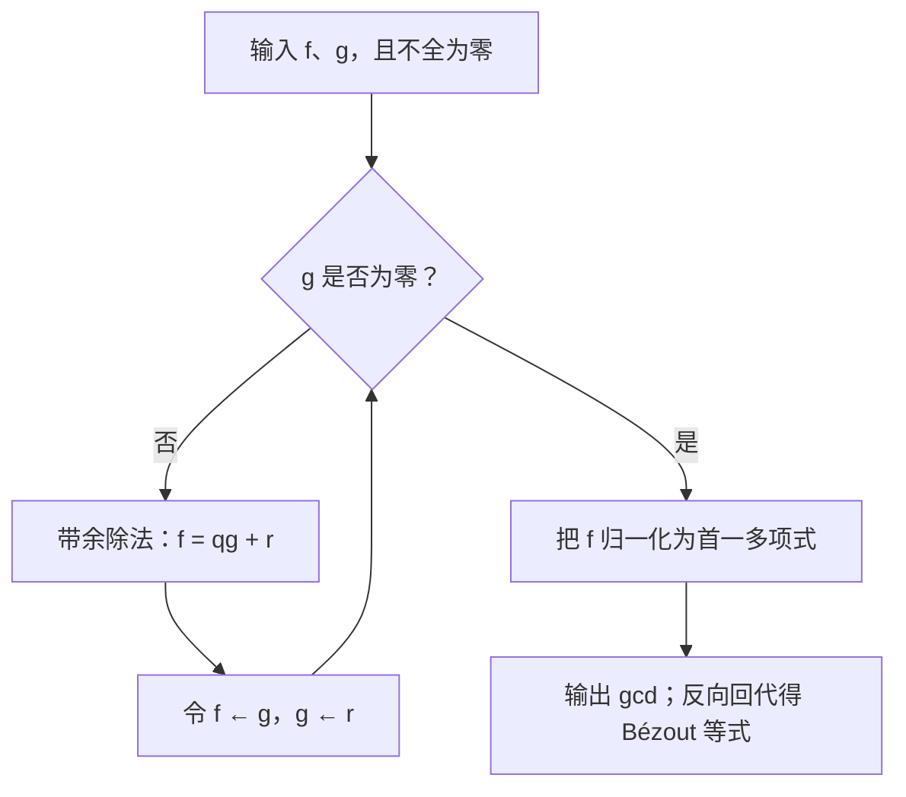

多项式这一章的核心不是求出更多根式，而是把“整除”变成一种组织结构的工具。带余除法提供算法，最大公因式提供互素性，互素性提供唯一分解和直和，根则把代数结构与函数图像联系起来。

**统一约定。** 本章的数域指 $\mathbb C$ 的、包含 $1$ 的子域，例如 $\mathbb Q,\mathbb R,\mathbb C$。因而它们特征为零，并且包含 $\mathbb Q$。$\mathbb F[x]$ 是形式多项式环；讨论整数系数时另写 $\mathbb Z[x]$。所有最大公因式在域上取首一形式。零多项式的次数不按普通非负整数处理，次数公式仅对注明的非零多项式使用。

## 3.1 竞赛要点与难点

| 问题信号 | 方法 | 易错点 |
| --- | --- | --- |
| 求公因式、证明互素 | 带余除法、辗转相除、Bézout 等式 | 把互素误当作差为常数 |
| 判断是否有重因式 | $\gcd(f,f')$ | 只看图像，未区分根的重数 |
| 有理系数下判断不可约 | Gauss 引理、Eisenstein、模素数约化 | 无有理根只排除一次因子 |
| 已知全部根但不想逐一求根 | Vieta、对称多项式、Newton 恒等式 | 忘记首项系数与符号 |
| 矩阵满足多项式恒等式 | 最小多项式、除法、互素分解 | 认为任意零化多项式都是最小多项式 |

每次写“不可约”都应问：**在哪个系数域上？** $x^2-2$ 在 $\mathbb Q$ 上不可约，在 $\mathbb R$ 上可约；$x^2+1$ 在 $\mathbb R$ 上不可约，在 $\mathbb C$ 上可约。

## 3.2 数域、一元多项式、整除与带余除法

### 形式多项式与基本性质

$f(x)=a_0+a_1x+\cdots+a_nx^n$ 是有限个系数组成的形式表达式。若 $a_n\ne0$，次数为 $n$；首项系数为 $1$ 时称首一。多项式相等指各次幂系数相等。

对非零 $f,g\in\mathbb F[x]$，首项相乘仍非零，因此

$$
\deg(fg)=\deg f+\deg g.
$$

所以多项式环无零因子，且单位恰是非零常数。加法只有 $\deg(f+g)\le\max(\deg f,\deg g)$，最高次项可能抵消。

若存在 $h\in\mathbb F[x]$ 使 $f=gh$，称 $g\mid f$。非零常数整除所有多项式；每个非零多项式都整除零多项式。整除具有传递性，且若 $g\mid f_1,f_2$，则 $g\mid u f_1+v f_2$。

### 带余除法为何成立且唯一？

给定 $g\ne0$，存在唯一 $q,r$ 使

$$
\boxed{f=qg+r,\qquad r=0\text{ 或 }\deg r<\deg g.}
$$

存在性：若被除多项式次数不低于 $g$，用首项之商乘 $g$ 并相减，次数严格下降，有限步结束。这里需要除以 $g$ 的首项系数，所以使用系数域，而不是无条件使用 $\mathbb Z$。

唯一性：若有两组商余式，$(q_1-q_2)g=r_2-r_1$。若商差非零，左边次数至少为 $\deg g$，右边次数小于它，矛盾。

**例。**

$$
x^3-2x+1=x(x^2-1)+(-x+1).
$$

因此商为 $x$，余式为 $1-x$。在整数系数中，$x$ 除以 $2x+1$ 的商需要 $1/2$，不能宣称带余除法始终留在 $\mathbb Z[x]$；当除式首一时则可留在整数系数中。

## 3.3 最大公因式、最小公倍式、互素与辗转相除

对不全为零的 $f,g$，首一最大公因式 $d$ 满足：$d\mid f,g$，且任意公因式都整除 $d$。首一条件排除非零常数倍的不唯一性。

若 $f=qg+r$，则 $f,g$ 与 $g,r$ 有完全相同的公因式，所以

$$
\gcd(f,g)=\gcd(g,r).
$$

反复带余除法，余式次数严格下降，最后一个非零余式归一化后就是最大公因式。这是 Euclid 辗转相除法。

### 一次完整计算与 Bézout 等式

取 $f=x^3-2x+1,g=x^2-1$。有

$$
f=xg-(x-1),\qquad g=-(x+1)(1-x).
$$

所以 $\gcd(f,g)=x-1$，并且第一步立刻给出

$$
x-1=xg-f.
$$

一般反向回代可得到

$$
\boxed{\gcd(f,g)=uf+vg,\qquad u,v\in\mathbb F[x].}
$$

当最大公因式为 $1$ 时称互素。因此 $f,g$ 互素，当且仅当存在 $u,v$ 使 $uf+vg=1$。

**应用。** 若 $f\mid gh$ 且 $\gcd(f,g)=1$，则由 $uf+vg=1$ 乘 $h$，得到 $h=ufh+vgh$，右边两项都被 $f$ 整除，所以 $f\mid h$。这个性质是多项式唯一分解证明的关键。

对非零 $f,g$，首一最小公倍式是被两者整除、并整除所有公倍式的首一多项式。若先把 $f,g$ 归一化为首一形式，则

$$
\boxed{\gcd(f,g)\operatorname{lcm}(f,g)=fg.}
$$

一般未归一化时右边也要除以其首项系数。对每个不可约因子，最大公因式取两者指数的较小值，最小公倍式取较大值。

### 算法流程

每次非零余式次数下降是算法终止的理由，不是靠试算经验保证终止。

## 3.4 不可约多项式与唯一因式分解

### 不可约与素因子的区别为何在这里消失？

次数至少为 $1$ 的多项式 $p$ 不可约，指不能写成两个正次数多项式的乘积。若不可约 $p$ 整除 $fg$，则要么 $p\mid f$，要么 $\gcd(p,f)=1$；后一种情况由上一节的性质推出 $p\mid g$。因此在 $\mathbb F[x]$ 中不可约多项式也是素因子。

注意非零常数是单位，不叫不可约多项式；零多项式也不属于此定义。

### 分解的存在性与唯一性

对任意非零多项式，若它可约就分成两个更低次数的因子，再继续。次数下降保证最终结束。于是

$$
\boxed{f=c\,p_1^{m_1}\cdots p_s^{m_s},}
$$

其中 $c$ 是非零首项系数，$p_i$ 是互不相同的首一不可约多项式，$m_i$ 为正整数。非零常数对应空乘积。这称为标准分解。

唯一性：若存在两种分解，第一种中的 $p_1$ 整除第二种因子的乘积，素因子性质保证它整除其中一个不可约因子；两个首一不可约因子因此相同。消去该因子并归纳，最终指数也相同。

所以“唯一”允许因子次序改变；若不要求首一，还应允许因子乘非零常数。

## 3.5 多项式函数、余数定理、根与重根

### 形式对象与函数对象

把 $x$ 代入 $a\in\mathbb F$，得到多项式函数 $a\mapsto f(a)$。本章数域无限，因此两个多项式若在所有点取值相同，则系数相同：非零 $n$ 次多项式至多有 $n$ 个不同根。

根数上界的证明用因式定理与次数归纳，不需要代数基本定理。它不能直接照搬到有限域上的“函数相同就多项式相同”；本章的数域假设正好避开了这个区别。

### 余数定理与因式定理

将 $f$ 除以 $x-a$，余式是常数 $r$，代入 $x=a$ 得 $r=f(a)$。因此

$$
\boxed{f(a)=0\ \Longleftrightarrow\ (x-a)\mid f.}
$$

若 $(x-a)^m\mid f$ 而 $(x-a)^{m+1}\nmid f$，称 $a$ 是 $m$ 重根。此定义可在包含根的扩域中使用，根不必属于原系数域。

### 导数判别：重因式的代数检验

形式导数为 $f'=sum_{k\ge1}ka_kx^{k-1}$。若 $f=(x-a)^m h$、$h(a)\ne0$，则

$$
f'=(x-a)^{m-1}\bigl(mh+(x-a)h'\bigr),
$$

括号在 $a$ 处等于 $mh(a)\ne0$，因为特征为零。因此重数恰下降一。

于是 $a$ 是至少二重根，当且仅当 $f(a)=f'(a)=0$；重数恰为 $m$，当且仅当

$$
f(a)=f'(a)=\cdots=f^{(m-1)}(a)=0,\qquad f^{(m)}(a)\ne0.
$$

对一般不可约因子同理，次数为正的不可约 $p$ 与 $p'$ 互素，故若 $f=c\prod_i p_i^{m_i}$，

$$
\boxed{\gcd(f,f')=\prod_i p_i^{m_i-1}.}
$$

因此非零 $f$ 无重因式，当且仅当 $\gcd(f,f')=1$。这一公式的特征零条件不可随意删除。

**例。** $f=(x-1)^3(x+2)^2$，所以 $\gcd(f,f')=(x-1)^2(x+2)$。去掉所有重复次数的首一多项式为 $f/\gcd(f,f')=(x-1)(x+2)$。

### 可视化：偶重根与奇重根

考察族

$$
p_t(x)=(x-1)^2(x-t).
$$

当 $t\ne1$ 时，$1$ 是二重根、$t$ 是单根，$\gcd(p_t,p_t')=x-1$；当 $t=1$ 时变为三重根，最大公因式变为 $(x-1)^2$。

::algebra-explorer{mode="polynomial"}
::

图中蓝线为 $p_t$，橙线为导数。将滑块移到 $t=1$，两根合并，原来的“接触横轴”变成三重根处的“穿过横轴”，但导数仍为零。更一般，在实根 $a$ 附近写 $f(x)=(x-a)^m h(x)$、$h(a)\ne0$：$h$ 在邻域内符号不变，所以奇重根两侧变号，偶重根两侧不变号。这一结论由分解证明，图像只是展示它。

## 3.6 代数基本定理与实、复系数分解

**代数基本定理：** 每个非常数复系数多项式至少有一个复根。结合因式定理反复分解，$n$ 次复系数多项式按重数计恰有 $n$ 个根，且

$$
f(x)=a_n\prod_{j=1}^n(x-\alpha_j).
$$

代数基本定理的证明需要超出本章整除理论的工具，这里将它作为基础定理使用，不把“分解到一次因子”当成不需证明的纯形式操作。

若 $f$ 的系数为实数，$f(\overline z)=\overline{f(z)}$，所以非实根成共轭对出现，重数也相同。对 $\alpha=a+bi$、$b\ne0$，

$$
(x-\alpha)(x-\overline\alpha)=x^2-2ax+(a^2+b^2),
$$

其判别式为 $-4b^2<0$。因此实系数不可约多项式恰是一次多项式和判别式小于零的二次多项式；一般实系数多项式唯一分解为这两类因子的乘积。

**例。**

$$
x^4+1=(x^2+\sqrt2x+1)(x^2-\sqrt2x+1)
$$

是实不可约因子的分解，两二次因子的判别式均为 $-2$。在 $\mathbb Q$ 上却不可约：令 $x=y+1$，得到 $y^4+4y^3+6y^2+4y+2$，用素数 $2$ 的 Eisenstein 判别即可证明；下一节说明这个方法。

## 3.7 本原多项式、Gauss 引理与有理系数因式分解

### 内容与本原性

非零整数系数多项式的内容 $c(f)$ 是所有系数的正最大公因数。本原多项式指内容为 $1$。本原不等于首一，例如 $2x+3$ 本原但不首一。

每个非零 $f\in\mathbb Z[x]$ 都能写成 $c(f)f_0$，其中 $f_0$ 本原。对 $\mathbb Q[x]$ 的多项式，先清分母，再提取内容，可写成有理常数乘本原整数多项式。

### Gauss 引理的证明

**引理：两个本原整数多项式的乘积仍本原。** 若乘积的所有系数都被素数 $p$ 整除，将系数约化到 $\mathbb F_p$，有 $\overline f\,\overline g=0$。本原性保证二者约化均非零，而 $\mathbb F_p[x]$ 无零因子，矛盾。

提取内容后立刻得到 $c(fg)=c(f)c(g)$。

**推论：** 正次数的本原 $f\in\mathbb Z[x]$ 在 $\mathbb Q[x]$ 中可约，当且仅当它能分解成两个正次数的整数系数多项式。

解释清分母时的关键：若 $f=gh$，将 $g,h$ 分别写成有理常数乘本原整数多项式 $g_0,h_0$，便有 $f=\gamma g_0h_0$。$g_0h_0$ 本原，$f$ 也本原，因此比较系数公因数可推出 $\gamma=\pm1$，把符号并入某一个因子即可。

这个结论允许我们用整数系数和素数整除来证明有理数域上的不可约性。它不意味着可约时必须有整数根，因子也可能是二次或更高次数。

### 模素数约化的判别

若 $f\in\mathbb Z[x]$ 本原，素数 $p$ 不整除首项系数，且 $\overline f\in\mathbb F_p[x]$ 不可约，则 $f$ 在 $\mathbb Q$ 上不可约。否则整数因式分解约化后仍保持两个因子的正次数，矛盾。

反向一般不成立：模 $p$ 可约不表示原多项式在 $\mathbb Q$ 可约。首项系数不被 $p$ 整除保证次数不下降，不能省略。

## 3.8 Eisenstein 判别与有理根定理

### Eisenstein 判别

设 $f=a_nx^n+\cdots+a_0\in\mathbb Z[x]$，$n\ge1$。若存在素数 $p$ 使

$$
\boxed{p\nmid a_n,\qquad p\mid a_0,a_1,\ldots,a_{n-1},\qquad p^2\nmid a_0,}
$$

则 $f$ 在 $\mathbb Q[x]$ 上不可约。

证明可先提取内容；内容不被 $p$ 整除，条件保持。若本原部分分为两个正次数整数因子，模 $p$ 后乘积是非零常数乘 $x^n$。两因子的首项不被 $p$ 整除，因此模 $p$ 后仍正次数，且只能分别是常数乘 $x^r,x^{n-r}$。二者常数项都被 $p$ 整除，原常数项便被 $p^2$ 整除，矛盾。

**例一。** $x^n-2$ 对 $p=2$ 满足条件，故在 $\mathbb Q$ 上不可约。

**例二：先平移再判别。**

$$
f(x)=x^4+1,\qquad f(y+1)=y^4+4y^3+6y^2+4y+2.
$$

后者对 $p=2$ 满足条件，故不可约。代换 $x=y+1$ 是多项式环的可逆变换，逆为 $y=x-1$，保持可约性，所以原多项式不可约。Eisenstein 条件不满足时，只能说此方法未判定，不能说可约。

### 有理根定理

若整数系数 $f=a_nx^n+\cdots+a_0$ 有既约有理根 $r/s$，$s>0$、$\gcd(r,s)=1$，且 $a_0\ne0$，则

$$
\boxed{r\mid a_0,\qquad s\mid a_n.}
$$

将 $f(r/s)=0$ 乘以 $s^n$，模 $r$ 与模 $s$ 分别比较，并利用互素性即可得到。若 $a_0=0$，先提出 $x$，零是已经知道的根。

首一整数多项式的有理根必为整数。**例。** $2x^3-3x^2-8x+12$ 的候选根来自 $r\mid12,s\mid2$；代入 $3/2$ 可验证为根，除法得到

$$
2x^3-3x^2-8x+12=(2x-3)(x^2-4)=(2x-3)(x-2)(x+2).
$$

候选清单是必要条件，不是“清单里每个数都是根”。二次、三次多项式在一个域上可约，当且仅当在该域上有根；次数至少四时失效。例如

$$
x^4+4=(x^2-2x+2)(x^2+2x+2)
$$

在 $\mathbb Q$ 上可约，却没有实根，更没有有理根。

## 3.9 多元多项式与对称多项式

### 多元多项式与次数

$\mathbb F[x_1,\ldots,x_n]$ 由有限个单项式 $c x_1^{a_1}\cdots x_n^{a_n}$ 的和组成。单项式总次数为 $a_1+\cdots+a_n$，多项式总次数是非零项的最大总次数；也可以分别谈关于某个变量的次数。

若各项总次数相同，则称齐次。把所有变量同时乘 $t$，$d$ 次齐次多项式满足 $f(tx_1,\ldots,tx_n)=t^d f(x_1,\ldots,x_n)$。第二章的二次型就是二次齐次多项式。

### 基本对称多项式

对任意变量排列值都不变的多项式称对称多项式。基本对称多项式为

$$
e_1=\sum_i x_i,\quad
e_2=\sum_{i<j}x_ix_j,\quad\ldots,\quad
e_n=x_1\cdots x_n.
$$

它们是从一次到 $n$ 次的对称对象。注意 $x_1^2x_2+x_2^2x_3+x_3^2x_1$ 只有循环对称，一般不是对所有排列都对称。

**对称多项式基本定理：** 每个对称多项式都能唯一表示为 $e_1,\ldots,e_n$ 的多项式。

构造思路：按字典序取最高单项式 $x_1^{a_1}\cdots x_n^{a_n}$。对称性保证 $a_1\ge\cdots\ge a_n$；而

$$
e_1^{a_1-a_2}e_2^{a_2-a_3}\cdots e_{n-1}^{a_{n-1}-a_n}e_n^{a_n}
$$

恰有这个最高单项式且系数为 $1$。减掉合适倍数后继续。逐个齐次部分处理时，固定总次数的单项式只有有限个，所以算法结束。不同的 $e_i$ 单项式对应不同的最高 $x_i$ 单项式，也给出表示唯一性。

### 两个实用恒等式

$$
\sum_i x_i^2=e_1^2-2e_2.
$$

对于三个变量，展开 $(x_1+x_2+x_3)(x_1x_2+x_1x_3+x_2x_3)$ 可得

$$
\sum_{\mathrm{sym}}x_1^2x_2=e_1e_2-3e_3,
$$

其中左边是六个不同的 $x_i^2x_j$、$i\ne j$ 的和。一定写明求和范围，别把六项对称和与三项循环和混在一起。

## 3.10 Vieta 定理与 Newton 恒等式

若 $f(x)=a_nx^n+a_{n-1}x^{n-1}+\cdots+a_0$ 的根按重数列为 $\alpha_1,\ldots,\alpha_n$，则展开
$a_n\prod_i(x-\alpha_i)$ 得到

$$
\boxed{e_k(\alpha_1,\ldots,\alpha_n)
=(-1)^k\frac{a_{n-k}}{a_n},\qquad1\le k\le n.}
$$

这就是 Vieta 定理。它把对称根表达式变成系数表达式，通常无需求每个根。

记幂和 $p_k=\sum_i\alpha_i^k$。前几条 Newton 恒等式为

$$
p_1=e_1,\quad p_2=e_1p_1-2e_2,\quad
p_3=e_1p_2-e_2p_1+3e_3.
$$

一般 $1\le k\le n$ 时，

$$
p_k-e_1p_{k-1}+e_2p_{k-2}-\cdots
+(-1)^{k-1}e_{k-1}p_1+(-1)^k k e_k=0.
$$

$k>n$ 时递推式变为

$$
p_k-e_1p_{k-1}+\cdots+(-1)^n e_np_{k-n}=0.
$$

一个统一推导令 $E(t)=\prod_i(1-\alpha_i t)=\sum_{j=0}^n(-1)^je_jt^j$，$e_0=1$。作为形式幂级数，

$$
-\frac{tE'(t)}{E(t)}
=\sum_i\frac{\alpha_it}{1-\alpha_it}
=\sum_{k\ge1}p_kt^k.
$$

两边乘 $E(t)$ 并比较系数，就得到上述公式。它是形式恒等式，不需要讨论 $t$ 的解析收敛区间。

**例。** $x^3-3x+1$ 的根为 $\alpha,\beta,\gamma$。Vieta 给出 $e_1=0,e_2=-3,e_3=-1$，所以

$$
\alpha^2+\beta^2+\gamma^2=6,\qquad
\alpha^3+\beta^3+\gamma^3=-3.
$$

第二式也可直接将每个根代入 $x^3=3x-1$ 后求和。用两种方法交叉验证，可以及时发现符号错误。

## 3.11 综合应用：插值、矩阵多项式与不变子空间

### 插值的唯一性来自根数上界

给定互异的 $a_1,\ldots,a_n$ 与函数值 $b_1,\ldots,b_n$，存在唯一次数小于 $n$ 的多项式

$$
f(x)=\sum_{i=1}^n b_i
\prod_{j\ne i}\frac{x-a_j}{a_i-a_j}.
$$

代入节点证明存在；两解相减是次数小于 $n$ 且有 $n$ 个根的多项式，故为零。这也解释第一章 Vandermonde 矩阵在节点互异时可逆。

若除式含重根，余式不仅受函数值约束，还受导数约束。例如 $m(x)=(x-1)^2(x+2)$，$f-r$ 被 $m$ 整除当且仅当

$$
r(1)=f(1),\quad r'(1)=f'(1),\quad r(-2)=f(-2),
$$

其中 $\deg r<3$。仅在两个不同节点匹配函数值不够。

### 矩阵多项式的最小多项式

固定方阵 $A$，存在非零 $f$ 满足 $f(A)=0$，例如第一章的特征多项式。取最低次数的首一零化多项式为 $m_A$。

若 $f(A)=0$，除法 $f=qm_A+r$ 给出 $r(A)=0$；最低次数性迫使 $r=0$。所以

$$
\boxed{f(A)=0\ \Longleftrightarrow\ m_A\mid f.}
$$

进而 $m_A\mid\chi_A$。计算 $A^k$ 或 $f(A)$ 时，只需求相应多项式除以 $m_A$ 的余式。它的次数可能远小于矩阵阶数，这正是最小多项式的计算价值。

### Bézout 等式构造直和投影

若 $f,g$ 互素，且 $f(A)g(A)=0$，取 $uf+vg=1$，代入矩阵得到

$$
I=u(A)f(A)+v(A)g(A).
$$

对任意 $w$，第一项作用后的向量属于 $\ker g(A)$，第二项属于 $\ker f(A)$。因为所有 $A$ 的多项式互相交换，可以用 $f(A)g(A)=0$ 验证。

若向量同时属于这两个核，作用上面的单位恒等式就得到它为零。因此

$$
\boxed{V=\ker f(A)\oplus\ker g(A).}
$$

**例。** 若 $A^2=I$，取 $f=x-1,g=x+1$，有

$$
I=\frac{I+A}{2}+\frac{I-A}{2},\qquad
V=\ker(A-I)\oplus\ker(A+I).
$$

两个矩阵分别是到特征值 $1$、$-1$ 子空间的投影。这连接了第一章的可对角化与第二章的直和；不要求这两个子空间在给定内积下正交。

## 3.12 自测与解答

1. 求 $\gcd(x^4-1,x^3-1)$ 和首一最小公倍式。
2. 已知 $f=(x^2+1)^3(x-2)$，求 $\gcd(f,f')$，并分别说明实数域与复数域中的根结构。
3. 证明 $x^5+10x+5$ 在 $\mathbb Q$ 上不可约。
4. “整数多项式没有有理根，所以不可约”在哪些次数成立？给出四次反例。
5. 若 $\alpha,\beta,\gamma$ 是 $x^3-2x^2+3x-4$ 的根，求平方和与立方和。
6. 矩阵 $A$ 满足 $A^2-3A+2I=0$，证明它可对角化，并求到两类特征空间的投影。

### 解答

1. 公因式为 $x-1$；首一最小公倍式为 $(x^4-1)(x^3-1)/(x-1)$。可用 $x^4-1=x(x^3-1)+(x-1)$ 开始辗转相除。
2. 最大公因式为 $(x^2+1)^2$。在 $\mathbb R$ 上标准分解包含一个三次幂的不可约二次因子和一个一次因子；在 $\mathbb C$ 上 $i,-i$ 各为三重根，$2$ 为单根。
3. 对素数 $5$：首项系数不被 $5$ 整除，其余系数（包括零系数）均被 $5$ 整除，常数项不被 $25$ 整除。
4. 二次、三次成立；四次取 $x^4+4$，它分成两个有理二次因子，却没有有理根。
5. $e_1=2,e_2=3,e_3=4$，故 $p_2=4-6=-2$，$p_3=2(-2)-3(2)+3(4)=2$。平方和可以为负，因为根未必全实。
6. 最小多项式整除 $(x-1)(x-2)$，因此在所用数域上分裂且无重根，可对角化。投影为 $P_1=2I-A$、$P_2=A-I$；它们和为 $I$、乘积为零、各自幂等，且 $(A-I)P_1=0$、$(A-2I)P_2=0$。

三章合在一起的主线是：消元找到秩与核，多项式找到不变分解，换基让结构显现；带内积时再要求正交或酉，才能把代数结构解释成长度、角度与主轴。
