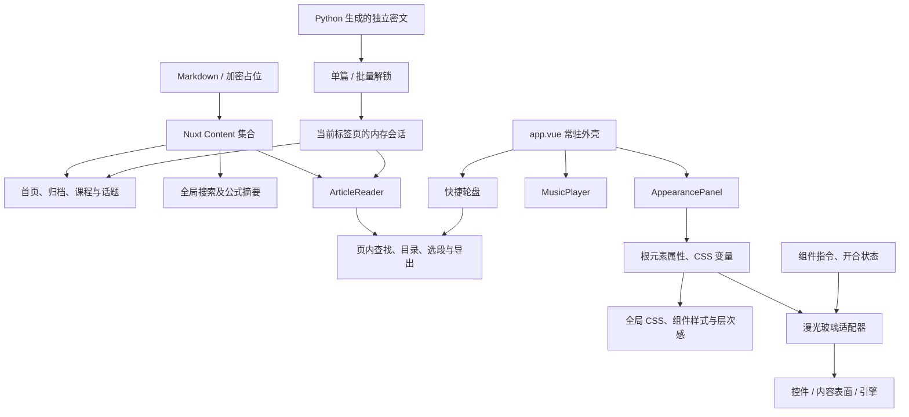

# Inkroam 代码整理与性能改进计划

2026-11-18，以 `main@0e46b0c` 为基线。当前阶段已审阅源码、Git 修改记录和既有验收文档。下列施工批次尚待实施。文中标为“待测”的项目需要运行时证据。

## 1. 工程目标和判断依据

让维护者能从一次用户操作找到负责的代码，知道谁保存状态、谁负责渲染，以及取消操作后由谁收尾。保留已经上线的视觉、交互、旧版偏好、文章路径和内容格式。功能缺陷单列，涉及可见行为变化时独立交付。

用三件可复核的事情衡量成效：

1. 对照同类历史修改，列出下一次修改需要触及的位置。组件和它的行为检查同时变化很合理；同一个默认值、偏移量或检查总数需要在多个位置手工同步，才值得消除。
2. 对结构调整，比较输入相同情况下的可观察结果，包括首帧、退场最后一帧、焦点、阅读位置和已保存的设置。文件缩短本身不能证明设计变得好维护。
3. 对性能调整，在同设备、同设置、同操作下记录前后数据。优先确认哪次 DOM 读取、贴图更新或数据查询可以省掉，再决定是否改变实现。

### 第一次接手的人能否独立维护

Inkroam 目前最费力的一步，往往发生在找到相关代码之后：维护者还得弄清楚“改这里就够了吗？”。移动端底栏的定位规则分散在多个媒体块里，外观面板的生命周期又被多份检查脚本分别模拟。这些关系让小修改依赖原开发者的记忆。后续整理以第一次接手仓库的人为准：仅凭代码和仓库文档，他应能找到生效位置、说清影响范围，选出能验证这次修改的检查。

| 用一个真实任务交接 | 怎样判断整理有效 |
| --- | --- |
| 调整手机底栏入口的留白 | 从音乐或显示入口出发，能指出当前视口下决定底部距离的声明，并说明横屏和安全区域如何影响它。历史上同一处布局连续改了三笔，最后才找到获胜规则，详见下节。 |
| 调整外观面板的内部实现 | 一次生命周期调整曾让三份模拟脚本同步修改。整理后，共用的装载逻辑只需维护一处；检查失败时，维护者能看出受影响的是旧偏好恢复、最近条数还是面板交互。 |
| 给现有课程新增一篇加密笔记 | 这是已有的良好范例：沿用导入入口即可生成占位文件、密文和登记项。接手者凭导入说明就能完成任务，无需了解播放器、搜索或玻璃渲染。 |

每批收尾时，在变更记录里回答一个问题：“下一位维护者遇到同类需求，从哪里开始，怎样知道已经改全？”若答案仍依赖聊天记录、原作者口述或 AI 扫描半个仓库，就把那个隐含依赖列为待办。

## 2. 历史修改暴露了哪些依赖

以下是对实际提交的抽样。提交号可直接用于 `git show`，选择它们是因为同一项修改的原因、补救和检查可以互相印证。

| 修改 | 发生了什么 | 对本计划的影响 |
| --- | --- | --- |
| `7999780` → `bfe7031` → `143ee6b` | 三笔都只改 main.css。先对齐音乐与显示入口，再给移动显示面板留空间，最后还要在实际获胜的视口规则里落实间距。 | 这是“只改一个文件仍然很难改”的实例。第一批 CSS 选移动底栏定位，追踪属性在不同媒体条件下最后由谁决定。 |
| `bc46df2` + `f002c79` | 导航已启动选中弹簧，page:finish 刷新又将它立即定位。修复在玻璃控件的布局刷新分支，另有行为检查。 | 保留“选中目标改变”与“页面布局刷新”的区别。普通控件可以即时对齐，正在移动的导航指示器有自己的运动状态。 |
| `b58a75d` → `766c1ee`，以及 `cb06461` | 正文工具的首次激活经历了预热方案调整；搜索页后来单独调整入场目标，仅移动内部文字，保持玻璃卡片稳定。 | 把首次打开、再次打开、路由入场分别列作验收场景。抽公共动画时必须知道哪一层真的可以移动。 |
| `254b011`、`2ef930a`、`e351e88` | 生命周期钩子变更波及多份组件模拟检查；错误页检查调整了配置源码的提取方式；密钥导入的应用路径修复又需要调整 Node 检查加载方式。 | 审阅哪些断言保护用户行为，哪些依赖源码拼接或模拟器细节。只替换已给正常修改带来负担的部分。 |
| `fe99ebc` → `0e46b0c` | 批量解锁将会话元数据接入多处列表；之后新增两篇加密笔记沿用了既有导入机制。 | 将“新增内容”和“改变内容展示规则”分开衡量。应保留加一篇笔记只交付占位、密文和登记的能力；列表展示规则有重复处理可收拢。 |

## 3. 现有架构与状态所有者

| 领域与入口 | 修改前需要知道的所有权和边界 |
| --- | --- |
| [外壳](../app/app.vue)、[路由](../app/router.options.ts)、[滚动访问](../app/utils/page-scroll.ts) | 路由改变正文，外壳、播放器与设置面板常驻。细指针桌面和触摸环境可能使用不同滚动元素。目录、选段、返回、刷新和导航伸缩共享这一约定。 |
| [偏好读取](../app/utils/appearance-storage.ts)、[阅读外观](../app/components/AppearancePanel.vue)、[Nuxt 首帧](../nuxt.config.ts) | 初始 HTML、挂载后恢复、手动设置、系统明暗变化是四个入口。v5 优先、v4 模糊值迁移、自定义壁纸、共享 PDF 偏好都涉及已有用户。 |
| [表面注册](../app/utils/glass-surfaces.ts)、[适配器](../app/utils/experimental-glass.ts)、[控件](../app/utils/glass-controls.ts)、[层次感接收面](../app/components/DepthReceivers.vue) | 开关、材质与分项/全局质量决定是否附加光学表面。注册、实际可见、可交互、休眠、销毁是不同状态。层次感还需要导航与接收面的几何数据。 |
| [正文](../app/components/ArticleReader.vue)、[正文工具](../app/components/ArticleTools.vue)、[轮盘](../app/components/QuickRadialMenu.vue) | 普通文档走 ContentRenderer，解锁文档提供客户端正文 DOM。正文工具操作当前文档；轮盘复用实际按钮，同步触发保证剪贴板与全屏操作保有用户激活。 |
| [音乐](../app/components/MusicPlayer.vue)、[本地曲库](../app/utils/local-music.ts)、[PDF 入口](../app/components/content/PdfViewer.vue) | 播放器持有播放意图、真实媒体状态、面板几何；文件在 IndexedDB。PDF 原生嵌入与自带阅读器按能力分流，自带阅读器负责文字搜索、渲染取消与 worker 清理。 |
| [公共搜索](../app/pages/search.vue)、[课程导航](../app/components/CourseNavigation.vue)、[私密会话](../app/composables/useUnlockedNotes.ts) | 搜索的完整正文与分节索引承担公式摘要和匹配。列表读取摘要，私密标题仅在标签页内叠加。公共索引、SEO、静态数据独立于私密会话。 |
| [导入工具](../scripts/encrypt-note.py)、[发布保护](../scripts/lib/encrypted-notes-guard.ts)、[CI](../.github/workflows/deploy.yml) | Python 在本地备份、生成独立密钥并加密；Nuxt 校验登记占位与密文。CI 使用仓库子路径生成，类型、源码、产物检查通过后发布静态目录。 |

## 4. 三条需要逐帧理解的操作

**阅读外观打开 → 进入二级菜单 → 立即返回。** `navigateAppearance` 先读取当前呈现高度，取消旧动画，保存原页滚动，切换页面，再于 nextTick 测量目标高度、恢复焦点与滚动。模板的 v-show、inert、Vue Transition 和 v-glass-presence 各自负责一部分；玻璃需要一直保留到实际退场结束。页面切换和高度动效完成时均有表面更新通知。审计时区分通知次数、适配器同步次数和真正重建的贴图数，它们有不同的成本。[面板实现](../app/components/AppearancePanel.vue) · [退场时序](../app/utils/glass-motion.ts)

**导航或正文工具按下 → 拖动 → 松手 → 路由完成。** 导航根据当前路由和按钮几何定位普通指示器。玻璃控件另外处理按压、运动、光学对齐与释放，适配器在页面完成后刷新布局。正文工具的面板使用网格裁剪进退，以便移动过程中采样背景。共同契约应限定在选中项、测量失效、取消与结束；保留各控件现有的弹簧、中心对齐、松手尺寸变化和裁剪行为。[导航](../app/components/SlidingNav.vue) · [控件运动](../app/utils/glass-controls.ts) · [正文工具动效](../app/utils/article-tool-motion.ts)

**批量解锁 → 课程列表 → 正文 → 导出或重新锁定。** 密钥文件按需解析，确认后逐篇尝试；成功结果进入内存会话，列表按路径读取私密元数据。正文解锁后提供目录与正文工具，导出再验钥；锁定、pagehide 或组件卸载分别清理其对应资源。整理这条链只用合成笔记、合成密钥验收。[批量解锁](../app/components/BatchDecryptSettings.vue) · [私密渲染](../app/utils/render-private-markdown.ts) · [导出](../app/components/ArticleTools.vue)

## 5. 施工顺序与交付边界

建议先完成 A 和 B 的小范围试点。B 的结果决定是否值得扩大 CSS 调整；C、D 共用一套开合与拖动基线。E、F 可按实际维护频率独立安排。G 是候选版本的最后一道验证。每批可以单独提交或回退，避免把功能纠错、文件移动、性能调优揉进同一份 diff。

### A　先让检查反映实际风险

**本批首先精简 `.mjs` 的重复工作。** 以 `git ls-files -- '*.mjs'` 盘点，基线有 **53 个**已跟踪文件。按实际入口分为下表六类；同一个混合套件只计一个文件。

| 当前用途 | 文件数 | 入口和处理意向 |
| --- | ---: | --- |
| 运行器登记的检查 | 44 | 九组的完整名称在 [check-all.mjs](../scripts/check-all.mjs)。38 个进默认阶段，另有 4 个纯产物和 2 个在线专用。逐套核对它保护的失败情形；混合套件另审重复执行。 |
| 检查运行器 | 1 | package.json 的 check 指向 check-all.mjs；负责选择、进程隔离和汇总退出码。 |
| 单独运行的检查 | 4 | check-study-code 编译课程 C 代码；check-css-cleanup 对照历史基线；check-quick-radial 和 check-nsga-ii 检查特定交互和算法。记录手动入口与适用时机，再决定是否已有等价覆盖。 |
| 性能诊断 | 2 | analyze-depth-traces、inspect-depth-capture 用于历史 trace。后者的文档明确指出旧脚本的 renderer 选择和归因局限；优先标明适用输入，评估旧入口是否仍有独立用途。 |
| 出图 | 1 | scripts/figures/competition-geometry.mjs，用于课程配图。 |
| 站点运行时 | 1 | app/utils/tree-walk.mjs 由 TreeWalk.vue 和教学回归共同导入；删除会影响正文可视化。 |

**静态审阅已经发现三类可动手的冗余。**

1. **同一份工作在两个 CI 阶段执行。** generate 前后按编排共启动 38 + 11 = 49 次检查子进程。两阶段都选中 reading-links、technical-prose、about-resident、error-page、topics、competition-algebra、reading-polish。运行器在纯产物模式下给子脚本传 `--built`，子脚本仍从头运行。例如 reading-polish 从第 9 行开始检查上下篇、排序与边界，到第 30 行才进入产物分支。这些纯逻辑断言在同一次发布中执行两遍。优先在现有文件里区分阶段，只执行本阶段断言；为生成内容查验所需的共同输入保留一次初始化。保留用户直接运行 `--built` 的既有效果。验收看断言实际进入哪个分支；子进程数可能仍是 49，不能据此判断是否省下工作。
2. **三个文件复制了同一种组件模拟。** reading-appearance、appearance-mode、recent-counts 都读取 AppearancePanel.vue、准备生命周期钩子并模拟组件执行。提交 `254b011` 为一次 onBeforeUnmount 变化同时修了三处。先列出各自独有的失败样本（偏好迁移、面板行为、最近条数），共用一份组件装载/清理代码或直接调用抽出的纯函数。保留各用例独立的存储和 Vue 状态。另审 e351e88 的加密脚本加载适配：专用模拟只有一个调用方，不足以支持再建通用加载框架。
3. **部分断言在阻碍等价重构。** check-technical-prose 第 60 行匹配一整条 CSS 声明的固定顺序；check-nav-sticky-offset 第 69 行要求 shell 和 header 至少各有五条被解析的规则。后者还另行验证多个视口下的实际偏移关系。把“规则必须足够多”列为删除候选，先证明当某个视口出现错误偏移时，保留的断言确实会失败。对前者，保留代码块状态标签切换时的宽度约束，然后允许等价 CSS 写法。缩进、函数名、声明顺序与数字常量只有在代表独立产品约定时才需要固定。

**怎么决定删哪一个。** 记录候选旧断言的输入、触发路径、预期失败、保留下来的检查位置。先挑一对等价写法，再构造一次真实行为错误：等价修改应通过，错误应被对应检查抓住。仅共享断言文字不构成重复，例如不同组件都检查 reduced-motion，丢失任何一个组件的支持都可能是独立回归。光学边界的像素对称性、产物中的引擎预加载标记、密文完整性、跨视口偏移分别覆盖不同故障，保留各自证据。整套脚本仅在所有独有覆盖有归属且旧调用方已核对后删除，并同步运行器与文档。把多个脚本原样拼进大文件对维护成本帮助有限。

**首笔交付**建议选择 reading-polish 验证源码/产物分流，再推广到另外六个混合套件；第二笔处理 AppearancePanel 的重复装载；第三笔逐个替换或删除低价值断言。分别记录删掉的重复执行块、同一组件需同步修改的模拟入口数、保留下来的独有失败样本。有计时时再报告耗时变化。这里依据当前源码与调用关系判断，尚未逐条证明 44 套里的每个断言等价，也没有得出可以直接删除整套脚本的结论。

- **证据。** [运行器](../scripts/check-all.mjs) 按产品和执行阶段选择套件。[发布门禁](../scripts/check-release-gates.mjs) 同时固定默认 38 套、兼容 built 42 套。新增合法检查曾引发计数失败。轮盘有注明可单跑的专项检查，NSGA-II 有算法检查以及生成 HTML 检查，两者均未在当前运行器登记。
- **动作。** 对照 CI 和 [脚本说明](../scripts/README.md) 标明必跑、按需、历史工具三类。先保护具体契约：源码阶段含加密检查，纯产物阶段含生成页面检查，两者各运行一次；兼容模式取并集，重复分组不重复启动，失败继续汇总且最终退出非零。独立选取关键套件做断言，避免以同一张清单生成实际和预期。按风险决定轮盘、教学专项进入哪一阶段，再更新说明。
- **验收与范围。** 对 runner 的模拟计划分别加入一个合法新套件、移除一个必需套件，前者应能选择，后者应被门禁发现。使用现有 VM harness 即可。后续在触及某模块时才处理它的源码字符串断言；保留调用时序、无 JS 降级等有明确保护对象的检查。CI 原有源码、生成、产物、上传顺序维持。

### B　CSS 先解决一个真实的级联问题

- **起点。** 基线的 main.css 有 3,658 行。移动定位跨越多个媒体块，MusicPlayer 的 scoped CSS 还拥有另一侧入口的尺寸。提交 `143ee6b` 明确区分了早期规则与后方获胜规则。现有 [级联门禁](../scripts/check-css-cascade.mjs) 用 PostCSS 读取 main.css 顶层选择器；媒体块、其他样式文件、Vue scoped 样式超出它的覆盖范围。
- **第一笔。** 只盘点左右底部入口及打开面板的位置。逐项记录属性、声明顺序、选择器优先级、媒体条件、safe-area、祖先定位方式。在 767.98px 两侧、手机横屏、窄窗口细指针分别核对最终位置和来源。只有当两处数值表达同一个布局约定时才共享变量，例如相同设备条件下两侧入口的底部留白。面板相对于触发按钮的距离仍由对应布局计算。
- **第二笔。** 梳理确认窗的尺寸、按钮间距、焦点、遮罩与退出阴影。检查 AppearancePanel、GlassSettings、BatchDecryptSettings、ArticleTools 四个入口。公共外观在统一规则中维护，取消/继续的视觉强调由调用方决定。导出还有二次验钥表单。若只有 CSS 重复就只动 CSS，保留原生 dialog 的焦点和关闭语义。
- **是否拆文件。** 从已证明独立的规则组开始。若要提取，先确定新文件在构建后的实际加载位置；原位于文件不同位置的规则，移动后可能改变相同优先级的胜者。比较构建后的顺序和前后 computed style，并同步级联门禁的读取范围。跨越媒体条件的例外逐条记录；证据不足的规则留在原位。继续整理其他区域的条件是试点能明确回答“下次改这个间距应改哪一处”。

### C　外观状态与玻璃生命周期

- **分清谁负责。** 偏好解析与迁移、解析成具体主题与材质、写根属性、注册 DOM 表面、创建/休眠/销毁光学控制器，分别记录输入与输出。保留现有的 `decodeAppearanceStorage`、`normalizeStoredAppearance` 等已验证边界；提取纯逻辑时将原输入快照作为对照。分项与全局覆盖、默认设置与手动壁纸、纸媒模式、减少透明度、旧偏好缺字段分别有独立含义。
- **实施候选。** 在面板与指令两端追踪同一次操作产生的通知。仅当最终需要更新的表面及其顺序相同时，合并重复同步。保留异步加载后的序号检查、关闭后重开的取消语义、已解码表面的休眠复用，以及首次成功解码才接管材质的时机。改动涉及 render/attach 之前先在控制器边界记录调用数量。
- **独立验收。** 选第一次打开、热打开、开到一半反向关闭、切页后立即返回四个序列。检查第一帧材质、最后一帧阴影、结束后实际活动的表面和观察器；关闭漫光玻璃后普通材质能恢复。只检查最终截图会错过最重要的交接帧。

### D　动画和滚动的所有权与性能

- **先收敛取消责任。** app.vue 的路由动画在双 rAF 内创建，卸载时只遍历已创建的 Animation；其 pagehide 保存回调也缺少对称的解除。候选修改是让外壳同时拥有待执行的帧与已启动的动画，导航快速反转时取消上一轮。检查被取消元素的内联 opacity、后退位置、中文锚点、页内选段与 reduced-motion。
- **再测共享热路径。** 指示器拖动会读取目标按钮中心和组几何；面板运动期间，控件对齐还会读取 scroller、panel 和裁剪边界。导航和接收面各有测量需求。先按一次打开、一次横拖、一次松手、一次带层次感的滚动分别计数。若同一帧读取相同几何，检查两次之间是否有布局写入、滚动、目标切换或动画变换；只有读数确实可复用才缓存。不要把拖动中的坐标跨帧缓存到松手之后。
- **验收。** 比较录屏中启动、反转和落点；记录布局读取次数、实际布局耗时、贴图更新数及可观测的长帧。玻璃关闭/开启分别跑；导航光效同步/延迟沿用基线数值。统计按场景拆分，注明浏览器、视口、DPR、前台可见性、设备和样本数。浏览器被遮挡或两组 DPR 不同就标为不可比较。十月份的 [全程报告](depth-performance-full-report-2026-10-13.md) 仅作为实验设计和历史证据。

### E　阅读、会话、搜索与内容

- **先做列表层。** 首页全部文章摘要与精选摘要存在包含关系，又在客户端合并去重。可从全部文章派生精选列表并让空状态读取同一结果。用“无公开精选、解锁一篇私密精选文章”的合成样本验证。会话目前每次展示一条记录都执行 `Object.values(...).find(...)`，课程导航还对同一份数据映射两遍。候选是随会话更新的路径索引与一次映射；验证重锁、全部锁定和离页清空能同步撤下私密元数据。
- **正文与公共搜索。** 文章/笔记复用 ArticleReader，侧栏、工具与页内查找以实际正文 DOM 为边界。保护普通内容的 Mermaid、代码、数学公式，私密渲染沿用其支持范围。公共搜索故意同时使用正文与分节数据生成数学摘要：先测搜索页产物体积、首次有效查询和重复查询，再考虑延迟取得正文或减少索引构造。匹配顺序、筛选网址、大小写、公式摘要以及空查询的行为必须有前后样本。
- **资源与隐私。** 对下载、打印、图片加载、ZIP 解析和批量解锁列清楚取消路径，覆盖关闭/路由离开后的异步返回。原文、密钥和带私密标题的截图留在本机。部署前继续调用登记校验。教学算法检查与内容资产按更新范围验收。

### F　音乐、PDF 与快捷轮盘

- **音乐。** 先划出播放请求、媒体事件、进度拖动、本地资源和面板变形的边界，优先整理一条反复维护的链。用刷新未播放、暂停中预拖、播放中切歌、跨页继续、全屏缩回和移除当前本地曲目验收。观察实际 audio 事件、Blob URL 的创建/释放与最后一帧间距。已有 request token 在异步取本地文件后阻止过期结果写入，应沿用。
- **PDF。** 保留原生 object 和 PDF.js 两种入口、按文件保存的位置及能力判断。自带阅读器有渲染 token、逐页搜索 token、文本缓存和加载任务。只在重叠翻页/搜索/离开能证明有重复工作时改动，检验扫描页、旋转缩放、加载失败退回附件入口及销毁。原生阅读场景不应因整理而请求自带阅读器的 worker。
- **轮盘。** 核对动作表、编辑器槽位、真实 DOM 目标与 disabled/inert 条件。若某动作反复要求调用方同步选择器，优先让原按钮提供稳定的动作标识。保留 Tab+Q、自定义键位、输入框内避让、焦点返回、取消拖动以及同步执行复制/全屏。不要为了统一轮盘和按钮引入异步队列破坏用户激活。

### G　集成与发布候选

按 A 确定的分组跑本批相关检查，跨模块候选版本再走已有 CI：typecheck、源码回归、以 `/inkroam/` 为基址生成、产物回归。另取一次公开文章、一次合成加密笔记、一次带 PDF 的课程笔记、一次首页→搜索→后退做端到端验收。产物侧看路由、资源路径、无 JS 可读部分和公开占位。音乐和玻璃按需加载的时机要在首次访问观察，热缓存结果单列。只有授权发布的批次才进入上传流程。

## 6. 审阅中发现的具体问题

本表跟踪证据和下一步验证。修复会改变当前体验的问题应独立于等价整理提交，便于判断哪一笔导致可见差异。

| 事项 | 已读到的证据 | 处置与验收 |
| --- | --- | --- |
| 私密正文中的站内链接 | render-private-markdown.ts 原样写 href；根相对的 `/notes/…` 在 Pages 子路径会解析到域名根。私密会话又只存在当前标签页，链接输出含 `target="_blank"`，清洗后的实际 DOM 也需要检查。 | 优先用含站内链接、锚点、外链的合成笔记在子路径核验。后续补丁处理站内地址和标签页行为，保证已解锁站内阅读连贯，保持既有清洗及外链防护。 |
| 离散外观切换的旧值 | AppearancePanel 对 reactive 对象做 deep watch，再用 from 与 state 判断离散字段变化。原地修改时二者指向同一对象；背景比较还使用同一当前明暗模式。 | 控制输入并记录 startViewTransition 调用，分别覆盖默认、手动、系统切换和连续滑动。恢复全页交叉淡入可能使观感发生变化，应单列行为修复。 |
| 首页精选空提示 | visibleFeaturedPosts 使用私密元数据，空提示使用 featuredPosts.length。 | 用 E 的合成文章在锁定与解锁间切换，卡片数和空提示必须一致。 |
| 路由入场与外壳清理 | app.vue 安排的双 rAF、pagehide 回调未完全纳入卸载清理。usePageScrollable 自身已有帧跟踪及观察器清理，属于另一条链。 | 验收快速 A→B→C 和外壳卸载；没有实机证据前，仅记录生命周期缺口。 |
| 加密登记工具并发 | encrypt-note.py 对单个文件原子替换；两个进程可以读取同一登记表后分别覆盖。已采用的顺序导入与该并发场景不同。 | 只有计划支持并发导入时再处理锁或串行事务。用临时仓库和合成原文验证两个登记均保留、备份/密钥不被覆盖，中断后构建仍会阻止不完整发布。 |
| 维护说明漂移 | architecture.md 仍把 main.css 描述为“全部样式”；实际另有 depth.css、正文技术样式和 Vue scoped 样式。encrypted-notes.md 的导入说明出现重复段落。 | 对应模块批次收尾时去重、更正入口和实际命令。历史测量带上日期、commit 和环境，保留其上下文。 |

## 7. 验收与回退

沿用[浏览器回归清单](browser-regression-checklist.md)，按本批影响范围取样。建议保留 1440×900 细指针、390×844 触摸两套对照；涉及底部布局再补短横屏、安全区域和桌面窄窗口。保存分辨率、DPR、背景、主题、材质和减少动效设置，前后使用相同参数。

| 变更 | 应交付的证据 | 何时停止扩大范围 |
| --- | --- | --- |
| 移动样式或提取规则 | 原文件/新位置、条件和加载顺序；受影响属性的前后计算值；开合/焦点/移动端截图 | 某一模式出现无法解释的差异时，先回到该选择器查级联，暂缓迁移下一组。 |
| 生命周期与动效 | 冷开、热开、快速反向、卸载四种结果；焦点、可交互性、最终几何；有运动的改动查看中间帧 | 单帧闪回普通材质、迟到的阴影、拖动末端跳变或任务在卸载后继续写入，均需在本批解决或回退。 |
| 性能 | 基线与候选提交、相同输入与窗口状态，先热身再重复采样；报告调用次数、耗时中位数和长尾。标注采样量与异常原因 | 若只减少代码行数、帧回调数量，或差异小于同一版本重复测量的波动，只能记录结构收益。 |
| 数据与存储 | 旧版偏好、正常/失败/取消、刷新与跨页、空列表、合成加密文档和子路径产物的对照 | 旧偏好丢失、私密数据进入公有路径、惰性资源提前加载或降级入口失效时停止合并。 |

每批记录：基线提交、触发操作、原所有者和新所有者、修改文件及其职责、实际执行的检查、尚未验证的设备、回退的最小提交。把格式整理和文件迁移从行为改动中拆开。旧接口确有调用方时在本批同时迁移，避免长期保留两套写入路径。用户要求节约额度时，先做直接受影响的逻辑检查，视觉验收集中到准备交付的节点。

## 8. 接手时从哪里开始

### 11 月 18 日实施记录 · A

| 已落地 | 给下一位维护者的入口 |
| --- | --- |
| 七个源码与产物混合套件按阶段执行。源码阶段保留算法、组件和内容断言，产物阶段读取核对生成页所需的输入。三个源码与在线混合套件也区分了在线请求与本地样例。 | [阶段参数](../scripts/lib/check-stages.mjs) 与 [运行器](../scripts/check-all.mjs)。原有发布流程仍启动 38 + 11 次子进程，节约的是子进程内部重复执行的工作。本批未测端到端耗时。 |
| 三个阅读外观检查共用一处 Vue 单文件组件解析、TypeScript 编译和依赖装载。每次挂载独立创建 VM 上下文。 | [面板 VM](../scripts/lib/appearance-panel-vm.mjs)。新增运行时依赖在这里接入。真实 Vue watcher、存储异常、旧偏好迁移和最近条数仍分别由原套件验证。 |
| 发布门禁改为逐项检查默认选集、产物及在线专属任务和兼容模式的并集。吸顶检查使用 PostCSS 解析媒体块，比较 19 个视口的偏移。代码标签按 CSS 属性读取几何约定。 | [发布门禁](../scripts/check-release-gates.mjs)、[吸顶偏移](../scripts/check-nav-sticky-offset.mjs)、[技术正文](../scripts/check-technical-prose.mjs)。轮盘和 NSGA-II 继续按相关改动单跑，入口见[脚本说明](../scripts/README.md)。 |

**验证记录。** 本批涉及的 13 个源码套件通过。用内存样例在运行器登记一个新检查，通过；漏掉一个已有检查，门禁报错。CSS 声明调序通过，把标签宽度改为 50em 或仅在 390px 视口引入不相等的吸顶偏移，对应检查均报错。用 18 节合成课程比较 `--built` 与 `--built-only`，两者都检查生成导航，仅前者运行源码断言；给列表项混入正文后，纯产物检查报错。本地缺少真实的 `.output/public`，真实生成页和在线服务留待发布流程及对应的在线检查验证。

### 11 月 18 日续作 · 回归脚本与性能诊断

- 阅读外观检查记录首次写入页面的主题。首页导航、关于页及阅读设置的顺序检查同时要求目标存在。以后删掉第一项也会触发失败。
- 播放器检查通过 Vue 编译真实模板，在 Happy DOM 里点击面板、播放键、快捷播放键和歌单行，并向音频元素派发事件。覆盖首次加载、预拖进度、恢复播放、拒播、卸载、导入与元数据恢复、两种拖动排序和全屏收起。存储、音频、几何和动画时钟使用受控输入。内存中把播放处理函数改名，检查通过；让加载状态提前显示暂停图标，对应断言失败。
- [运行器](../scripts/lib/check-runner.mjs) 接受受控的子进程执行函数。[发布门禁](../scripts/check-release-gates.mjs) 直接调用它，并从 YAML 读取发布步骤。仍需单独模拟组件逻辑的脚本共用 [VM 源码处理](../scripts/lib/vm-source.mjs)，按语法节点识别静态导入和导出修饰符。
- 直接依赖与锁文件已同步。本轮工作树的 58 个 `.mjs` 均可解析，静态导入的外部包均有根依赖声明。Happy DOM 仅用于开发检查。
- 两个性能分析命令共用[目标页面选择与帧阶段配对](../scripts/lib/depth-captures.mjs)。给定多页面样例时，两者均选中了指定页面，并拒绝同 URL 多主帧的歧义样例。复读 10 月 6 日 23:08:36 的真实录制，两个命令均选中 PID 16532。本次核对的是数据归属。
- 本地通过类型检查、38 套源码检查、快捷轮盘专项、以 `/inkroam/` 为基址的静态生成和 11 套产物检查。产物检查遍历 143 个 HTML 文件，核对 6,155 个本地链接及资源引用。播放器的物理屏幕效果与实际解码播放未在本轮测量。

### 11 月 18 日续作 · 检查能否发现真实回归

- PDF 阅读器的测试从 PDF.js 模块和 worker URL 注入依赖，直接执行组件的加载、恢复与卸载逻辑。覆盖模块到达前离开、文档加载中离开和加载失败回退。文内搜索在 DOM 中生成高亮，并检查清除后文字和标记的状态。
- 漫光玻璃、正文图片、选段、搜索下拉与层次投影使用 Happy DOM 匹配实际选择器。用隐藏输入框与进度滑条并列、卡片嵌套、图片包在链接或按钮内、音乐从未播放切入播放等样例区分正确和错误的目标。几何尺寸、音视频、动画和渲染引擎仍由检查提供可控输入。滑块场景改为具名参数，增加新场景时可直接读出所用面板和定位方式。
- 源码检查 38/38 通过，现有静态产物检查 11/11 通过。另在内存中分别清空 PDF worker 地址、把滑条选择器放宽到任意输入框、取消嵌套投影排除。三项改动均触发对应断言。此批验证覆盖加载、交互和生命周期，浏览器实机光学表现与帧率另行测量。

**下一笔是 B 的移动底栏。** 先记录 767.98px 断点上下、左右两个入口的最终留白、面板可用高度及 safe-area，再决定共同规则的归属。具体基线与范围见 B 节。
