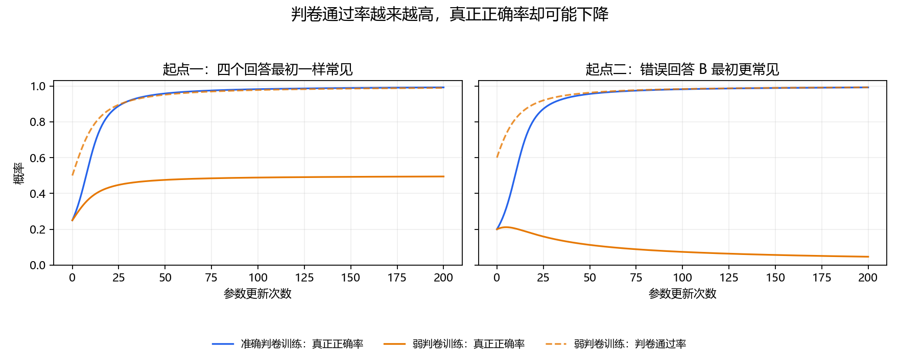

# 第一课：模型学到的，是给它的分数

这节从你做过的手机价格分类和 Softmax 出发。目标是看清研究问题的来源，不要求现在就掌握 GRPO、复杂度下界或置信序列。

## 1. 沿用熟悉的模型结构

你的手机分类网络输出几个数，经 Softmax 可得到各类别的概率。这里也输出四个数，只是将它们直接当成全部可训练参数，不再使用多层网络。

一道题有 A、B、C、D 四个回答。模型以概率 p_A、p_B、p_C、p_D 选择回答，四个概率之和为 1。这就是这个小环境中的“策略”。

只有 A 真正正确。准确判卷器给的分数是 `[1,0,0,0]`；弱判卷器漏掉了 B 的错误，给分为 `[1,1,0,0]`。

举一个代码任务的例子：A 是能正确处理各类输入的程序；B 只对题面示例输入给出正确输出；弱判卷器只检查示例输入，于是接受了 B。这是解释性的例子，本实验没有生成或执行程序。

## 2. 损失函数换成什么

先把模型想提高的平均分数记为 J：

\[
J=p_A r_A+p_B r_B+p_C r_C+p_D r_D.
\]

概率是权重，r 是判卷器的分数。

- 准确判卷：`J=p_A`。提高 J 就是提高真正答对的概率。
- 弱判卷：`J=p_A+p_B`。提高 J 时，选择 A 或 B 都能获得分数。

这两个目标函数不同。模型收到的训练信号没有告诉它，B 的分数是误判。

你熟悉的是最小化损失 L。令 `L=−J`，照样可以使用梯度下降；等价地，可以直接对 J 使用梯度上升。

## 3. 四个参数怎样更新

四个可训练参数叫 logits，记作 z_A、z_B、z_C、z_D。经 Softmax 得到概率。这里能够枚举全部四个回答，因此能精确计算 J 和它的梯度：

\[
\frac{\partial J}{\partial z_j}=p_j(r_j-J),\qquad
z_j\leftarrow z_j+\alpha p_j(r_j-J).
\]

其中 α 是学习率。该公式来自 Softmax 的求导；没有对判卷程序求导。

`r_j−J` 表示该回答的得分比当前平均分高多少。它乘上 p_j 后决定对应 logit 的更新。某个 logit 上升不一定意味着对应概率在每一步都上升，因为其他 logits 也在变化。

代码中的核心只有几行：

```python
probs = softmax(logits)
average_reward = probs @ rewards
gradient = probs * (rewards - average_reward)
logits += learning_rate * gradient
```

大模型不能枚举所有回答，通常需要通过采样估计更新方向。那是下一步要补的内容。本节使用精确期望梯度，没有模拟采样波动，也没有实现完整 GRPO。

## 4. 实际运行结果

每种设置更新 200 次，学习率均为 0.5，没有随机采样或挑选随机种子。

| 初始回答概率 | 用哪种判卷器训练 | 最终真正正确率 p_A | 最终错误回答概率 p_B | 最终弱判卷通过率 p_A+p_B |
|---|---|---:|---:|---:|
| `[0.25,0.25,0.25,0.25]` | 准确判卷 | 99.17% | 0.28% | 99.45% |
| 同上 | 弱判卷 | 49.46% | 49.46% | 98.92% |
| `[0.2,0.4,0.2,0.2]` | 准确判卷 | 99.16% | 0.30% | 99.47% |
| 同上 | 弱判卷 | 4.68% | 94.54% | 99.21% |

第二种起点中，弱判卷训练的真正正确率由 20% 降至 4.68%，判卷通过率却由 60% 升至 99.21%。这说明本例确实发生了“分数上升但真实正确率下降”。

这组具体结果来自本节指定的 Softmax 参数化和更新规则。不能推成所有模型遇到误判都会出现相同数字；第一种起点中 A、B 对称，也没有发生同样的正确率下降。



## 5. 它怎样连接到我们的论文候选

当前例子有一个固定漏洞：B 永远被弱判卷器误判为正确。研究方案还会加入昂贵的复核器，以及复核器偶尔犯错的情况。两种错误机制需要分开建模。

引入复核之后，要回答的具体问题是：

1. 复核次数有限，先检查哪些回答？
2. 获得复核结果后，怎样改变用于训练的分数或更新？
3. 复核本身不完全可靠时，花多少成本可以把错误控制到指定范围？

本节现象是已有的基础问题，不是论文创新。候选论文希望对其中一个尚未被覆盖的精确问题，给出新的算法或实质证明。

## 6. 本节产物和运行方式

- [教学脚本](01_reward_vs_correctness.py)：只需要 NumPy、Matplotlib；不需要 GPU。
- [完整数值结果](../results/lesson_01/summary.json)。
- [每一步的概率记录](../results/lesson_01/trace.csv)。

在项目根目录运行：

```powershell
& 'D:\anaconda3\python.exe' -X utf8 research\learning\01_reward_vs_correctness.py
```

已用中心有限差分独立核对示例梯度公式，并检查四个保存结果中的概率和为 1。没有进行语言模型训练或算法性能基准比较。
